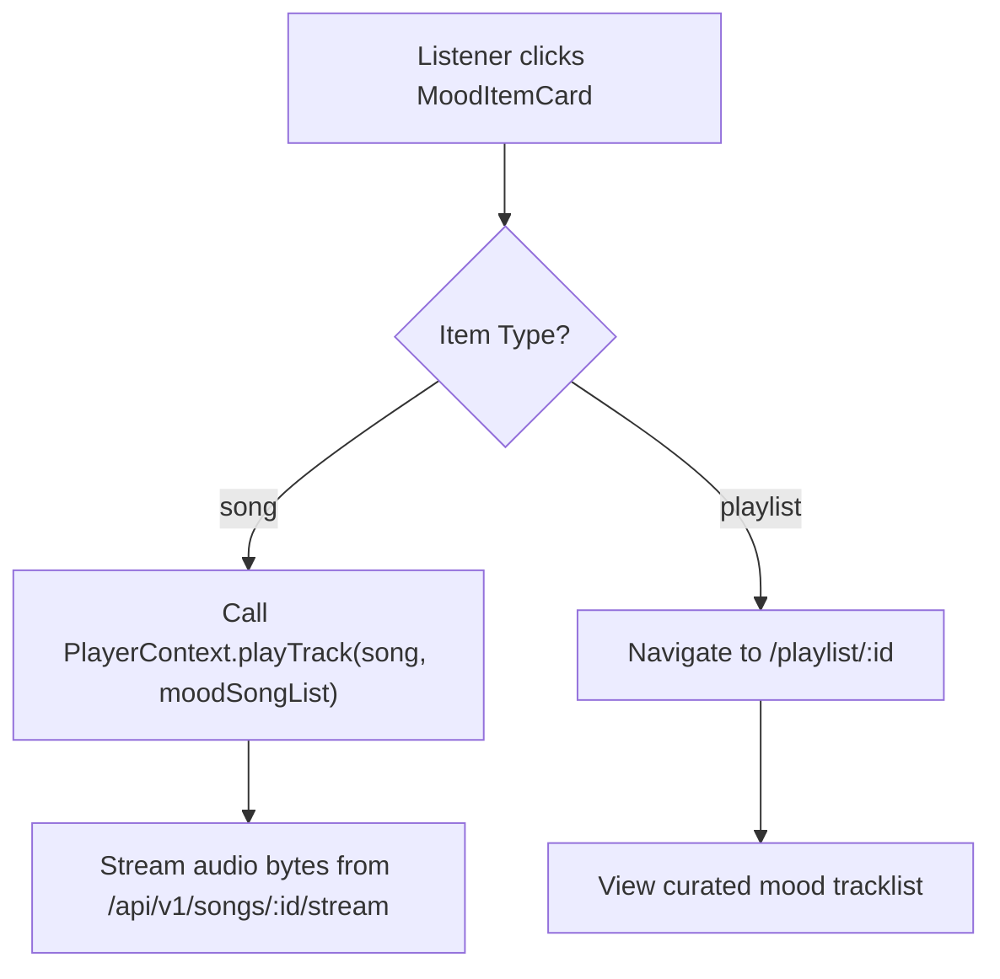

# Implementation Plan: Mood and Context Recommendations (Feature 103)

**Branch**: `103-mood-and-context-recommendations` | **Date**: 2026-11-03 | **Spec**: [spec.md](./spec.md)

**Input**: Feature specification from `/specs/100-ai-recommendations/103-mood-and-context-recommendations/spec.md`

---

## 1. Summary

Feature 103 enables authenticated listeners on AuraTune to discover music aligned with their real-time emotional vibe or activity context. Rather than relying on historical playback or complex search queries, listeners select from a curated taxonomy of 8 preset chips divided into **Core Moods** (*Chill*, *Energetic*, *Melancholy*, *Focus*) and **Activity Contexts** (*Study/Work*, *Workout*, *Late Night*, *Travel/Commute*) (Clarification 2026-10-30).

The technical approach implements a dedicated situational discovery pipeline:
1. **Curated Input Taxonomy**: Frontend renders preset chips retrieved from `GET /api/v1/recommendations/mood-context/tags`. Single-tag selection is enforced, preventing conflicting combinations.
2. **Multi-Entity Delivery (Songs & Mood Playlists)**: Output is strictly limited to individual Songs and theme-curated Mood Playlists (Clarification 2026-10-30, FR-003). Albums and Artists are excluded to ensure mood consistency.
3. **Empty Matches with Alternative Suggestions**: If a mood produces zero matches, the backend returns HTTP 200 with 2–3 active alternative suggestions (`["chill", "focus"]`) to render an empathetic empty-state card with quick clickable chips (Clarification 2026-10-30, FR-004, AF-02).
4. **AI Inference & Fault-Tolerant Degradation**: Backend queries the internal Python AI Service (`POST /ai/recommend/mood`) with a strict **2.5-second timeout**. If the AI service times out or errors, the backend intercepts the error and returns a degraded state with navigation shortcuts, preventing any dashboard crashes (FR-004, EF-01).
5. **Race Condition Prevention**: Client uses `AbortController` and response tag-echo verification to cancel in-flight requests during rapid chip switching, updating results in $< 1.0$s (AF-01).
6. **Interaction Dispatching**: Selecting a song delegates immediate playback to the Music Player bar; selecting a mood playlist navigates to the playlist detail view (FR-007, SC-004).

---

## 2. Technical Context

**Language/Version**:
- Frontend: JavaScript (ES Modules, JSX), Node.js >= 18
- Backend: JavaScript / Node.js (ES Modules), runtime Node.js >= 18
- Internal AI Service: Python 3.10+ (FastAPI)
- Database: PostgreSQL (SQL syntax matching `docs/design/database/README.md`)

**Primary Dependencies**:
- Frontend: React 18 (`react`, `react-dom`), Vite 5, Tailwind CSS 3, `lucide-react`
- Backend: Express.js (or NestJS REST framework), `pg` / `knex`, `jsonwebtoken`, `axios` or native `fetch` with `AbortController`
- AI Microservice: FastAPI, Uvicorn, NumPy / Scikit-learn
- Shared/Dev: Vitest, Supertest, ESLint

**Storage**:
- PostgreSQL database: `songs` and `playlists` tables with mood/genre indexes
- In-memory client cache (`Map<tag, { data, timestamp }>`) with 5-minute TTL

**Testing**:
- Unit Tests: Vitest for tag whitelist validation, empty alternative selection, and deduplication logic
- Contract Tests: Supertest validating endpoints against OpenAPI spec ([`mood-context-recommendations-api.json`](./contracts/mood-context-recommendations-api.json))
- Fault-Tolerance Tests: Integration tests verifying graceful degradation when AI service times out (> 2.5s)
- Security Tests: Integration tests ensuring mood inputs remain strictly confidential (HTTP 401 on unauthenticated)

**Target Platform**:
- Web application running on modern desktop and mobile browsers (Chrome, Edge, Firefox, Safari)

**Project Type**:
- Full-stack Web Application (Client + Backend API + PostgreSQL Database + Internal AI Microservice)

**Performance Goals**:
- Recommendation stream renders within **2.0 seconds** upon tag selection (per `UC-100-003`).
- Toggling between preset chips updates results stream within **1.0 second** (cached switches $< 50$ms).
- AI service timeout enforced at **2.5 seconds**.

**Constraints**:
- Strict compliance with Vietnamese Decree 13/2023/ND-CP: mood choices are confidential to the authenticated account (FR-005, FR-006, SC-001).
- Content scope strictly restricted to Songs and Mood Playlists (Clarification 2026-10-30, FR-003). Must NOT recommend individual albums or artists.
- Must NOT include personal listening history analysis or top genres (Feature 101).
- Must NOT include general historical taste profiling (Feature 102).
- Must NOT implement free-form text search (Group 030) or conversational AI chat (Group 120).
- Must NOT crash the interface or throw 500/503 errors during AI service outages (FR-004, SC-003).

**Scale/Scope**:
- 1 feature (Feature 103) within Group 100. Primary endpoint `GET /api/v1/recommendations/mood-context` and metadata endpoint `GET /api/v1/recommendations/mood-context/tags`.

---

## 3. Current Implementation Baseline vs Planned Work

| Component / Layer | What Currently Exists | What Will Be Implemented in Feature 103 | What Needs Future Confirmation |
|---|---|---|---|
| **Frontend UI** | Static mood mapping prototype in `src/frontend/src/utils/aiMockData.js` (`getMockRecommendations`). | `MoodDiscoverySection.jsx`, preset tag bar (`MoodChipBar.jsx`), empty-state card with suggestion chips, and error banner. | Embedding in Home Dashboard vs dedicated `/discovery` view tab. |
| **Frontend Service** | Ad-hoc text-matching helper in `aiMockData.js`. | `src/frontend/src/services/moodRecommendationService.js` and `mock/mockMoodRecommendationService.js` supporting request aborting and in-memory caching. | Dynamic theming/accent color changes matching active mood. |
| **Backend API** | Conceptual `/recommendations/*` routing. `src/backend` has `.gitkeep`. | `moodRecommendationController.js`, `moodRecommendationRoutes.js`, and `moodRecommendationService.js` implementing tags and feed endpoints. | Rate limiting on tag toggling. |
| **Database** | Reference schema (`songs`, `playlists`). | SQL queries filtering active songs and public playlists matching mood tokens and acoustic attributes. | Compound index on `songs(genre, is_active)` or dedicated `songs.mood_tags` array. |
| **Internal AI Service** | Architectural concept in `docs/design/architecture/system-architecture.md`. | FastAPI endpoint `POST /ai/recommend/mood` returning candidate IDs based on acoustic feature clusters. | Audio valence/energy feature extractor pipeline. |

---

## 4. Constitution Check

| Gate | Status | Notes |
|---|---|---|
| **No New Product Scope** | **PASS** | Scope strictly matches Feature 103 in `spec.md` and Proposal Section 6.10. No feature creep. |
| **Group Ownership Boundary** | **PASS** | Group 100 (Nhựt) owns Mood & Context Recommendations. Free-form text queries remain in Group 030 (Đăng); Playback in Group 040 (Huy); Playlist details in Group 060 (Khoa); AI Chat in Group 120 (Nhựt). |
| **Multi-Entity Alignment** | **PASS** | Restricted to Songs and Mood Playlists per Clarification Session 2026-10-30. |
| **Data Privacy & Isolation** | **PASS** | Authenticated Bearer JWT required; mood choices are not broadcast or logged with PII. |
| **Resilient Fault-Tolerance** | **PASS** | Complies with EF-01 and AF-02: AI outage returns HTTP 200 degraded state; empty matches return alternative suggestion chips; never crashes. |
| **No Secrets Committed** | **PASS** | No API keys, credentials, or `.env` entries are committed. |
| **Language & Conventions** | **PASS** | Documentation in English Markdown; diagrams in Mermaid; API conventions match `/api/v1` envelope. |
| **Test-First & Verifiable** | **PASS** | Unit, contract, privacy, and rapid tag-switching test scenarios established before implementation. |

---

## 5. Project Structure

### Documentation (`specs/100-ai-recommendations/103-mood-and-context-recommendations/`)

```text
specs/100-ai-recommendations/103-mood-and-context-recommendations/
├── spec.md                                         # Feature specification (Source of truth)
├── plan.md                                         # This implementation plan
├── research.md                                     # Phase 0 architectural research & decisions
├── data-model.md                                   # Phase 1 data model & state machine
├── quickstart.md                                   # Phase 1 validation & test scenarios
├── checklists/
│   └── requirements.md                             # Quality checklist
├── contracts/
│   ├── README.md                                   # API integration guide & microservice contract
│   └── mood-context-recommendations-api.json       # OpenAPI 3.0 specification
└── ui/
    ├── 01-mood-recommendations-entry.png
    ├── 02-mood-selection.png
    ├── 03-context-recommendations.png
    └── 04-recommendation-results.png
```

### Source Code Layout (`src/`)

```text
src/
├── backend/
│   └── src/
│       ├── controllers/
│       │   └── moodRecommendationController.js # Handles GET .../tags and GET .../mood-context
│       ├── services/
│       │   ├── moodRecommendationService.js    # Tag validation, AI invocation, fallback & alternatives
│       │   └── moodCatalogHydrationService.js  # Hydrates metadata and filters active items
│       ├── repositories/
│       │   └── moodCatalogRepository.js        # Queries songs and playlists by mood attributes
│       ├── clients/
│       │   └── aiServiceClient.js              # HTTP client to Python AI service with 2.5s timeout
│       └── routes/
│           └── moodRecommendationRoutes.js     # Express route definitions
│
└── frontend/
    └── src/
        ├── services/
        │   ├── moodRecommendationService.js    # Client adapter with AbortController & in-memory cache
        │   └── mock/
        │       └── mockMoodRecommendationService.js # Mock adapter for standalone demo
        ├── components/
        │   └── mood/
        │       ├── MoodDiscoverySection.jsx    # Container integrating chip bar and stream
        │       ├── MoodChipBar.jsx             # Horizontal scrollable preset tags bar
        │       ├── MoodItemCard.jsx            # Polymorphic card (song or mood playlist)
        │       └── MoodEmptyState.jsx          # Friendly empty state with suggestion chips
        └── pages/
            └── Discovery/ (or Home/)
                └── MoodDiscoveryPage.jsx       # View page displaying mood & context discovery
```

**Structure Decision**: Preserves the established `src/frontend` and `src/backend` separation. Reuses existing shared UI components (`CoverArt`, `Icon`) and Contexts (`PlayerContext`, `AppStore`).

---

## 6. Architecture & Data Flow

### 6.1. Mood Recommendation Architecture Flow

```mermaid
sequenceDiagram
    autonumber
    actor Listener as Listener (Browser)
    participant Frontend as Discovery UI (React)
    participant Backend as Backend API (Node.js)
    participant DB as PostgreSQL
    participant AIService as Python AI Service

    Listener->>Frontend: Open Discovery View (/discovery)
    Frontend->>Backend: GET /api/v1/recommendations/mood-context/tags
    Backend-->>Frontend: 200 OK (8 curated preset tags)
    Frontend-->>Listener: Render Core Mood & Context Chips

    Listener->>Frontend: Click "Chill" chip
    Note over Frontend: Abort any pending in-flight requests
    Frontend->>Backend: GET /api/v1/recommendations/mood-context?tag=chill
    Note over Backend: Validate tag against whitelist & authenticate JWT
    
    alt Invalid Tag
        Backend-->>Frontend: 400 Bad Request (INVALID_MOOD_TAG)
        Frontend-->>Listener: Display validation notice
    else Valid Tag & Authenticated
        Backend->>AIService: POST /ai/recommend/mood (timeout: 2.5s)
        
        alt AI Service Success (< 2.5s)
            AIService-->>Backend: 200 OK with candidate tuples (song/playlist, id, score)
            Backend->>DB: Hydrate metadata & filter inactive/deleted items
            DB-->>Backend: Active catalog details
            Backend->>Backend: Deduplicate items
            
            alt Matching Items > 0
                Backend-->>Frontend: 200 OK (total_items > 0, items: [...])
                Frontend-->>Listener: Render Songs & Mood Playlists stream
            else Matching Items == 0 (AF-02)
                Backend-->>Frontend: 200 OK (total_items: 0, alternative_suggestions: ["focus", "late_night"])
                Frontend-->>Listener: Render Empty State Card with Alternative Mood Chips
            end
            
        else AI Service Timeout (> 2.5s) or 5xx Error (EF-01)
            Note over Backend: Catch error; do NOT return 5xx to client
            Backend->>DB: Query local catalog fallback for public mood playlists
            DB-->>Backend: Local items (or empty)
            Backend-->>Frontend: 200 OK (is_service_degraded: true, fallback_shortcuts: [...])
            Frontend-->>Listener: Render Degraded Notice with Navigation Shortcuts
        end
    end
```

### 6.2. Card Interaction & Navigation Flow



---

## 7. Complexity Tracking

No constitution violations detected. Complexity is strictly minimized:

| Aspect | Solution | Simpler Alternative Rejected Because |
|---|---|---|
| **Curated Taxonomy** | Fixed 8 preset tags with whitelist validation | Free-form natural language prompts belong to Search (Group 030) and AI Host (Group 120); produces uncontrolled vector queries. |
| **Entity Restriction** | Songs and Playlists only (no albums/artists) | Albums and artists span multiple disparate moods, creating musical dissonance for situational activities. |
| **Empty State Alternatives** | Suggest alternative mood tags on 0 matches | Serving random popular tracks to a sad user causes emotional mismatch; showing a blank screen loses user engagement. |
| **Rapid Switching** | Client `AbortController` + tag echo check | Disabling chips during loading feels unresponsive; ignoring race conditions results in stale display. |

---

## 8. Verification & Test Strategy

1. **Unit Testing**:
   - Tag whitelist validator: accepts 8 allowed tags, rejects invalid strings with HTTP 400.
   - Alternatives generator: selects 2–3 active tags when results are empty.
   - Deduplication utility: ensures no duplicated `(type, id)` in response.
2. **Contract Testing**:
   - Supertest validation of `GET .../tags` and `GET .../mood-context` against OpenAPI spec.
3. **Resilience Testing**:
   - Simulated AI outage: mock 3000ms delay; verify backend returns HTTP 200 within 2.6s with `is_service_degraded: true` and fallback shortcuts.
4. **Security & Privacy Testing**:
   - Unauthenticated requests return HTTP 401. User mood inputs are never leaked across sessions.
