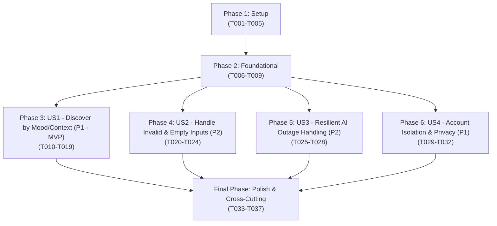

# Tasks: Mood and Context Recommendations (Feature 103)

**Branch**: `103-mood-and-context-recommendations` | **Group**: 100 – AI Recommendations (Owner: Lê Công Minh Nhựt)  
**Input**: Design documents from `specs/100-ai-recommendations/103-mood-and-context-recommendations/` (`plan.md`, `spec.md`, `data-model.md`, `research.md`, `quickstart.md`, `contracts/mood-context-recommendations-api.json`)  
**Prerequisites**: `plan.md` (required), `spec.md` (required for user stories), `data-model.md`, `research.md`, `contracts/mood-context-recommendations-api.json`, `quickstart.md`

---

## Format: `[ID] [P?] [Story] Description with file path`

- **Checkbox**: `- [ ]` markdown checkbox
- **[P]**: Can run in parallel (different files, no dependencies on incomplete tasks)
- **[Story]**: User story identifier (`[US1]`, `[US2]`, `[US3]`, `[US4]`) for story-phase tasks; omitted for Setup, Foundational, and Polish phases
- **File Paths**: Explicit source file path included in every task

---

## Path Conventions

- **Backend**: `src/backend/` (Node.js / Express API server)
  - Config & Constants: `src/backend/config/`, `src/backend/constants/`
  - Clients: `src/backend/clients/`
  - Repositories: `src/backend/repositories/`
  - Services: `src/backend/services/`
  - Controllers: `src/backend/controllers/`
  - Routes: `src/backend/routes/`
  - Utils & Helpers: `src/backend/utils/`
  - Tests: `src/backend/tests/`
- **Frontend**: `src/frontend/` (React 18 / Vite 5 Client)
  - Services: `src/frontend/src/services/`
  - Mock Services: `src/frontend/src/services/mock/`
  - Components: `src/frontend/src/components/mood/`
  - Pages/Views: `src/frontend/src/pages/Discovery/`
  - Tests: `src/frontend/tests/`

---

## Phase 1: Setup (Shared Infrastructure & Taxonomy Configuration)

**Purpose**: Initialize external AI service connection settings, preset mood/context taxonomy constants, response envelopes, and frontend mock skeletons.

- [ ] T001 Configure AI microservice connection settings and timeout configuration (`AI_SERVICE_URL`, `AI_SERVICE_TIMEOUT_MS=2500`) in `src/backend/config/aiConfig.js`.
- [ ] T002 [P] Define curated 8 preset tags taxonomy constant (`chill`, `energetic`, `melancholy`, `focus`, `study_work`, `workout`, `late_night`, `travel_commute`) with categories (`mood`, `context`), display labels, icons, and gradient tokens in `src/backend/constants/moodTaxonomy.js`.
- [ ] T003 [P] Implement internal AI microservice client method `getMoodRecommendations(tag, type, limit)` in `src/backend/clients/aiServiceClient.js` calling internal Python service `POST /ai/recommend/mood` with a strict 2.5-second `AbortController` timeout per `plan.md`.
- [ ] T004 [P] Implement response helper and envelope formatter in `src/backend/utils/moodResponse.js` enforcing standard schema `{ success, message, data, error }` with fields `tag`, `tag_category`, `is_service_degraded`, `total_items`, `items`, `alternative_suggestions`, and `fallback_shortcuts` per `contracts/mood-context-recommendations-api.json`.
- [ ] T005 [P] Create mock mood recommendation service skeleton in `src/frontend/src/services/mock/mockMoodRecommendationService.js` with stubbed 8 preset tags and polymorphic fixtures (`song`, `playlist`) matching OpenAPI schema.

---

## Phase 2: Foundational (Blocking Prerequisites)

**Purpose**: Core database repository, catalog hydration service, and routing infrastructure that MUST be completed before ANY user story can begin.

**⚠️ CRITICAL**: No user story implementation can proceed until this phase is verified.

- [ ] T006 Implement mood catalog repository in `src/backend/repositories/moodCatalogRepository.js` querying active catalog songs (`is_active = true` and `deleted_at IS NULL`) and public mood playlists (`status = 'Public'` and `is_active = true`) matching mood tokens or acoustic attributes.
- [ ] T007 [P] Implement mood catalog hydration service in `src/backend/services/moodCatalogHydrationService.js` to hydrate candidate entity IDs with display metadata (`title`, `subtitle`, `image_url`, `badge`, `target_id`, `extra` with `duration`, `audio_url`, `artist_id` for songs; `track_count`, `is_official` for playlists) and silently filter out any deactivated, unplayable, or private items (FR-008, SC-005).
- [ ] T008 [P] Create mood recommendation router module in `src/backend/routes/moodRecommendationRoutes.js` and mount `/api/v1/recommendations/mood-context` in `src/backend/server.js`.
- [ ] T009 [P] Create frontend API client adapter in `src/frontend/src/services/moodRecommendationService.js` supporting dynamic toggle between live API calls and mock adapter via `import.meta.env.VITE_USE_MOCKS` and integrating client `AbortController` to cancel in-flight requests during rapid chip switching (AF-01).

**Checkpoint**: Foundation ready — catalog repository, hydration service, router mounting, and client adapter are established.

---

## Phase 3: User Story 1 - Discover Music by Mood or Context (Priority: P1) 🎯 MVP

**Goal**: Authenticated listeners select a curated preset chip (4 core moods: `chill`, `energetic`, `melancholy`, `focus`; 4 contexts: `study_work`, `workout`, `late_night`, `travel_commute`) to load a recommendation stream strictly comprising Songs and Mood Playlists, with 1-click playback or navigation.

**Independent Test**: Log in with an authenticated account, call `GET /api/v1/recommendations/mood-context/tags` to fetch the 8 preset chips, select `"chill"`, request `GET /api/v1/recommendations/mood-context?tag=chill`, verify HTTP 200 returns songs and mood playlists (`total_items > 0`, zero duplicate items, no albums/artists), and verify clicking a song plays immediately via PlayerContext and clicking a playlist navigates to playlist view (SC-004).

### Tests for User Story 1

> **NOTE: Write these tests FIRST and ensure they FAIL before implementing services and controllers.**

- [ ] T010 [P] [US1] Create unit test suite in `src/backend/tests/services/moodRecommendationService.test.js` validating valid tag resolution, candidate hydration, entity restriction to songs and playlists only, and deduplication eliminating identical `(type, id)` pairs (FR-003, FR-014).
- [ ] T011 [P] [US1] Create contract test suite in `src/backend/tests/contracts/moodContextRecommendationsContract.test.js` validating `GET /api/v1/recommendations/mood-context/tags` and `GET /api/v1/recommendations/mood-context` against OpenAPI schemas in `contracts/mood-context-recommendations-api.json`.

### Implementation for User Story 1

- [ ] T012 [US1] Implement core mood recommendation workflow in `src/backend/services/moodRecommendationService.js` calling `aiServiceClient.getMoodRecommendations(tag, type, limit)`, validating candidates via `moodCatalogHydrationService`, enforcing entity restrictions (strictly `type: "song"` and `type: "playlist"` only; no albums/artists per FR-003), and deduplicating items by `type:id` (FR-002, FR-003, FR-014).
- [ ] T013 [US1] Implement controller handlers `getMoodContextTags` and `getMoodContextRecommendations` in `src/backend/controllers/moodRecommendationController.js` returning curated tags and handling query params `tag` (mandatory), `type` (enum: `["all", "song", "playlist"]`, default `"all"`), and `limit` (integer 1-50, default 20).
- [ ] T014 [US1] Register route endpoints `router.get('/tags', authenticateToken, moodRecommendationController.getMoodContextTags)` and `router.get('/', authenticateToken, moodRecommendationController.getMoodContextRecommendations)` in `src/backend/routes/moodRecommendationRoutes.js`.
- [ ] T015 [P] [US1] Implement frontend service methods `getMoodContextTags()` and `getMoodContextRecommendations(tag, { type = 'all', limit = 20, signal })` in `src/frontend/src/services/moodRecommendationService.js` sending Bearer JWT header.
- [ ] T016 [P] [US1] Implement horizontal scrollable chip bar `src/frontend/src/components/mood/MoodChipBar.jsx` rendering 8 preset chips (4 core moods, 4 contexts) with active selection state, category badge, and gradient styling per `data-model.md`.
- [ ] T017 [P] [US1] Implement polymorphic card component `src/frontend/src/components/mood/MoodItemCard.jsx` displaying artwork, title, subtitle, badge, and handling 1-click interactions: playing songs via `player.playTrack(song)` or navigating to `/playlist/:id` (FR-007, SC-004).
- [ ] T018 [US1] Implement mood discovery container component `src/frontend/src/components/mood/MoodDiscoverySection.jsx` coordinating `MoodChipBar`, loading skeleton, responsive card grid of `MoodItemCard`, and delegating audio playback to `PlayerContext`.
- [ ] T019 [US1] Integrate `MoodDiscoverySection` into `src/frontend/src/pages/Discovery/MoodDiscoveryPage.jsx` (and Home Dashboard discovery view) with automatic initial selection and loading of the default preset chip (`"chill"`).

**Checkpoint**: User Story 1 is fully functional as the MVP increment. Authenticated listeners can browse and interact with mood recommendations via preset chips.

---

## Phase 4: User Story 2 - Handle Unrecognized Inputs or Empty Results (Priority: P2)

**Goal**: Provide clear, graceful feedback when input is invalid or yields zero matching tracks; return HTTP 400 with code `INVALID_MOOD_TAG` for unknown tags; return HTTP 200 with 2–3 `alternative_suggestions` when `total_items: 0`, rendering an empathetic empty-state card with quick suggestion chips.

**Independent Test**: Request recommendations with an invalid tag `super_sad` and verify HTTP 400 with code `INVALID_MOOD_TAG`; request recommendations for a valid tag with zero catalog items, verify HTTP 200 with `total_items: 0` and `alternative_suggestions: ["chill", "focus"]`, and verify UI renders `MoodEmptyState` with clickable suggestion chips that switch tags seamlessly on click (SC-002, SC-003).

### Tests for User Story 2

- [ ] T020 [P] [US2] Create unit test in `src/backend/tests/services/moodValidationAndAlternatives.test.js` verifying tag whitelist validation (rejecting non-whitelisted strings with HTTP 400) and alternative suggestions selection (returning 2–3 active alternative tags when items list is empty) (FR-002, FR-004, AF-02).

### Implementation for User Story 2

- [ ] T021 [US2] Add tag whitelist validation logic in `src/backend/controllers/moodRecommendationController.js` rejecting unknown tags with HTTP 400 and error code `INVALID_MOOD_TAG` listing allowed preset values.
- [ ] T022 [US2] Implement alternative suggestions generator in `src/backend/services/moodRecommendationService.js` that selects 2–3 active alternative preset tags (`["chill", "focus"]`) when hydrated items count equals 0, returning `total_items: 0`, `items: []`, and populated `alternative_suggestions` (FR-004, AF-02).
- [ ] T023 [P] [US2] Implement friendly empty-state component `src/frontend/src/components/mood/MoodEmptyState.jsx` displaying clear message ("Hiện chưa có bài hát phù hợp với tâm trạng này") and rendering clickable suggestion chips that switch the active tag on click (SC-002, SC-003).
- [ ] T024 [US2] Connect `MoodEmptyState` within `src/frontend/src/components/mood/MoodDiscoverySection.jsx` to render when `total_items === 0` and handle suggestion chip click to seamlessly trigger a new recommendation query.

**Checkpoint**: User Story 2 complete. Invalid inputs are rejected cleanly with HTTP 400, and empty matches guide users to active alternatives without crashes.

---

## Phase 5: User Story 3 - Resilient Handling of AI Service Outage (Priority: P2)

**Goal**: Ensure the browsing experience degrades gracefully when the internal AI service times out (> 2.5s) or encounters 5xx errors; catch errors in backend, query local public mood playlists or fallback shortcuts, return HTTP 200 with `is_service_degraded: true`, and never crash UI or return 500/503.

**Independent Test**: Simulate Python AI microservice timeout (> 2.5s) or HTTP 500; request mood recommendations; verify backend returns HTTP 200 within 2.6s with `is_service_degraded: true` and populated `fallback_shortcuts`, and verify frontend displays an informative degraded banner with navigation shortcuts without crashing (SC-003, EF-01).

### Tests for User Story 3

- [ ] T025 [P] [US3] Create integration test in `src/backend/tests/integration/moodDegradationResilience.test.js` simulating AI microservice 3000ms delay and 500 internal server error, verifying backend catches error, enforces 2.5s timeout, and returns HTTP 200 with `is_service_degraded: true` within 2.6s (FR-004, EF-01, SC-003).

### Implementation for User Story 3

- [ ] T026 [US3] Implement timeout and error recovery handler in `src/backend/services/moodRecommendationService.js` wrapping `aiServiceClient.getMoodRecommendations()` in a try-catch block, catching `AbortError` or HTTP 5xx, querying `moodCatalogRepository.getPublicMoodPlaylists(tag)` as local fallback, and populating `fallback_shortcuts` with `is_service_degraded: true` (FR-004, EF-01).
- [ ] T027 [P] [US3] Implement degraded service notification banner in `src/frontend/src/components/mood/MoodDegradedBanner.jsx` showing friendly message ("Hệ thống gợi ý AI đang bận. Đang hiển thị danh sách phát tâm trạng phổ biến") with quick navigation shortcuts.
- [ ] T028 [US3] Integrate `MoodDegradedBanner` into `src/frontend/src/components/mood/MoodDiscoverySection.jsx` conditionally displayed when `data.is_service_degraded === true`, keeping player controls and rest of the application completely functional (SC-003).

**Checkpoint**: User Story 3 complete. AI downtime and timeouts degrade smoothly to public playlists and navigation shortcuts with HTTP 200.

---

## Phase 6: User Story 4 - Account Isolation and Privacy (Priority: P1)

**Goal**: Ensure mood selections and recommendation streams remain strictly private to the authenticated account; reject unauthenticated access with HTTP 401; comply with Vietnamese Personal Data Protection Decree 13/2023/NĐ-CP.

**Independent Test**: Request mood endpoints without Bearer token and verify HTTP 401 Unauthorized; request as User A and User B concurrently and verify mood queries and responses are strictly session-scoped with zero cross-account leakage (SC-001).

### Tests for User Story 4

- [ ] T029 [P] [US4] Create security test suite in `src/backend/tests/security/moodAccountIsolation.test.js` verifying that unauthenticated requests to `/api/v1/recommendations/mood-context/*` return HTTP 401 `UNAUTHORIZED` and validating zero cross-account mood signal exposure between concurrent users (FR-005, FR-006, SC-001).

### Implementation for User Story 4

- [ ] T030 [US4] Enforce `authenticateToken` JWT authentication middleware on all routes in `src/backend/routes/moodRecommendationRoutes.js`, extracting `req.user.id` and rejecting unauthenticated callers with HTTP 401 (`UNAUTHORIZED`).
- [ ] T031 [US4] Enforce session-level privacy scoping in `src/backend/services/moodRecommendationService.js` ensuring mood requests are strictly ephemeral to the caller session, never broadcasted to public activity feeds, and never logged with personal identifiable information (PII) per Decree 13/2023/NĐ-CP (FR-005, FR-006).
- [ ] T032 [P] [US4] Implement unauthenticated state handler in `src/frontend/src/services/moodRecommendationService.js` redirecting to `/login` or displaying authentication prompt on HTTP 401 response without disclosing mood data.

**Checkpoint**: User Story 4 complete. Account isolation and privacy are enforced at API middleware and service layers.

---

## Final Phase: Polish & Cross-Cutting Concerns

**Purpose**: Client-side latency optimizations, race condition prevention on rapid tag switching, comprehensive documentation, and end-to-end scenario validation.

- [ ] T033 [P] Implement in-memory client-side cache (`Map<tag, { data, timestamp }>`) with 5-minute TTL in `src/frontend/src/services/moodRecommendationService.js` to ensure toggling back to recently viewed chips completes in $< 50$ms (AF-01).
- [ ] T034 [P] Implement request cancellation with `AbortController` in `src/frontend/src/components/mood/MoodDiscoverySection.jsx` to abort previous in-flight requests on rapid tag toggling, eliminating race conditions and stale responses (AF-01).
- [ ] T035 [P] Create frontend component unit tests in `src/frontend/tests/components/MoodChipBar.test.jsx` and `src/frontend/tests/components/MoodDiscoverySection.test.jsx` testing chip selection, empty state display, and 1-click play dispatch.
- [ ] T036 [P] Update API documentation and integration notes in `specs/100-ai-recommendations/103-mood-and-context-recommendations/contracts/README.md` reflecting endpoints, request parameters, response envelopes, error schemas, and mock testing steps.
- [ ] T037 Execute end-to-end verification covering all scenarios in `specs/100-ai-recommendations/103-mood-and-context-recommendations/quickstart.md` (Scenario 1: Standard stream, Scenario 2: Empty matches & alternatives, Scenario 3: AI outage degradation, Scenario 4: Privacy & boundaries).

---

## Dependencies & Execution Order

### Phase Dependencies



### User Story Dependencies

- **User Story 1 (P1 - MVP)**: Can start immediately after Phase 2 (Foundational). Delivers core discovery flow, chip bar, and polymorphic cards.
- **User Story 2 (P2)**: Extends US1 controller and service with tag whitelist validation and alternative suggestions generator on 0 matches.
- **User Story 3 (P2)**: Wraps US1 AI client call with 2.5s AbortController and graceful fallback handling returning HTTP 200 with `is_service_degraded: true`.
- **User Story 4 (P1)**: Enforces JWT authentication middleware on US1/US2/US3 endpoints and verifies session boundary isolation.
- **Final Polish**: Depends on all stories being completed. Adds in-memory cache, rapid-switching abort handling, and quickstart validation.

---

## Parallel Execution Examples

### User Story 1 Parallel Work

```bash
# Backend Developer A (Tests & Service):
Task: T010 [P] [US1] Unit tests in src/backend/tests/services/moodRecommendationService.test.js
Task: T011 [P] [US1] Contract tests in src/backend/tests/contracts/moodContextRecommendationsContract.test.js
Task: T012 [US1] Core service in src/backend/services/moodRecommendationService.js

# Frontend Developer B (UI Components):
Task: T015 [P] [US1] Client methods in src/frontend/src/services/moodRecommendationService.js
Task: T016 [P] [US1] Chip bar in src/frontend/src/components/mood/MoodChipBar.jsx
Task: T017 [P] [US1] Card component in src/frontend/src/components/mood/MoodItemCard.jsx
```

### User Story 2 & 3 Parallel Work

```bash
# Developer A (User Story 2 - Empty Matches & Alternatives):
Task: T020 [P] [US2] Tests in src/backend/tests/services/moodValidationAndAlternatives.test.js
Task: T023 [P] [US2] UI empty state in src/frontend/src/components/mood/MoodEmptyState.jsx

# Developer B (User Story 3 - AI Outage Resilience):
Task: T025 [P] [US3] Tests in src/backend/tests/integration/moodDegradationResilience.test.js
Task: T027 [P] [US3] UI banner in src/frontend/src/components/mood/MoodDegradedBanner.jsx
```

---

## Implementation Strategy

### MVP First (User Story 1 Only)

1. Complete **Phase 1: Setup** (AI config, 8 preset taxonomy, response helper, mock service).
2. Complete **Phase 2: Foundational** (Catalog repository, hydration service, router mounting).
3. Complete **Phase 3: User Story 1** (Tests, core service, chip bar, polymorphic cards, player integration).
4. **VALIDATE**: Run `quickstart.md` Scenario 1. Authenticate, select "Chill", verify matching songs and mood playlists load and play. Deploy MVP.

### Incremental Delivery

1. **Sprint 1 (Foundation + MVP)**: Setup + Foundational + User Story 1 (Discovery & 1-click playback).
2. **Sprint 2 (Safety & Privacy)**: User Story 4 (JWT authentication & account isolation per Decree 13/2023/NĐ-CP).
3. **Sprint 3 (Edge Cases & Resilience)**: User Story 2 (Tag whitelist validation & empty state alternatives) + User Story 3 (2.5s AI timeout & degraded fallback).
4. **Sprint 4 (Polish & Optimization)**: Client in-memory caching (< 50ms switch), AbortController race condition elimination, and quickstart validation.

---

## Scope Boundaries & Prohibitions (Rule Check)

- **Permitted Entities**: Strictly individual **Songs** and theme-curated **Mood Playlists** (FR-003).
- **Prohibited Entities**: NO Albums and NO Artists (Clarification 2026-10-30).
- **Prohibited Features**:
  - NO Listening History Analysis or Top Genres (Feature 101).
  - NO General Long-Term Personalized Taste Profiling (Feature 102).
  - NO Free-Form Keyword or Semantic Search (Group 030).
  - NO Audio Streaming or Player Engine Re-implementation (Group 040).
  - NO AI Conversational Chat or Chatbot (Feature 120).
- **Fault-Tolerance Rules**:
  - AI Service Timeout enforced at **2.5s** with `AbortController` (EF-01).
  - On timeout or 5xx error, catch error and return HTTP 200 with `is_service_degraded: true` and `fallback_shortcuts`. NEVER throw 500/503.
- **Empty State Rules**:
  - When valid tag has 0 items, return HTTP 200 with `total_items: 0` and 2–3 `alternative_suggestions` (AF-02).
