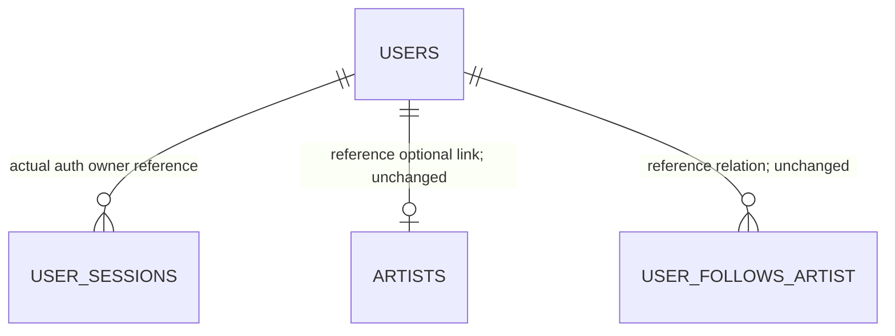

# Data Model — Feature 111 User Management

**Status:** Logical model and invariants, not new DDL or approved final wire schema. [U01–U11](./research.md#decision-register) identify required mappings and decisions. Only source-approved DTO names are fixed below.

## Entities and evidence

| Entity | Confirmed information | Unresolved mapping / boundary |
| --- | --- | --- |
| Acting Admin | Existing AuraTune account, valid current session, current unbanned `admin` role | Actor identity derives from server verification; U06/U07 coordinates concurrent demotion/revocation and write authorization. Never a body/query actor field. |
| Target account | Existing account identity, current role/ban, creation time | Checked-in auth schema uses text `users.id` PK plus unique `user_id`; reference ER uses `user_id` as PK. U04 maps visible ID/path/auth/session keys without ambiguous fallback. |
| Admin account projection | `user_id`, `display_name`, `email`, `role`, `created_at`, `is_banned`, optional `ban_reason` | Seven-field allowlist is FR-004, not a claim that reason column exists. No avatar/provider/session/password/lockout attributes. Exact types/nullability/enclosing list metadata U05. |
| Ban decision/reason | Nonblank recorded effective reason; direct default literal when custom absent; persistent until explicit unban | No reason/audit schema exists in auth migration. Minimal physical record and duplicate/post-unban behavior U03/U04. No full audit-history entity/table/API approved. |
| Existing session | `user_sessions` with `session_id`, owner reference to `users(id)`, `is_revoked`, token hashes, device/time state | Internal auth entity only; none of these fields is exposed to directory. U06/U07 approves durable all-active-session invalidation and concurrent session creation ordering. |
| User directory page | Approved target projections, filters and deterministic ≤20-row page | Exact pagination metadata/transport U05; consistency across concurrent changes and comparator source U08. |
| Private UI request state | Acting account/session generation, query/page generation, target/action and confirmed/pending/error/uncertain outcome | Volatile internal state, not wire fields, durable drafts or an operation table. U09. |
| Artist/follow/track context | Existing optional artist link and independent relationships | Read integration evidence only. 111 creates no artist, changes no linked artist/track owner and removes no follows/history. U10. |

The diagram combines actual auth persistence with clearly labelled reference catalog relations; it is not proof they share the same deployed key. The minimum reason record is deliberately not drawn as an invented table.

## Actual persisted baseline

[Auth migration](../../../src/database/migrations/001_auth_tables.sql) establishes account display name/email/role/creation/ban and existing authentication secrets/lockouts. `role` is text with default `user`; the migration does not establish the ER's role CHECK. Application validation must still enforce exactly `user`, `artist`, `admin`; any additional physical constraint requires reviewed mapping/deployment, not speculative DDL here.

[Auth repository](../../../src/backend/repositories/authRepository.js) can read by `id` then `user_id` but updates by `id` only, and current auth responses can normalize visible IDs differently from stored `user_id`. U04 must prove the correct target/principal mapping for legacy rows with unequal values and collisions; do not use an unreviewed OR lookup that can select a different account. Preserve stable visible identity and the approved `user_id ASC` tie-break.

No `ban_reason`, reason-history relation or administrative transaction is established in the migration. Any minimal approved persistence change must preserve account/auth/session/follow/artist references and have a reviewed migration/rollback path. This feature introduces no deletion cascade, expiry state or new token format.

## Validation rules

| Input / operation | Source-backed constraint | Remaining decision |
| --- | --- | --- |
| `q` | Trim edges; case-insensitive substring in `email` OR `display_name`; AND with other filters | U08 actual case/collation and escaping; no concatenated-field/diacritic/fuzzy widening |
| `role` query / accepted role write | Exact `user`, `artist`, `admin` | U05 role-operation transport, U02 source alignment; reject invalid values, no silent default |
| `is_banned` query | Boolean true/false filter, optional when not supplied | U05 canonical wire parsing; string `false` must not be truthy-converted to true |
| Directory order | `created_at` descending, then `user_id` ascending | U04/U08 canonical type/time/comparison and concurrent paging behavior; no null/date-now fallback |
| Page behavior | At most 20 rows; filter/search change resets first page | U05 exact navigation metadata/parameters; no unapproved arbitrary size/sort |
| Custom `reason` | Required effective nonblank text, whitespace-only invalid | U03/U05 distinguish explicit blank from omitted custom reason/defaulting location; no invented length limit |
| Direct default reason | Exactly `Vi phạm tiêu chuẩn cộng đồng` when custom reason not provided | U03 approved request/default semantics; not a promise that explicit blank is accepted |
| Ban target | Existing non-Admin, not self | Current checks at accepted boundary U07; self/other Admin forbidden |
| Role target | Other account; self-role change strictly prohibited | U02 banned/Admin target edges and source precedence; no last-Admin rule or artist linking added |
| Unban | Explicit authorized action; no new reason or scheduled expiry required | U02 Admin-target case, U03 reason disposition, U05 duplicate outcome |
| Account projection | Exactly approved allowlist; no secrets in any outcome | U05 optional reason representation/nullability, no whole-row serialization |

Use server validation even when controls are disabled. Reject unsupported writable account fields according to the accepted request contract; never spread input into the existing generic repository update.

## State transitions

| Before / request | Required logical result | Preserved / unresolved |
| --- | --- | --- |
| Unbanned non-Admin + valid ban | Banned with required recorded effective reason; active sessions invalidated; acknowledged only after required persistence | Role/identity/follows/artist/track/history/password-lock state unchanged |
| Banned target + duplicate ban | Remains banned; truthful no-op/idempotent outcome | No contradictory state; reason/audit update policy U03, exact response U05 |
| Banned eligible target + unban | Active ban cleared; new sign-in allowed subject to other existing auth rules | Pre-ban sessions remain unusable; reason clearing/history retention U03 |
| Unbanned target + duplicate unban | Remains unbanned; no-op outcome, no mutation under US3 acceptance | Exact representation/status U05 |
| Self/other Admin + ban | Forbidden; no mutation | Older “invalid” wording cannot justify a state change |
| Missing target | Not found; no mutation or prior-existence disclosure | Authorized target recognition contract U05 |
| Other account + accepted valid role change | Approved role persists; next protected authorization uses current role | Ban/artist links/ownership/follows unchanged; specific target edges U02 |
| Self + role change | Denied; no role change | Denial mapping U05, not a client-only disabled control |
| Definite validation/auth/transaction failure | No administrative state change; safe feedback | No success toast or partially applied reason/session mutation |
| Lost response / unknown commit | Unknown until authorized reconciliation | Not proof of failure, unchanged target or successful state; no blind toggle/retry |

Ban is independent of password `lockout_until` and failed-login counters. Unban is not password unlock/reset and does not re-enable pre-ban sessions. Role assignment to Artist does not supply an artist record; Admin assignment does not supply Studio ownership.

## Logical atomic boundary

U07 must define an actual deployment/transaction/conditional mechanism using existing database capabilities. Required logical work is:

1. Verify current acting identity/session/Admin eligibility and resolve canonical target safely.
2. Check operation-specific self/current-target-role rules and validate accepted input.
3. Apply only the intended field transition and required reason record. For ban, durably invalidate applicable sessions and coordinate concurrent login/refresh so acknowledgement cannot precede required enforcement.
4. Return accepted safe durable outcome; otherwise roll back/coherently recover with no false success. Unknown commit remains uncertain, never a guessed rollback.

The outline does not approve a stored function, lock, serializable isolation level, version column, queue or token epoch. A sequential set of Supabase requests or per-process mutex is not sufficient evidence of multi-worker correctness. U07 also specifies opposing ban/unban and role-versus-ban ordering; 111 does not inherit a product winner policy from another feature.

## Cross-feature invariants

- Account ban blocks authenticated capability, not account existence or anonymous artist/content visibility.
- Changing role/ban never silently updates artist link, track owner, Artist preference, Admin content restriction, media, follows or original follow time.
- 113 current-user totals count existing distinct accounts including banned/all roles. Role changes do not create a new account; do not persist/update a 111-owned aggregate or derive stats from local rows.
- Role demotion/ban removes administrative access on subsequent authenticated requests; private directory/cache must be withheld. Client refresh/hydration cannot reassign origin or reintroduce stale privileges.
- Service-role database access stays backend-only with explicit authorization/projection; the presence of RLS does not replace application checks.

## UI states

Auth resolving → login-required / forbidden / valid Admin. For valid Admin, list state is loading → successful nonempty / successful empty / safe failure, keyed by exact filter/page generation. Mutation state is pending → confirmed applied / confirmed no-op / definite error / uncertain-reconciling. Logout, account replacement, lost Admin role or ban clears private state and late feedback.

Unknown target state cannot become a confirmed value from absence on a filtered or unfinished page. After a state change that removes a row from current filters, refresh the appropriate approved page; no fabricated totals or automatic page-selection policy is prescribed. No persistent Admin PII cache or new status API is selected.
