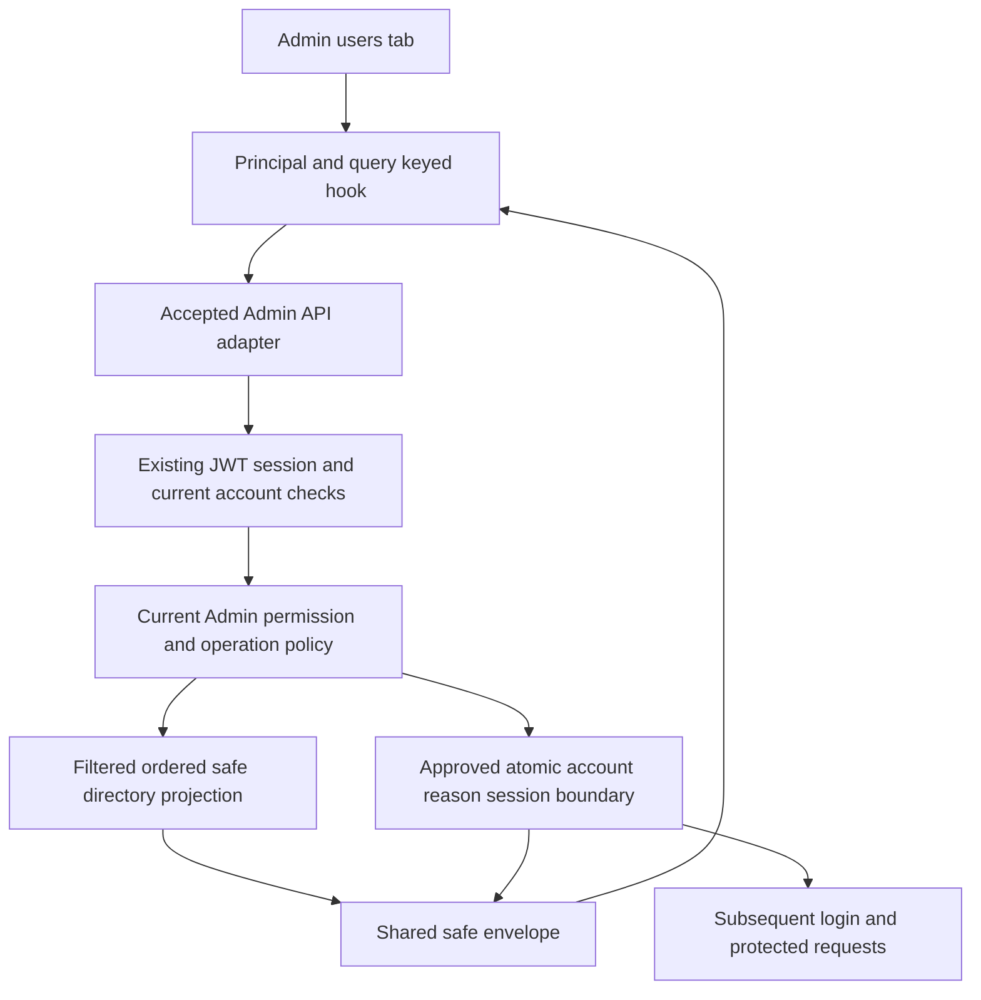

# Implementation Plan: Feature 111 — User Management

**Branch:** `110-admin-functions-plan-tasks` | **Date:** 2026-11-09 | **Spec:** [spec.md](./spec.md)

**Input:** [Specification](./spec.md), [requirements checklist](./checklists/requirements.md), and all five [UI mockups](./ui/).

**Status:** Complete for technical review; **not implementation-ready**. [U01–U11](./research.md#decision-register) retain source conflicts, missing interfaces/persistence and verification gates. Recorded requirements, observed implementation and proposed approaches are distinguished. No source specification, checklist, image, application code or other feature is modified; no Tasks are generated.

## Summary

Provide backend-authorized account directory/search/filtering, other-account role changes, and persistent ban/unban in the existing Admin users tab. Return only the seven permitted account fields. Preserve exact query semantics, deterministic order and 20-row pages. Ban self/other Admin is forbidden; self-role change is prohibited. Successful bans must block new login and subsequent authenticated requests and invalidate active sessions; unban does not revive old credentials. Anonymous public access is unaffected.

Reuse current React/Vite JavaScript, custom routing, Express, AuraTune JWT/session/Firebase exchange and backend Supabase integration. Current Admin actions are local mocks; no Admin backend handlers exist. Role changes are explicitly required by FR-022 and newer clarification/Vision, despite older exclusion text and checklist drift. Design includes them but gates implementation on documented source alignment and an accepted API capability. Direct default-reason bans must coexist with mandatory nonblank-reason validation and truthful success feedback; the precise omitted/blank/default transport remains U03/U05.

## Technical Context

**Language/Version:** JavaScript ES modules/JSX; existing React `^18.3.1`, Vite `^5.4.11`. Supported Node runtime unpinned: **NEEDS CLARIFICATION U11**.

**Primary Dependencies:** Existing Express `^4.21.2`, Supabase JS `^2.119.0`, JWT/bcrypt/cookies, Firebase Admin exchange, Tailwind `^3.4.17`, Lucide and native fetch. No new auth provider, router, state framework or datastore selected.

**Storage:** Existing backend configuration uses Supabase when configured and an in-memory auth fallback otherwise. Checked-in migration provides accounts/sessions, not ban-reason/audit persistence. **NEEDS CLARIFICATION U04/U07**: actual deployed keys/store, minimum reason record and atomic state/session execution. Durable administrative success cannot be established by browser state or an unapproved volatile fallback.

**Testing:** Existing frontend build/dev/preview and root backend auth smoke; no 111 harness. **NEEDS CLARIFICATION U11**: approved runner/scripts/layout, disposable fixtures and multi-session/database verification. Feature 131 proposals do not establish installed tools.

**Target Platform:** Existing responsive web SPA and Node/Express backend. Follow shared browser/accessibility/HTTPS guidance; deployment/runtime verification remains U11.

**Project Type:** Existing frontend/backend/database web application; extend modules incrementally.

**Performance Goals:** Preserve page size ≤20 and deterministic server order. Measure actual directory queries against Vision metadata-query guidance, including p95 <100 ms where applicable. There is no feature-specific 500 ms mutation SLA or zero-latency network guarantee. FR-023 requires direct responsive feedback without false persisted success; final timing/measurement conditions are U11.

**Constraints:** Valid current Admin authorization; allowlisted output; no secrets; current account/session enforcement; no self-role change or self/Admin-target ban; no automatic unban; no account deletion/reset/impersonation/export/artist linking, content moderation or stats implementation. Source-precedence, exact API, persistence, auth and concurrency gates must close before dependent implementation.

**Scale/Scope:** Five original stories, 23 FRs and seven SCs; users tab in the existing `/admin` surface. Three established Admin list/ban/unban endpoints; role-update method/path and any per-target read/reconciliation capability remain unapproved. No guessed pagination metadata, counts, sort parameter, role endpoint or Admin detail page is introduced.

## Constitution Check

*Assessed before research and re-evaluated after design.*

The [Constitution](../../../.specify/memory/constitution.md) remains a placeholder template. Commented examples are not ratified principles.

| Check | Initial evidence | Post-design disposition |
| --- | --- | --- |
| Ratified governance | Not available | U01 open; no constitutional pass/waiver claimed |
| Authoritative requirements preserved | Role/reason/source drift identified | All FR/SC covered; U02/U03 hold conflicting portions |
| Existing architecture/auth/database reused | Current seams inspected | Reused; U04–U09 block exact production integration |
| Admin-only and safe projection | Requirements explicit | Designed; backend tests and current-role/session proof required |
| Cross-feature separation | Specs/UC records available; prior planning files absent here | No implicit artist/content/follow mutation; U10 coordination explicit |
| English Markdown, confined output, fixed branch | Required | Five planning artifacts in 111 only; no Tasks/code/Git mutations |

The installed [Plan skill](../../../.agents/skills/speckit-plan/SKILL.md) says “ERROR on gate failures or unresolved clarifications.” The user's explicit request is a review-ready package with unresolved gates. Therefore this design records **HOLD**, not fabricated decisions or implementation approval. The research phase exhausts checked-in evidence and records missing approvals; it cannot truthfully resolve them by assumption.

## Project Structure

### Documentation (this feature)

```text
specs/110-admin-functions/111-user-management/
├── spec.md                         # authoritative; unchanged
├── checklists/requirements.md      # authoritative; unchanged
├── ui/                             # all five inspected; unchanged
├── plan.md
├── research.md                     # evidence, conflicts, U01-U11
├── data-model.md                   # logical model, not new DDL
├── contracts/user-management.md    # established surface and open wire gates
└── quickstart.md                   # future validation, not executed tests
```

Tasks belong to a later authorized `/speckit.tasks` step.

### Source Code (repository root)

```text
src/frontend/src/
├── pages/Admin/AdminPage.jsx            # existing shared shell; migrate users tab only
├── components/common/ui.jsx             # existing login/forbidden/empty/error primitives
├── services/adminUserService.js         # proposed accepted-contract adapter
├── hooks/useAdminUsers.js               # proposed principal/query/request lifecycle
├── services/sessionApiClient.js         # existing origin-bound recovery seam
├── context/AppStore.jsx                 # replace 111 mock authority; coordinate auth hydration
└── routes/AppRouter.jsx                 # existing custom /admin route
src/backend/
├── server.js                           # register approved Admin router before fallback
├── routes/adminUserRoutes.js            # proposed existing paths; role path pending U05
├── controllers/adminUserController.js   # proposed validation/projection/envelope
├── services/adminUserService.js         # proposed current-Admin and transition policy
├── repositories/adminUserRepository.js  # proposed narrow persistence/projection
├── middleware/authMiddleware.js         # existing current-session/current-user checks
├── controllers/authController.js        # existing local login/refresh/session/me
├── controllers/firebaseExchangeController.js # existing identity exchange
├── repositories/authRepository.js      # existing account/session persistence
├── utils/authHelpers.js                # existing token/session helpers
└── db.js                               # existing volatile demo fallback, not proof of durability
src/database/
├── supabaseClient.js                    # existing server-only service client
└── migrations/                         # changes only after U04/U07 acceptance
```

**Structure Decision:** Extend existing service/controller/repository seams without splitting the application or rewriting all Admin tabs/store. Proposed filenames are future module locations, not implemented files. Coordinate shared auth and database changes with established owners. Test paths/commands and concrete migration/deployment artifacts require U11/U04/U07 acceptance; no DDL is supplied now.

## Phase 0 — Research Outcome

[research.md](./research.md) records source review, all five images, code gaps and an explicit decision register. Most behavior is fixed: field allowlist, role values, default filters/order/page size, persistent bans, no self/Admin-target ban, no self-role change and scope separation. Missing physical/wire/concurrency choices are not missing authorization to invent product behavior.

Source conflicts needing disposition:

- FR-022/2026-11-01 clarification and Vision FR-110-004 allow other-account role changes, including Admin; old Input/checklist exclude admin-role management. Retain FR-022 in architecture/coverage while holding that implementation under U02/U05.
- FR-005/013 require nonblank reason; FR-023 permits one-click default when custom reason is absent. Keep direct default/custom cases and explicit-blank rejection visible; default insertion location and precedence require U03/U05.
- FR-010/US3 specify forbidden for self/Admin-target ban; older clarification says invalid. Use the more specific forbidden requirement in proposed error alignment, not an undocumented status choice. Exact validation/target-check precedence remains U05.
- Admin-target **unban** and role changes on banned targets are not fully described; do not extend a ban prohibition or clear a ban automatically. U02 covers those cases.

Group 090 specifications/checklists and current draft use-case records are available. Its earlier planning/research/Tasks/consolidated review are **not present in this checkout**. They are not cited as existing files or treated as approved dependencies. U10 records the limitation; no branch switch/import is performed.

## Phase 1 — Technical Architecture

### Data flows



This is logical flow, not selection of transaction/RPC or a new endpoint. Authentication/role denial precedes protected account disclosure. Handlers receive a verified acting principal, not an actor/role from request body. Writes validate current actor, target identity/eligibility and accepted input at the approved processing boundary.

### Authorization matrix

| Principal / target | Directory/search | Ban | Unban | Role update |
| --- | --- | --- | --- | --- |
| Guest/missing/invalid/expired session | Deny authentication | Deny | Deny | Deny |
| Current User or Artist | Forbidden; no directory data | Deny | Deny | Deny |
| Banned principal, including an Admin role | Deny with approved ban failure | Deny | Deny | Deny |
| Current unbanned Admin → existing other non-Admin | Allow approved projection | Allow valid effective reason | Allow per current ban state | FR-022 requires allowed role values; U02/U05 gate |
| Current Admin → self | Own row may appear in permitted directory | Forbidden | Self-management edge requires U02; no recovery bypass | Prohibited server-side and disabled in UI |
| Current Admin → other Admin | Row may appear | Forbidden | U02 must clarify exact scope; not inferred | FR-022 includes other accounts; U02 source alignment required |
| Authorized actor → missing target | Normal list may be empty | Not found; no mutation | Not found; no mutation | Accepted role-operation missing-target contract required |

Admin user-management permission does not grant Artist Studio identity/ownership or permission to change profile visibility/content through 111. A banned Admin cannot invoke unban to recover their own access.

### Directory, safe projection and query semantics

Known output allowlist, exactly FR-004: `user_id`, `display_name`, `email`, `role`, `created_at`, `is_banned`, and `ban_reason` when recorded. These are approved Admin-visible DTO names, not proof every database column exists. Select/project explicitly; never return raw auth rows or reuse the broader own-account auth formatter. Exclude hashes, tokens, session IDs/device/IP, provider links/secrets and all other attributes. Errors/labels/logs must obey the same boundary.

Backend implements trimmed case-insensitive **substring of either email or display name**, exact `role` in `user|artist|admin`, boolean `is_banned`, AND across filters, `created_at DESC, user_id ASC`, at most 20 records per page. Filter/search change resets the UI to first page and invalidates old requests. Do not adopt demo accent folding, concatenated name/email matching, fuzzy search, truthiness of string `false` or SQL wildcard interpretation as new semantics.

Use bound/escaped query construction; U08 selects actual case comparison, canonical ordering and safe literal matching with `%`, `_`, quotes and Unicode. Apply filters/order before pagination. U05 must approve pagination request/response metadata; a behavioral 20-row rule does not establish `page`, `limit`, cursor, total or arbitrary-sort fields. U08 addresses consistency while roles/ban states or accounts change across requests, without inventing snapshot tokens or a full-export requirement.

### Role changes

Cover FR-022 despite older source conflict. Reuse accepted account role field and exactly three allowed values; derive actor from current auth and refuse self-role changes server-side. Do not use the artist-link endpoint as role update, add a guessed route or expose generic row update. Only role changes; do not update artist links, track ownership, follows, ban state or authentication secrets.

Role changes must affect subsequent server authorization based on current database role, as middleware already reads; a stale JWT role cannot restore Admin privilege. Frontend current-user hydration must consume verified current role rather than trusting old local state. Existing `/api/v1/auth/me` and refresh responses are implemented integration candidates, not new 111 endpoints. No automatic account-to-artist provisioning, account ban clearing or blanket session logout on every role change is inferred. Exact behavior for banned targets and concurrent actor demotion is U02/U06/U07.

No separate original role-change user story exists; include FR-022 as a cross-cutting management capability alongside the five existing stories, with dedicated verification. Do not renumber stories or silently omit the role requirement.

### Ban, default reasons and unban

Use existing distinct desired-state PUT ban/unban operations, not a raw toggle. Ban affects only an eligible non-Admin target; self/Admin-target attempts are forbidden. Required reason must be nonblank after trimming; store the reason using an approved durable representation. One-click ban with no custom reason must record exactly **“Vi phạm tiêu chuẩn cộng đồng”** under FR-023. The proposed compatibility interpretation distinguishes omitted custom reason from an explicitly blank invalid `reason`; U03 must accept the exact request/defaulting rule before implementation. No mandatory reason modal is added.

Unban clears active ban state explicitly; no timeout/expiry/scheduler. No unban reason is required by current source. Duplicate ban/unban must report truthful no-op/idempotent outcome without contradictory state; exact response/status, duplicate-reason/audit handling and retained/cleared reason after unban remain U03/U05. Do not copy 112's reason-preservation rule as if it were a 111 requirement. No full audit-history UI, export, reason editing or invented append-only table is introduced.

FR-023 immediate feedback is compatible with pending feedback immediately and success toast after confirmed persistence; FR-017/SC-006 forbid false success. UI labels/toasts follow the mockup intent, with precise pending/no-op/error/uncertain states. A filter-matching row can disappear after a confirmed role/ban change; refresh the accepted directory rather than changing unrelated users or inferring target deletion.

### Session and authentication enforcement

Existing middleware verifies JWT/session ownership, expiry, user agent and revocation, loads current user and overrides token role. However local login currently omits ban validation; refresh rejects/revokes only the refreshed banned session; middleware rejection alone does not revoke untouched sessions. Therefore existing code does **not** implement complete FR-011 or post-unban fresh sign-in.

Required invariant: after acknowledged ban, new login is rejected; all subsequent authenticated requests are denied, even with otherwise unexpired tokens; unban must not resurrect pre-ban sessions. Reuse current session/revocation capabilities as a candidate, but U06/U07 must approve the durable and race-safe mechanism covering all target sessions and concurrent login/refresh/session creation. Sequential logout-all helper calls are not proof of an atomic ban operation. No new token type, ban epoch column, provider-wide signout or cookie system is selected here.

Apply consistent checks to password login, Firebase exchange, refresh and protected operations. Keep password failure lockout separate; unban must not reset password locks or credentials. Normalize existing banned 401/ad hoc envelopes toward shared 403/USER_BANNED with auth-owner compatibility review. Shared AI-specific 503 is not an invented Admin storage error.

Coordinate long authenticated operations with their final authorization boundary: a previously authorized Artist upload cannot bypass a committed account ban. Public reads remain independent; 111 does not stop anonymous public playback or hide content.

### Atomicity, concurrency and uncertain outcomes

The logical mutation unit needs current actor/session/Admin authorization, canonical target resolution, current target role/self protections, the allowed account change, required reason record and durable session invalidation for bans. U07 must select actual transaction/conditional execution and deployment/security mechanism; separate Supabase calls or a Node mutex do not prove multi-worker correctness.

Test simultaneous duplicate bans/unbans, opposing ban/unban, target promotion to Admin versus ban, acting Admin demotion/revocation versus management, and login/refresh versus ban. Preserve existing fixed guards; 111 does not state an exact competing-request winner protocol. U07 must document that policy/design rather than silently importing 092/112 processing order or adding version headers. Failed/rolled-back operations cannot leave partial reason/status/session changes or false success.

A lost response can conceal a committed mutation. Keep outcome unresolved and reconcile through an accepted authorized capability before definitive feedback or manual retry. Absence from one filtered/paged directory page does not prove target missing or desired state achieved. U05/U09 must supply safe current-target recognition; no guessed Admin detail/status route, idempotency header or exactly-once promise.

### Frontend lifecycle and privacy

Retain existing Admin shell and users tab. Add accepted role/ban filters and pagination controls as required by the spec, without inventing filter transport fields. Migrate only 111 state/actions to its service/hook; overview, moderation and system tabs remain peer-owned. Existing AppStore helpers are not persistence or authorization.

Key private state by originating Admin/account/session generation plus query/page/request generation and target/action. Discard stale list/mutation results and toasts on account switch, loss of Admin role, ban or session expiry. Prevent A's request refresh/replay from being sent as B, including B also being Admin. Clearing late UI data alone is insufficient. Same-origin bounded auth recovery may reuse existing infrastructure only after accepted U09 design; never blindly repeat an uncertain administrative mutation.

Keep Admin list/PII out of persistent browser caches and public responses; private cache headers/any shared cache behavior require U05 acceptance. Render names/reasons as text, use safe error messages, and avoid raw rows/request credentials or full reasons in diagnostics. No external AI processing of directory data. Responsive, labelled controls and keyboard access follow shared guidance; speculative avatar/profile information is outside the seven-field allowlist.

## Cross-Feature Integration

| Boundary | Required behavior / dependency |
| --- | --- |
| 112 account versus moderation | Ban/role change does not set Artist track preference, Admin content restriction or deletion. 112 unrestrict does not unban an account. Shared Admin authorization is current-state enforced; no moderation controls implemented here. |
| 113 authoritative users | Successful calculation reads real current account state. Ban preserves account existence and total-user contribution; role changes may affect role-derived metrics without creating/deleting users. Do not update frontend counts as authority or implement stats/counters/jobs. Current 113 scope conflicts remain 113-owned. |
| 091 public profiles | Account ban and artist public visibility are separate; no inferred account→artist hiding. Public profile reads stay anonymous; admin-visible email/reason/role never enters public artist DTOs. |
| 092 follows | Ban restricts authenticated access, not stored follow membership/time. All current allowed personal roles retain own-account scope after role change; no Admin access to another person's private follow list. |
| 093 ownership | Role assignment alone does not link/create an artist or reassign tracks. Admin role alone does not grant ordinary Artist Studio access. A demoted/banned actor loses relevant protected capability; data ownership/media/history persist according to their own lifecycle. |
| Shared identity/auth | Reconcile actual `users.id`/`user_id`, current-role hydration, ban/revocation and origin-bound refresh with Khoa/Đăng/Hoàng. Import no absent Group 090 planning decision as approved. |

## Implementation Sequence and Gates

| Stage | Future implementation scope | Exit evidence |
| --- | --- | --- |
| A — Source/design review | U01–U11 dispositions, role/reason conflicts, actual identity/store and interfaces | Accepted evidence and source precedence; no invented schemas/routes |
| B — Shared security foundation | Current Admin permission, auth errors, ban/login/session invalidation and replay isolation | Real password/Firebase/refresh/protected/multi-session negative tests |
| C — Directory | Safe complete page projection, exact filters/order/page/reset and UI lifecycle | Contract/query/privacy tests and ≥21-row fixtures |
| D — Management | Accepted role capability, atomic ban/reason/revocation, unban/no-op and truthful direct feedback | Current actor/target guard, durable persistence and concurrency/fault evidence |
| E — Cross-feature verification | Public independence, follow/ownership preservation and authoritative user-source behavior | Integration evidence without implementing peers |
| F — Acceptance/review | All FR/SC and original scenarios; explicit remaining limitations | Actual results and independent review; no readiness overclaim |

## Verification and Review

[quickstart.md](./quickstart.md) defines setup prerequisites, concrete scenarios, fault/concurrency/session matrices and coverage for FR-001–023/SC-001–007. Require actual server/database tests, raw response/privacy inspection and two-account/multiple-session races, not UI-only mock assertions. Read-only preparation can proceed now; dependent implementation remains gated. Exact OpenAPI 3.0.3 follows accepted U05 schemas and any explicitly approved role capability; the current Markdown contract intentionally does not fabricate them.

## Complexity Tracking

No constitutional waiver or new infrastructure is justified by assumption. A coherent account/reason/session boundary is required, but its concrete transaction/deployment mechanism is unresolved. Reuse established session/database modules rather than adding an auth service, audit system, queue or datastore without accepted evidence.
