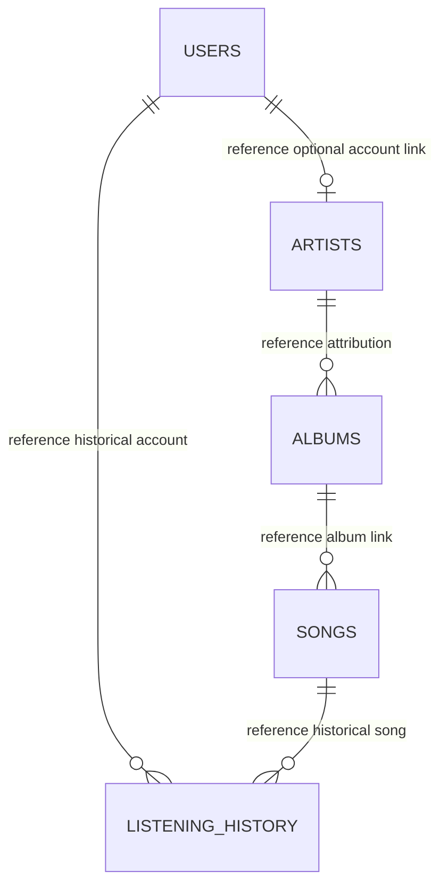

# Data Model — Feature 112 Content Moderation

**Status:** Logical entities and invariants, not DDL, wire fields, a selected storage provider or a terminal-state implementation. [M01–M12](./research.md#decision-register) govern concrete mapping and source alignment.

## Entities and evidence

| Logical entity | Required information | Evidence / open mapping |
| --- | --- | --- |
| Acting Admin | Valid current account/session, unbanned Admin authority | Existing JWT/session/current-user checks; shared 111-U06 remains open. Actor cannot be supplied by body/query. |
| Song identity | Stable song ID, artist attribution and canonical owner context | Reference `songs.song_id` through album→artist, but actual catalog/standalone/co-credit ownership not migrated. M03/M04; browser `artistId`/`uploadedBy` is not authority. |
| Artist preference | Artist-public versus Artist-hidden/private intent | Independent from Admin restriction, confirmed restore rules. No approved flag/enum selected. |
| Admin restriction | Current restricted/unrestricted condition and required recorded reason | FR-005/006/027; no schema or generic `status` column proven. Duplicate restrict cannot overwrite reason. M04. |
| Removal/deletion outcome | Distinguishable removed label and terminal deletion without resurrection | FR-028/029/newer removed wording versus FR-027/checklist requires M02 action mapping. Do not create a new state merely to hide conflict. |
| Moderation review projection | Minimal song/artist/owner/moderation and available rights context | Source mentions alternative names such as `song_id`, `artist_id`, `owner_user_id`, `status`, `is_deleted`; these are conditional review concepts, not a finalized mandatory DTO/column set. M05. |
| Rights/source evidence | Available source/distribution/license/attribution declarations | Existing Group 090 source; physical representation M04. Read-only, absent is not verified permission; no proof-upload or legal determination. |
| Owner Studio projection | Own authorized metadata, restriction state and reason | FR-024/US4A; no private Admin identity, playback permission or deleted recovery. Protected read schema/capability M05/M11. |
| Media association | Existing playable reference and actual eligibility-controlled delivery | Existing stream contract, no provider/access mechanism proven. M08; review permission is not a new audio-preview permission. |
| History/audit records | Required historical playback and existing audit identity/records preserved on removal | FR-030; actual source/representation and preservation M09. No new full audit table/service/UI, ledger or retention period approved. |
| Moderation list page | Non-deleted candidates and source-defined comparisons/filter/page | Newest upload DESC, song ID ASC, 20/page; exact transport and upload-time/type mappings M04/M05. |
| Private request state | Actor/session/query/page/target/request generation, pending/confirmed/error/uncertain | Internal volatile orchestration, not approved DB/wire fields or persistent operation table. M10. |

This is reference context only. It does not prove a deployed catalog, required ownership, safe deletion references or a chosen moderation relation. Actual auth uses `users.id` plus `user_id` and needs shared mapping; do not copy reference keys blindly.

## Independent state dimensions

Use distinct logical dimensions even if accepted persistence eventually encodes them differently. Names below are concepts, not proposed database columns.

| Existing/nonterminal | Artist intent | Admin restriction | Required result |
| --- | --- | --- | --- |
| Yes | Public | Clear | Public eligibility only under accepted shared context policy; profile-public wording still M03 |
| Yes | Hidden/private | Clear | Not public/playable; Admin unrestrict cannot change Artist intent |
| Yes | Public | Restricted | No new public display/playback; authorized Admin/owner metadata projections only |
| Yes | Hidden/private | Restricted | Still non-public; clearing either layer alone cannot bypass the other |
| Terminally deleted | Any prior value | Any prior value | No 112 restoration; no new public start or default owner/deleted review workflow |
| Missing | Unknown | Unknown | Appropriate authorized missing outcome; no guessed prior existence |
| Load/operation failed | Unknown/unconfirmed | Unknown/unconfirmed | Error or uncertain state, not a persisted moderation label |

A public Artist profile, Artist-role account, Artist-selected song preference and current account ban are separate questions. M03 must interpret FR-023's Artist visibility wording. Ban does not automatically hide a public Artist, moderation does not ban an account, and Admin role does not confer ordinary Artist ownership.

`removed` in newer source/mock is not automatically synonymous with terminal deleted. It is also not permission to create both a reversible delete and an irreversible delete without approval. M02 must identify which required operation produces the label, where that row may appear, and what valid restore means while preserving FR-027.

## Allowed transitions and preserved data

| Accepted operation | Required transition/invariant | Preserved / pending detail |
| --- | --- | --- |
| Restrict eligible existing song | Apply Admin restriction with required valid reason and source-aligned confirmation | Artist intent, identity/owner, metadata/audio/rights/history unchanged |
| Duplicate restrict | No state/reason overwrite | No-op status/schema and validation precedence M05; no default reset |
| Unrestrict existing restricted song | Clear Admin layer only; no reason/second confirmation under confirmed rule | Artist-hidden status and deletion guards remain; historical reason disposition M04/M09 |
| Duplicate unrestrict | No state/reason overwrite | No new default reason on restore inferred from FR-029 |
| Terminal delete | Final no-restore public-distribution outcome; missing delete not-found | Historical playback/audit preserved; physical record/blob/reference handling M09 |
| Source-labelled direct removal/restoration | FR-029/030 must be covered | M02 mapping/default/confirmation unresolved; not an approved raw status toggle |
| Artist permitted edit/preference change on restricted track | May change only its own allowed scope under 093/Group D05 | Cannot clear restriction, publish effectively or resurrect deleted item |
| Definite failed operation | No saved moderation mutation | No partial reason/state change or success toast |
| Unknown commit | Reconcile before definitive claim/retry | No inference from filtered-page absence or stale local object |

Do not mutate title/artist/album/duration/cover/tags/audio/owner/uploader or source/rights/license/distribution/attribution via 112. No note field or replacement/version lifecycle is introduced.

## Validation and comparison rules

- Search trims edges and lowercases comparison; substring matches title OR artist name. AND-combine filter criteria. No fuzzy/accent/concatenated-field policy is inferred from `normalizeText`.
- Restriction filter has yes/no behavior; default includes both. Query names/types and paging metadata are M05, not borrowed from 111's user filters.
- Sort authoritative upload time DESC, canonical `song_id` ASC; page size 20, reset first page after search/filter change. Do not substitute release date or fabricate missing upload time. M04 reviews case/type/collation/paging consistency.
- Restrict/delete reason is nonblank after trim in confirmed rules. Newer default copyright reason is exactly `Vi phạm bản quyền`. M02/M05 must align missing custom reason/default with explicit blank rejection and action confirmation. No invented reason length limit or confirmation payload flag.
- Restore/unrestrict does not require a new reason or second confirmation. Duplicate no-op does not overwrite state/reason. A new default must not be written merely because a duplicate/direct button was clicked.
- Source metadata is read-only and only returned when actually available/authorized. Missing rights evidence and failed retrieval are distinct; neither creates a verified-license claim.
- Never treat temporary read failure as missing/deleted or an empty page as a full target-state proof. Authentication/authorization must prevent disclosure before private target review.

## Logical atomic boundary

M07 approves exact execution/deployment; this is not SQL or an RPC signature:

1. Verify current actor/session/Admin authority and canonical target/existence.
2. Check accepted operation, current Artist preference, Admin restriction and terminal guards; validate reason/input under accepted source/contract semantics.
3. Apply only the intended moderation/lifecycle transition and necessary record preservation in one coherent database processing boundary.
4. Preserve duplicate reason/state, system-order outcomes and no resurrection; coordinate current owner writes, history recording and media eligibility.
5. Acknowledge only the required durable result/enforcement. Roll back definite failures without partial saved mutation; unknown outcomes require safe reconciliation.

Force separate workers/barriers; HTTP click/arrival order is not the processing point. A relation-specific follow lock or sequential Supabase calls is not a song architecture. No chosen transaction isolation, lock, function, version column, operation table or retry key is approved here.

## Historical preservation and delivery

FR-030 preservation constrains lifecycle design; it is not a blanket permission to purge or retain everything forever. M09 maps actual history/audit identities and reference/cleanup behavior so valid historical plays survive and existing audit records are not destroyed. If records are absent/unmapped, FR-030 acceptance stays blocked rather than claiming a vacuous pass.

113 reads valid retained listening-history events independently from `songs.total_plays`; Studio history has its own source scope. 112 updates neither statistic from a sum of remaining rows and invents no counter/recount policy. Exact track-total meaning belongs to 113.

Public distribution must stop new starts after acknowledged moderation even if physical cleanup is pending. M08 must prove known URL/range/cache and queue enforcement, while already-started playback may finish. A subsequent Range request may represent an active continuation or a new start; classify this using the approved shared design, not a fabricated playback-session token or a universal deny-all-continuations rule.

## Private UI lifecycle

Keep auth resolving/login-required/forbidden apart from list loading/nonempty/empty/error. Keep intentionally restricted, source-aligned removed, missing/deleted and temporary unavailable distinct under accepted projections. Mutations are pending, confirmed applied/no-op, definite failed or uncertain/reconciling; those are internal request states, not a publication approval queue.

Key all private state by origin account/session and query/page/target/request generations. On logout/replacement/lost Admin or owner authority, clear private data and late feedback and prevent credential-reassigned replay. Source-required confirmation/cancel and direct feedback mapping remain M02. No private durable browser cache, deleted inventory, extra audit page or automatic realtime refresh is selected.
