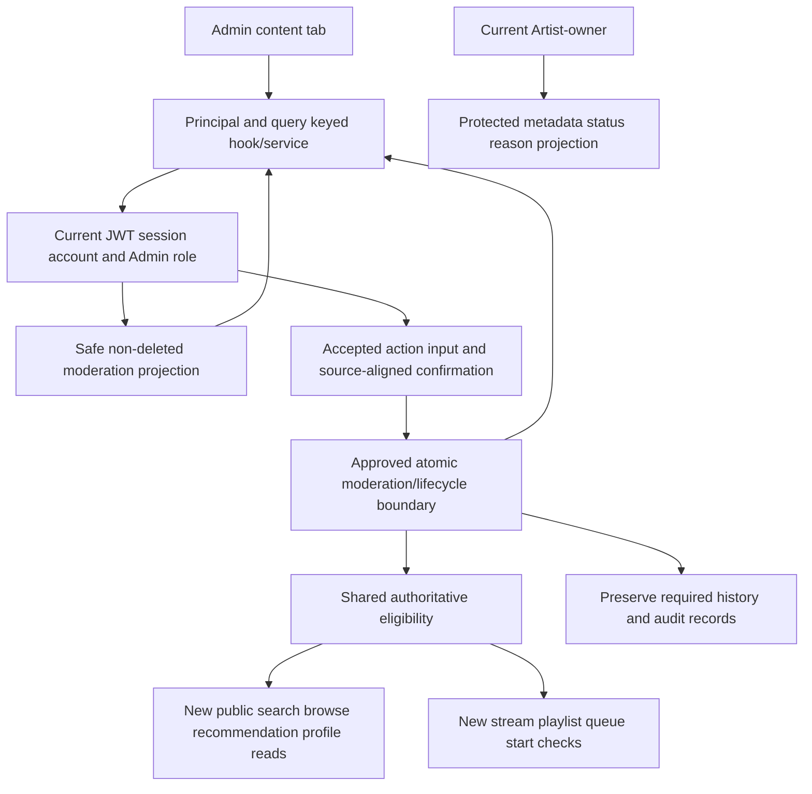

# Implementation Plan: Feature 112 — Content Moderation

**Branch:** `110-admin-functions-plan-tasks` | **Date:** 2026-11-09 | **Spec:** [spec.md](./spec.md)

**Input:** [Specification](./spec.md), [requirements checklist](./checklists/requirements.md), and all four [UI mockups](./ui/).

**Status:** Complete for technical review; **not implementation-ready**. [M01–M12](./research.md#decision-register) retain source-precedence, identity, interface, persistence, delivery and verification gates. No specification/checklist/image, application code, peer artifact or Git branch is changed. No Tasks are generated.

## Summary

Provide current-Admin-only song moderation in the existing Admin content tab: locate non-deleted songs, review minimum ownership/rights context, apply or clear Admin restriction, and perform the source-supported removal/deletion operations. Artist preference, Admin restriction, terminal deletion, account validity and public Artist visibility must remain distinct. Owner Studio may show authorized restricted-song metadata/status/reason without granting playback, unrestriction or Admin-private data.

Reuse current React/Vite JavaScript, custom router, Express, AuraTune JWT/session/Firebase exchange and backend database seams. Current moderation and playback are browser mocks; no production catalog/moderation/media handlers exist. Exact API/persistence and media enforcement require accepted shared design. Preserve all 30 FRs, six SCs and seven story headings, including **US4A**.

The source contains both reason-plus-confirmation restrict/delete and newer direct one-click/default-reason removal/restoration, plus reversible `removed` language versus terminal deletion. This plan preserves both requirements in traceability and gates their exact action mapping under M02. It does not equate “removed” with “deleted,” silently discard FR-029/030, authorize restoration of deleted content, or choose physical deletion/retention policy.

## Technical Context

**Language/Version:** Existing JavaScript ES modules/JSX, React `^18.3.1`, Vite `^5.4.11`; Node version unpinned: **NEEDS CLARIFICATION M12**.

**Primary Dependencies:** Existing Express `^4.21.2`, Supabase JS `^2.119.0`, JWT/cookies/Firebase exchange, Tailwind `^3.4.17`, Lucide and native fetch. No new framework/router/auth provider or moderation engine selected.

**Storage:** Existing backend Supabase configuration with volatile auth fallback; checked-in migration supplies auth only. Actual song/ownership/status/reason/history/audit schema, persistent mode and atomic execution are **NEEDS CLARIFICATION M03/M04/M07/M09**. Reference ER and local status maps are not deployed moderation persistence.

**Testing:** Frontend dev/build/preview and root auth smoke exist, not a 112 suite. Shared runtime/runner/layout, real-database/media/range/multi-worker/browser environment **NEEDS CLARIFICATION M12**. A timer player cannot prove streaming enforcement.

**Target Platform:** Existing responsive web SPA/Node backend; shared browser, keyboard/accessibility and HTTPS conventions apply. Actual deployment/provider behavior remains gated.

**Project Type:** Incremental frontend/backend/database feature plus shared public-catalog, Studio and Player/Queue integration; no new application.

**Performance Goals:** Twenty-item pages, deterministic source-defined ordering, truthful responsive feedback and no post-success public eligibility bypass. Measure applicable Vision metadata-query p95 <100 ms guidance under documented conditions. No feature-specific millisecond mutation SLA is invented; 093's separate 500 ms issue is not a moderation target.

**Constraints:** Backend current Admin enforcement; minimal projections; reason/confirmation/default source alignment; independent Artist preference and Admin restriction; no resurrection; preserved historical records/audit logs; denied new playback with already-started completion. No prior approval queue, metadata/audio editing, account management, stats, reports, AI review, notifications or full audit system added.

**Scale/Scope:** Admin content tab, existing GET/PUT/DELETE Admin song surface, seven stories and all 30 FRs. Search/filter/paging behavior is known; exact query fields/DTOs, review/reconciliation and protected Studio capabilities are not approved. No new routes, wire properties, providers or enums are selected here.

## Constitution Check

*Assessed before Phase 0 and again after Phase 1.*

The [Constitution](../../../.specify/memory/constitution.md) is still a placeholder template. Commented examples do not constitute ratified gates.

| Check | Initial evidence | Post-design disposition |
| --- | --- | --- |
| Ratified governance | Missing | M01 open; no pass or waiver invented |
| All spec/checklist/UI requirements preserved | Source contradictions identified | M02 records action/precedence conflicts; no silent change |
| Current architecture/auth reused | Inspected | Shared 111 security evidence is open, not approved implementation |
| Artist/Admin/public boundaries | Confirmed behavior plus wording drift | Designed as distinct policies; M02/M03/M05 mapping gates |
| Media access/history/no resurrection | Not implemented | M07–M09 release blockers remain explicit |
| English Markdown/Mermaid, exclusive output, fixed branch | Required | Five 112 artifacts only; no Tasks/code/Git mutation |

The [Plan skill](../../../.agents/skills/speckit-plan/SKILL.md) says “ERROR on gate failures or unresolved clarifications.” The user's explicit request calls for a review-ready package with unresolved implementation gates. Therefore the gate remains **HOLD**, rather than fabricating accepted schemas/policies or claiming research can replace required team decisions.

## Project Structure

### Documentation (this feature)

```text
specs/110-admin-functions/112-content-moderation/
├── spec.md                           # authoritative, unchanged
├── checklists/requirements.md        # authoritative, unchanged
├── ui/                               # all four inspected, unchanged
├── plan.md
├── research.md                       # source/implementation evidence; M01-M12
├── data-model.md                     # logical entities/invariants, no DDL
├── quickstart.md                     # future validation, not passed tests
└── contracts/content-moderation.md   # established surface and open wire decisions
```

Tasks require a later authorized `/speckit.tasks` step.

### Source Code (repository root)

```text
src/frontend/src/
├── pages/Admin/AdminPage.jsx          # existing shell; migrate content tab only
├── pages/Studio/StudioPage.jsx        # existing owner-view integration seam, US4A only
├── services/moderationService.js      # proposed accepted-contract adapter
├── hooks/useModerationSongs.js        # proposed principal/query/request lifecycle
├── services/sessionApiClient.js       # existing shared origin-bound auth seam
├── context/AppStore.jsx               # retire 112 local status authority incrementally
├── App.jsx                           # existing guarded/raw player and URL entry points
├── hooks/useMockPlayer.js             # current timer; integration evidence, not streaming
├── utils/playback.js                  # existing next/repeat behavior
└── components/player/                # existing Player/Queue integration surfaces
src/backend/
├── server.js                         # mount approved routes before fallback
├── routes/adminSongRoutes.js          # proposed existing Admin paths
├── controllers/contentModerationController.js # proposed narrow validation/envelope
├── services/contentModerationService.js # proposed policy/atomic orchestration
├── repositories/moderationRepository.js # proposed approved catalog persistence boundary
├── services/contentEligibilityService.js # proposed shared eligibility policy, not media protocol
├── middleware/authMiddleware.js       # existing current session/user checks
└── repositories/authRepository.js     # existing auth account/session source
src/database/
├── supabaseClient.js                  # existing backend-only service client
└── migrations/                       # only accepted mappings/deployment, none supplied now
```

**Structure Decision:** Extend existing services/repositories and shared shell; proposed filenames are future locations, not implemented components. Read/write/Studio/media route/module details require M05/M08 acceptance. Coordinate shared files with 111/093/Player owners, do not replace the whole store or build their entire features. No provider adapter, new playback token or test framework is selected by this tree.

## Phase 0 — Research Outcome

[research.md](./research.md) separates current requirements, draft owner records, observed code and proposals. Current peers 111/113 and Group 090 specs/UC records are present; earlier 112 text stating peer files were absent is historical. Group 090 planning/research/Tasks/consolidated review remain absent from this checkout and are not linked as existing sources or imported from another branch.

Required source dispositions include:

- **Action mapping:** FR-005/007/checklist require nonblank reason and confirmation; FR-029/newer clarification require direct one-click/default reason. This is a conflict **if they describe the same executed action**, as the Group 090 source assessment records. M02 must approve the mapping/confirmation behavior; this package does not assert every passage necessarily conflicts.
- **Lifecycle vocabulary:** reversible `removed` mock/newer delisting is not automatically terminal DELETE. FR-027/checklist prohibit deleted restoration; FR-030 mandates non-destructive historical/audit preservation. M02/M09 define mapping without choosing hard/soft storage or a deleted-content recovery UI.
- **Known behavior versus stale wording:** FR-027/checklist fix no-op/no-reason-overwrite and successful system order despite older FR-018/SC-006 calling it pending. Preserve the concrete rule, record precedence drift and leave execution mechanism open.
- **Read boundaries:** Admin review of non-deleted hidden/restricted content and owner Studio access are explicit; older blanket non-public-unavailable/Admin-only wording must not erase US4A. Deleted-review edge wording needs M02/M05 disposition without inventing a deleted-detail endpoint.
- **Public predicate:** FR-023's “Artist remains publicly visible” must be aligned with Artist-selected track preference and context-specific public artist policy. M03 separates account, artist profile and track states rather than inferring a ban/profile cascade.

## Phase 1 — Architecture and Responsibilities

### Data flow



This is a logical responsibility diagram, not a selected transaction, cache/index invalidation system, storage service or route.

### Authorization and projections

| Principal/context | Permitted capability | Mandatory limit |
| --- | --- | --- |
| Guest/User/ordinary Artist at Admin APIs | None | Deny before private list/target disclosure; no writes |
| Banned/expired/revoked/non-current Admin | None | Existing current-account/session checks; no cached private data or stale JWT-role bypass |
| Valid current Admin | Minimal in-scope moderation review and accepted restrict/unrestrict/removal actions | No target ownership requirement for platform moderation; no user ban or Artist metadata/audio edits |
| Valid current Artist-owner in Studio | Own restricted-song metadata, status and restriction reason | No Admin-private identity, playback/unrestrict/republish bypass; no new deleted-song access |
| Non-owner/public accessing restricted data | No non-public projection/playback | Public omission/non-disclosure; owner path is not public detail with an ownership flag |

Use server-derived current actor and canonical ownership. Display credit is not management permission, and a browser artist/owner selector cannot authorize Studio. “Admin clears its own restriction” identifies the Admin moderation layer; do not invent a creator-specific Admin-ID constraint or Admin identity column without accepted evidence.

Three projection classes must be distinct: minimal Admin review, limited owner Studio, and public eligible content. Admin review rights do not create an unapproved privileged audio-preview exception. Public/owner errors cannot leak restricted reasons, rights evidence or private Admin details. Exact fields and missing/deleted/error distinctions require M05, not raw row serialization.

### Moderation list and rights review

List includes **non-deleted** songs across public, Artist-hidden and Admin-restricted states, independently represented. Search trims whitespace/lowercases comparison and matches a substring of title **or** artist name; AND-combine restriction filter. Default restriction filter includes both yes/no. Sort by authoritative upload timestamp descending, then canonical `song_id` ascending; 20 rows per page; filter/search change resets first page; empty is valid.

The behavior does not name a search/restriction/page query parameter or exact response/count/cursor fields. M04/M05 must map upload timestamp, comparison and transport. Do not substitute release date, browser creation time, mock array order, accent folding or concatenated-field matching. Escape literal wildcard/filter syntax and bind query input; filter/order before paging. Concurrent-page behavior must be reviewed without inventing snapshot tokens.

Rights/source/license/distribution/attribution are read-only existing declarations. Show only available authorized evidence, distinguish absent from temporarily unavailable, and never manufacture a license/verified ownership claim. Group 090 owner-declared rights choices are evidence, not a deployed rights schema or legal verification system. No proof-upload, extra note field or editable metadata is introduced.

### Independent states and action semantics

Model Artist public/hidden preference, Admin restriction and terminal deletion independently. Effective public availability depends on the accepted shared context predicate; clearing Admin restriction alone cannot publish Artist-hidden content, bypass other confirmed eligibility or resurrect a deleted song.

| Operation | Required invariant | Open implementation/source boundary |
| --- | --- | --- |
| Restrict | Set Admin restriction; preserve Artist preference/metadata/owner/media/history; valid reason and source-required confirmation | M02 direct/default relationship; M04/M05 representation |
| Duplicate restrict | No state or reason overwrite | Exact no-op response and validation precedence M05 |
| Unrestrict/restore | Clear Admin restriction only; no reason or second confirmation under confirmed rule | M02 FR-029 mapping; no invented default-reason overwrite during restore |
| Duplicate unrestrict | No state or reason overwrite | Exact response M05 |
| Terminal delete | No further 112 restore; missing delete not-found; historical records/audit preservation required | M02 removed/delete mapping and M09 physical/reference mechanics |
| Direct one-click removal/restoration | Preserve FR-029/030 coverage, exact default from newer clarification `Vi phạm bản quyền` | M02 must map to approved action(s); not automatically DELETE or unrestricted active |

No title/artist/album/duration/cover/tags/audio/owner/uploader/rights/license/attribution modification through 112. No separate moderation-note feature. Newer `removed` wording is a behavioral/source label, not approval of a universal database enum or a second invented deletion state.

Reason omission/default and explicit blank need accepted examples: FR-013 rejects blank/whitespace; FR-029 supplies a default copyright/community reason and newer clarification gives the exact copyright literal. Do not silently choose a new default for all cases or overwrite the original reason on a duplicate. Immediate pending feedback may be shown, but confirmed success toast must wait for the accepted persisted result; FR-015 forbids optimistic false success. Exact interaction remains M02/M05.

### Concurrency and atomicity

Preserve FR-027: valid opposing operations take effect in successful system order; last successful applicable action determines persisted state, failed actions do not mutate, duplicates do not overwrite reason, and accepted deletion cannot be reversed. Click timestamps and HTTP response arrival do not select a winner. Older pending-policy text remains a source-alignment issue, not permission to weaken this rule.

M07 must approve a multi-worker database execution boundary coordinating current actor/session/Admin authority, canonical target/existence, Artist preference, moderation state, deletion and reason/history preservation. Separate Supabase calls or a Node mutex do not demonstrate atomicity. No lock key, RPC/function, version column, idempotency header or isolation level is selected here.

Force histories for two Admins restrict/unrestrict/delete, Admin restrict versus Artist restore/edit/delete, unrestrict versus Artist hide, deletion versus late Artist/Admin write/upload finalization and valid play recording versus moderation. Preserve unrelated fields and ownership; Artist preference changes may remain allowed by owner scope while restriction persists, but cannot create effective publication or clear restriction. Coordinate shared constraints with 093 without importing its upload workflow.

### Playback, public surfaces and media lifecycle

After successful restriction/removal, newly loaded search/recommendation/browse/artist-profile results omit unavailable tracks. Apply eligibility before public ranking/limits; a hidden high-play song cannot occupy a featured slot or keep a related playlist qualified when no eligible song remains. Catalog/index/cache access must not serve stale eligible truth after acknowledged moderation. M08 defines enforcement with actual shared services; no new infrastructure is assumed.

Every new start through explicit play, collection, queue, next/previous, shuffle, repeat/replay or known direct media URL must enforce current eligibility; unavailable queued items are skipped. Already-started playback may finish. Stale rendered UI may remain until refresh and no realtime repaint/subscription is required. FR-030 immediate streaming/queue wording must be aligned with FR-023 active-completion semantics under M02; do not add a global hard stop.

Existing stream contract is `GET /songs/:id/stream`, binary 200/206 with Range. M08 must demonstrate real provider/direct URL/range/CDN/cache access and distinguish an allowed continuation from a new/replayed start. This is not permission to invent playback sessions/tokens or DRM. An openly readable permanent object URL plus catalog filtering is not sufficient proof. No signed-URL TTL, provider, object-erasure schedule or transport redesign is chosen by 112.

FR-030 requires non-destructive historical playback/audit preservation. M09 must prove actual history/source identities and retained existing audit records survive removal and any approved cleanup. It does not authorize a full audit UI/API/service, a new ledger/table or retention period. Logical distribution removal and physical record/blob lifecycle are separate; storage failure cannot justify continued new streaming or false success. Missing audit/history infrastructure is a gate, not a vacuous preservation pass.

### Owner Studio integration and cross-feature scope

US4A is required shared integration, not an Artist upload implementation. Use an approved protected own-track capability with current Artist/ownership and minimal metadata/status/reason; no public endpoint with an `include_hidden` switch or guessed Studio route. Existing source lacks an exact protected read contract, so M05/M11 hold this interface. Hide/restrict does not delete Studio ownership or expose Admin-private data.

093 permits Artist metadata/preference/deletion controls under its own source. Group 090 recorded D05 allows permitted own actions while Admin restriction remains; those actions cannot unrestrict, republish or restore deleted content. This plan does not revoke those actions wholesale or implement audio replacement/album CRUD. Admin user-management authority is not Studio ownership.

### Authentication, frontend lifecycle and error handling

Reuse existing JWT/current-session/current-user checks, with current DB role rather than token role alone. Coordinate [111 open gates](../111-user-management/research.md#decision-register), especially U01/U04/U06/U07/U09/U11. Current local login lacks complete ban enforcement, banned middleware returns nonstandard 401 and refresh can revive untouched sessions after unban; these are open shared security dependencies, not solved by 112. Do not implement 111 role/ban actions here.

M06/M10 require origin-account/session-bound refresh and replay; no A moderation action sent as B, even if both Admins. Query/page/target/request generations suppress stale results and toasts. Loss of Admin role/ban/session clears private moderation data; owner Studio uses its own identity/ownership guards. Only current accepted mutation outcomes update confirmed UI. Reconciliation failure stays unknown, not false success or a guessed previous boolean.

A dropped PUT/DELETE response can conceal commit; reconcile through an accepted authorized capability before definitive feedback or manual retry. Absence from a filtered page is not target deletion or confirmation. Duplicate desired-state semantics do not promise retry precedence over a later opposite action. No raw toggle, automatic uncertain resubmit, hidden status endpoint or exactly-once key is added.

Shared envelopes/error codes govern safe 400 validation, 401 auth, 403 forbidden/banned, 404 missing and 500 internal errors; final no-op/status/unknown/deleted mapping requires M05. AI-specific 503 cannot be reused as a made-up media outage code. Render untrusted titles/reasons as text and keep raw rows, credentials, private owner/Admin data and provider details out of responses/logs. Scope private caching to accepted security design, without selecting storage/TTL.

## Cross-Feature Integration

| Boundary | Required agreement / invariant |
| --- | --- |
| 111 | Current role/ban/session enforcement reused after acceptance; account bans do not become track restrictions, and unban does not clear content restrictions. No role/ban code added through 112. |
| 113 | Retained valid listening-history events remain available under authoritative definitions; no decrement/recount from local tracks, no new metrics/counters/jobs. Exact track-total predicate and existing 113 source conflicts remain peer-owned. |
| 093 | One canonical ownership/song model; independent Artist preference/Admin restriction; no restriction bypass by Artist restore/stale metadata, no deleted resurrection; limited owner Studio projection. |
| 091/092 | Public artist sections filter unavailable tracks before ranking/limits; artist profile permission is distinct from account ban. Moderation does not hide/delete the artist or alter personal follow membership/time. |
| Player/Queue/search/media/history | Shared eligibility enforced on all new starts/reads, queue skip and active finish preserved; provider/range/cache/history proof required before acceptance. |
| Source availability | 111 planning exists and is open. Group 090 specs/checklists/draft UC records exist; earlier Group 090 planning package is absent here. No cross-branch imports or claims of those missing decisions being approved. |

## Implementation Sequence and Gates

| Stage | Future implementation scope | Exit evidence |
| --- | --- | --- |
| A — Source/governance/model | M01–M05 mapping, direct/confirmed action vocabulary, three projections | Accepted decisions and exact examples, no guessed schema/state/route |
| B — Shared auth/read foundation | Current Admin and owner guards, safe page/rights review | Real auth/ownership/projection/query tests; no provider required for read-only fixtures |
| C — Atomic actions | Restrict/unrestrict and approved removal/delete semantics/reasons | M06/M07 transaction/race/no-op/no-resurrection evidence |
| D — Delivery/lifecycle | Public eligibility, direct URL/range, queue and retained history/audit | M08/M09 real distribution/access/preservation proof |
| E — Shared UI/Studio recovery | Accepted confirmation/default/feedback, owner projection, origin-bound uncertainty | M10/M11 account/query/race and peer integration results |
| F — Acceptance | All FR/SC/story and source-alignment evidence, browser/query checks | M12 actual results and independent review; gates remain open if unmet |

## Verification and Review

[quickstart.md](./quickstart.md) maps all seven stories, FR-001–030 and SC-001–006 to future contract/database/component/media/browser scenarios. Include all combinations of Artist-public/hidden and Admin-clear/restricted, irreversible deletion, reason/no-op invariants, real multi-worker histories, owner/non-owner projection and direct media/range replay checks. Mock timer/state tests and auth smoke cannot establish moderation acceptance. Final OpenAPI 3.0.3 follows accepted M05 wire design; this review package does not fabricate it.

## Complexity Tracking

No constitutional exception or new infrastructure is approved. Independent policies, atomic coordination and media/history responsibilities are necessary; exact persistence/access/cleanup mechanisms remain reviewed choices. Do not add a moderation engine, approval queue, audit subsystem, storage provider or distributed transaction merely to make missing evidence look resolved.
