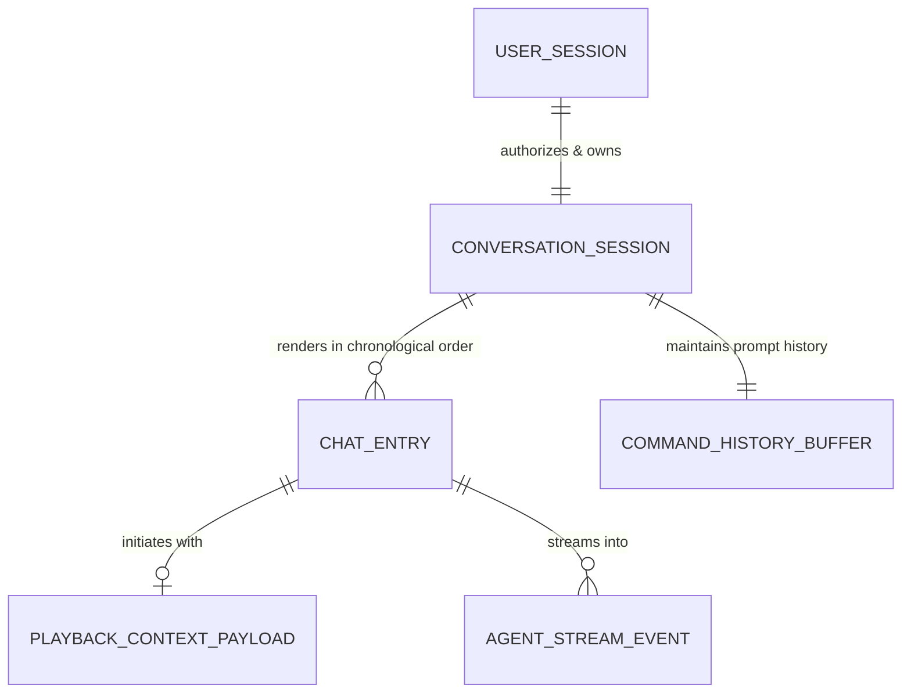
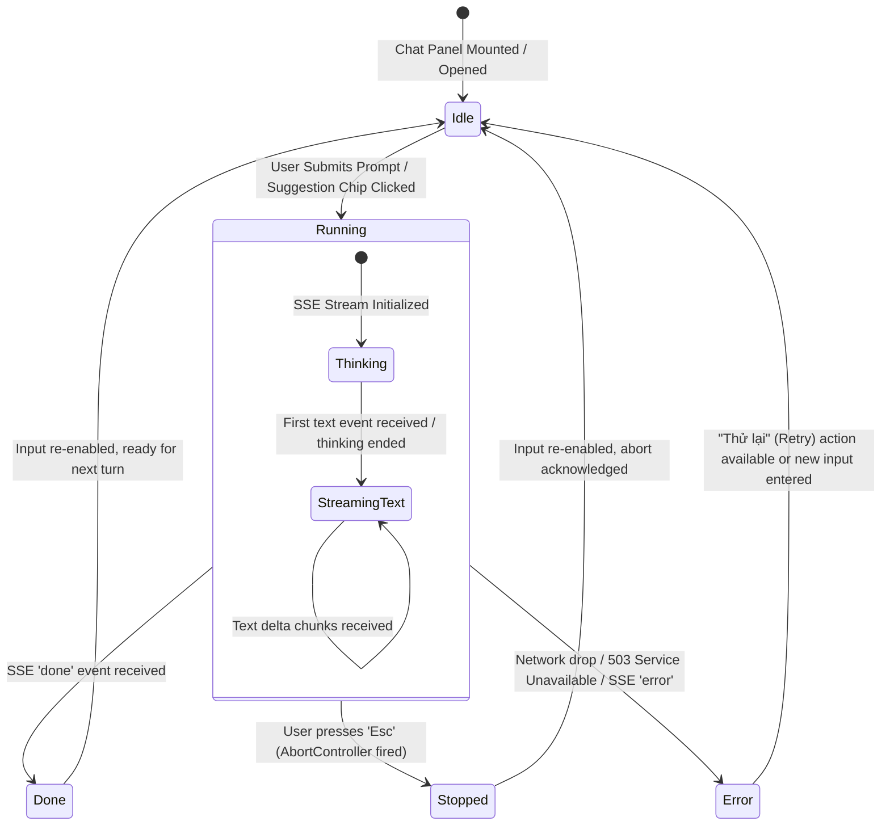
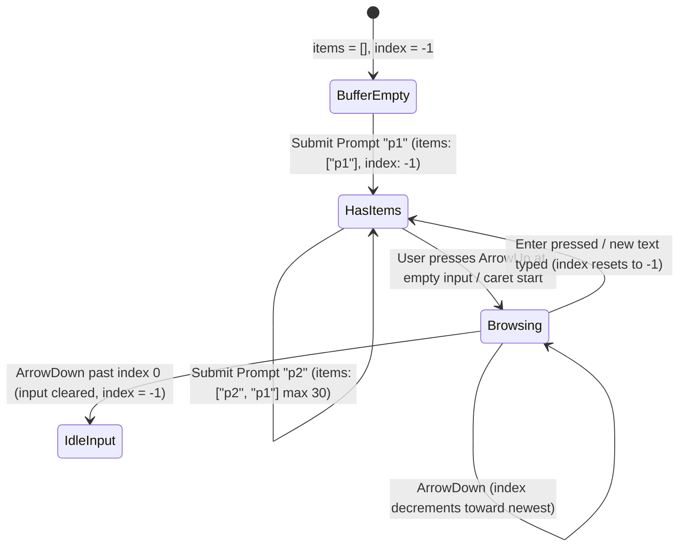

# Data Model: Conversational Interface (Feature 121)

## Overview

This document specifies the logical data model, entity structures, validation rules, state transitions, and memory lifecycle for **Feature 121: Conversational Interface** in AuraTune.

Per the specification clarifications (Session 2026-10-30 / 2026-11-01), the conversation lifecycle in v1 is designed as a **Session / In-Memory conversation model with command history**. Entities represent domain contracts, API stream schemas, and client component state structures rather than persistent PostgreSQL tables.

---

## 1. Domain Entities & Schemas

### 1.1. `UserSession` (Identity Boundary Entity)

Represents the authenticated listener session establishing the security perimeter under which conversation interactions occur.

| Field | Type | Required | Description | Validation / Constraints |
|---|---|---|---|---|
| `userId` | `UUID` | Yes | Unique identifier of the authenticated user. | Valid UUID, extracted from verified JWT token. |
| `role` | `String` | Yes | Account role: `"listener"`, `"artist"`, or `"admin"`. | Must be a recognized platform role. |
| `accessToken` | `String` | Yes | Bearer JWT access token. | Non-expired, signed by platform secret. |
| `isAuthenticated`| `Boolean` | Yes | Authentication state flag. | Must be `true` to access chat interface. |

---

### 1.2. `ConversationSession` (Active Conversation Model)

Represents the transient conversation thread active within the client's current session.

| Field | Type | Required | Description | Constraints |
|---|---|---|---|---|
| `sessionId` | `String` | Yes | Client-generated unique session identifier. | Prefix `cs-` followed by timestamp or UUID. |
| `userId` | `UUID` | Yes | Owning user identifier. | Must strictly match `UserSession.userId`. |
| `startedAt` | `Integer` | Yes | Unix timestamp (ms) when the session initialized. | Positive integer. |
| `entries` | `List<ChatEntry>` | Yes | Chronological list of dialogue log entries. | Default initialized to single `BannerEntry`. |
| `commandHistory`| `CommandHistoryBuffer` | Yes | In-memory prompt history for arrow navigation. | Maximum capacity: 30 items. |

---

### 1.3. `ChatEntry` (Polymorphic Dialogue Item)

The conversation display log consists of polymorphic entry items discriminated by `kind`.

#### 1.3.1. `BannerEntry` (`kind: 'banner'`)
Initial welcome banner displayed upon opening or after `/clear`.
- `id`: `String` (e.g., `"banner"` or `"banner-0"`)
- `kind`: `'banner'`

#### 1.3.2. `HelpEntry` (`kind: 'help'`)
Inline cheat sheet output generated when the user submits `/help`.
- `id`: `String` (e.g., `"help-1"`)
- `kind`: `'help'`

#### 1.3.3. `UserMessageEntry` (`kind: 'user'`)
Represents an individual message dispatched by the authenticated listener.
- `id`: `String` (e.g., `"user-2"`)
- `kind`: `'user'`
- `text`: `String` — Sanitized plain text content (1 to 500 characters, whitespace-trimmed)
- `sentAt`: `Integer` — Unix timestamp (ms)
- `deliveryStatus`: `'sending' | 'delivered' | 'failed'`

#### 1.3.4. `AgentRunEntry` (`kind: 'run'`)
Represents the AI host's response turn, containing live reasoning states and the streamed Markdown answer.
- `id`: `String` (e.g., `"run-3"`)
- `kind`: `'run'`
- `status`: `'running' | 'done' | 'stopped' | 'error'`
- `startedAt`: `Integer` — Unix timestamp (ms) when request started
- `endedAt`: `Integer | null` — Unix timestamp (ms) when generation completed or stopped
- `thinkingEndedAt`: `Integer | null` — Unix timestamp (ms) when reasoning transitioned to response streaming
- `thinking`: `List<String>` — Array of reasoning trace strings emitted by the AI service
- `text`: `String` — Markdown-formatted text response payload
- `error`: `String | null` — Error message description if status is `'error'`
- `retryPrompt`: `String | null` — Preserved original user prompt for inline retry

---

### 1.4. `PlaybackContextPayload` (Client-to-Server Request Body)

The contextual playback metadata transmitted with each prompt to `/api/v1/agent/chat`.

| Field | Type | Required | Description | Constraints |
|---|---|---|---|---|
| `prompt` | `String` | Yes | Listener prompt text. | Non-empty, 1-500 chars. |
| `context.currentTrack` | `Object` | Yes | Current track metadata. | `{ id, title, artist }` or `null` if idle. |
| `context.isPlaying` | `Boolean` | Yes | Audio playback state. | `true` if audio is playing, else `false`. |
| `context.volume` | `Integer` | Yes | Current master playback volume. | Integer between 0 and 100. |

---

### 1.5. `AgentStreamEvent` (Server-to-Client SSE Schema)

The event stream emitted by `POST /api/v1/agent/chat` (`Content-Type: text/event-stream`).

```typescript
type AgentStreamEvent =
  | { type: 'thinking'; text: string }
  | { type: 'text'; delta: string }
  | { type: 'error'; message: string; code?: string }
  | { type: 'done'; totalDurationMs: number };
```

---

## 2. Entity Relationships



---

## 3. State Machines & Transitions

### 3.1. Agent Run Lifecycle State Machine



### 3.2. In-Memory Command History Ring Buffer (`historyRef`)

The history buffer holds up to 30 past user prompts with circular or bounded index navigation.



---

## 4. Business Rules & Validation Constraints

1. **Prompt Validation**:
   - `prompt.trim().length >= 1` (reject empty or whitespace-only prompts; FR-006).
   - `prompt.length <= 500` characters (enforced via textarea `maxLength={500}`).
2. **Duplicate Submission Protection**:
   - Submissions are disabled while `running === true` (FR-005).
3. **Command Interception**:
   - If `prompt === '/clear'`, intercept client-side: reset `entries` to initial welcome banner; record command into history buffer; do NOT call backend (FR-008).
   - If `prompt === '/help'`, render inline shortcut cheat sheet entry; record into history buffer; do NOT call backend.
4. **Service Outage Invariant**:
   - If `store.aiAvailable === false`, the textarea is set to `disabled={true}`, header displays `● tạm ngưng`, and an amber alert notice is displayed (FR-009).
   - Audio playback in `PlayerContext` must remain completely untouched during all chat state mutations (FR-011).
5. **Account Isolation Invariant**:
   - When the user logs out (`store.currentUser === null`), the active conversation session is destroyed.
   - User B logging into the application starts with a pristine welcome banner; User B cannot access User A's dialogue entries or command history buffer (FR-010, SC-004).
