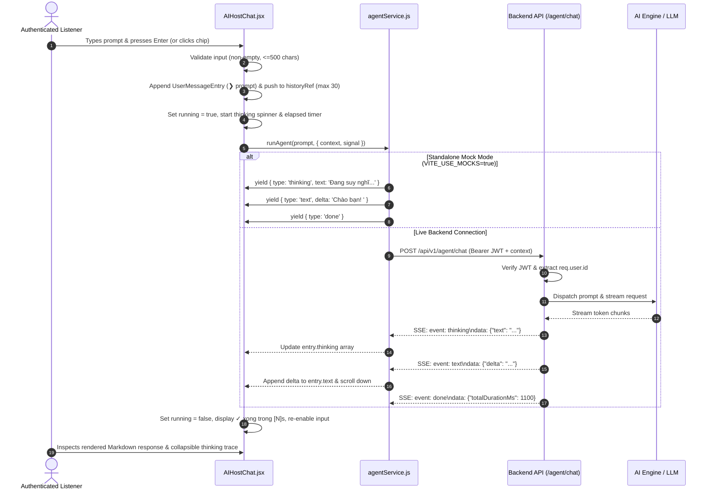

# Implementation Plan: Conversational Interface (Feature 121)

**Branch**: `feat/121-conversational-interface` | **Date**: 2026-11-03 | **Spec**: [spec.md](./spec.md)

**Input**: Feature specification from `/specs/120-ai-conversational-agent/121-conversational-interface/spec.md`

---

## 1. Summary

Feature 121 delivers the foundational **Conversational Interface** for the AuraTune AI Conversational Agent (Group 120). It provides authenticated listeners with a dedicated, floating terminal-style CLI dialogue space to converse directly with the AI music host.

The technical approach formalizes the existing frontend implementation in `src/frontend/src/components/chat/AIHostChat.jsx`, connecting it to a streaming Server-Sent Events (SSE) backend endpoint (`POST /api/v1/agent/chat`). The interface captures sanitized plain text prompts from listeners, provides immediate visual processing feedback (animated braille spinner `⠋`, rotating verbs, active elapsed seconds timer, and expandable reasoning traces), and incrementally renders streamed Markdown responses with a pulsating terminal cursor. Per the approved specification clarifications, conversational dialogue is managed via a **transient in-memory session lifecycle**, supporting instant visual resets via the `/clear` command and retaining up to 30 recent prompts navigable via the Up/Down arrow keys. The interface provides non-disruptive degradation during AI service suspension (`● tạm ngưng`) and ensures that all chat failures isolate completely from the background audio player.

---

## 2. Technical Context

**Language/Version**:
- Frontend: JavaScript (ES Modules, JSX, React 18), Node.js >= 18
- Backend: JavaScript / Node.js (ES Modules) or Python (FastAPI AI Service)
- Database: PostgreSQL (reference schema in `docs/design/database/README.md`)

**Primary Dependencies**:
- Frontend: React 18 (`react`, `react-dom`), Vite 5, Tailwind CSS 3, `lucide-react`, markdown rendering utility (`react-markdown` with `rehype-sanitize` or equivalent lightweight sanitizer)
- Backend: Express.js (or NestJS / FastAPI), SSE streaming middleware, `jsonwebtoken`
- Testing: Vitest, React Testing Library, Supertest

**Storage**:
- Client component memory: Active dialogue log (`entries` state) and prompt history ring buffer (`historyRef`, maximum 30 items)
- No database table persistence required for v1 conversation messages per explicit specification clarification (transient session model)

**Testing**:
- Unit Tests: Vitest for prompt sanitization, keyboard history navigation, `/clear` interceptor, and duration formatters
- Component Tests: React Testing Library for `AIHostChat.jsx` rendering, status states (`online` vs `tạm ngưng`), and thinking toggles
- Contract Tests: Supertest / API verification for `POST /api/v1/agent/chat` SSE stream and `GET /api/v1/agent/health`
- Non-regression Tests: Verified continuous audio streaming in `PlayerContext` during simulated chat errors and network drops

**Target Platform**:
- Modern desktop and mobile web browsers (Chrome, Edge, Firefox, Safari)

**Project Type**:
- Full-stack Web Application (Client UI component + HTTP SSE streaming backend endpoint)

**Performance Goals**:
- User can open the conversational interface and submit a prompt in < 5 seconds from navigation (SC-001)
- Active processing indicator rendered within **300ms** of prompt submission (SC-002)
- Streaming response time-to-first-token < 1 second on stable connection
- In 100% of AI service outage scenarios, audio playback continues with **zero interruption** (SC-005)

**Constraints**:
- Strict compliance with Vietnamese Personal Data Protection Decree 13/2023/ND-CP: account conversation isolation is non-negotiable (FR-010, SC-004)
- Session / In-memory conversation lifecycle only (FR-008). No persistent database tables for dialogue logs in v1
- Natural language music intent parsing is strictly delegated to Feature 122 (`122-music-intent-understanding`)
- Music playback actions (queue manipulation, volume control, playlist execution) are strictly delegated to Feature 123 (`123-real-time-music-assistance`)
- Zero disruption to background audio streaming and platform navigation (FR-011)

**Scale/Scope**:
- 1 feature (Feature 121) within Group 120. Floating terminal dialog component + 1 streaming REST endpoint (`POST /api/v1/agent/chat`).

---

## 3. Current Implementation Baseline vs Planned Work

| Component / Layer | What Currently Exists | What Will Be Implemented in Feature 121 | What Needs Future Confirmation |
|---|---|---|---|
| **Frontend UI Component** | Prototype `AIHostChat.jsx` in `src/frontend/src/components/chat/` featuring terminal dialog, suggestions, banner, help, and thinking spinner. | Polish `AIHostChat.jsx`: integrate safe Markdown rendering for AI responses (FR-007), inline delivery failure badge with "Thử lại" (Retry) action, and verified accessibility focus trap. | Future custom themes or docking modes (e.g. sidebar vs modal). |
| **Frontend Service Layer** | `src/frontend/src/utils/agentService.js` providing simulated async generator `runAgent()` yielding mock thinking and text events. | Formalize `agentService.js` to support HTTP SSE streaming via `fetch` + `ReadableStream` targeting `POST /api/v1/agent/chat`, with automatic fallback to mock generator when `VITE_USE_MOCKS=true`. | Reconnection retry backoff policies for dropped streams. |
| **Backend API** | Concept in `docs/design/architecture/system-architecture.md`; `src/backend` currently has `.gitkeep`. | `agentController.js` and `agentRoutes.js` mounting `POST /api/v1/agent/chat` (SSE stream) and `GET /api/v1/agent/health` with JWT verification. | Final backend framework selection (Express vs NestJS) for entire repository. |
| **External AI Integration** | Python AI Service concept in `docs/design/architecture/system-architecture.md`. | Backend proxy forwarder to AI service or local LLM provider adapter emitting chunked tokens. | External model provider choice (Gemini API vs OpenAI) and deployment credentials. |
| **Database** | Reference schema in `docs/design/database/README.md`. | **None required**. Feature 121 operates strictly in-memory per clarification (FR-008). | Optional future schema for persistent cross-session history if approved for v2. |

---

## 4. Constitution Check

Checking compliance against repository principles, Team Contract, Proposal, and Project Plan:

| Gate | Status | Notes |
|---|---|---|
| **No New Product Scope** | **PASS** | Scope strictly conforms to Feature 121 in `spec.md` and Proposal Section 6.12. Excludes music intent parsing (122) and player action execution (123). |
| **Group Ownership Boundary** | **PASS** | Group 120 (Nhựt) owns the AI Conversational Agent. Audio player (Huy, Group 040) and Auth (Khoa, Group 010) boundaries are strictly respected. |
| **Data Privacy & Isolation** | **PASS** | Authentication enforced via Bearer JWT. Chat state is memory-isolated; logout wipes all active entries and history buffers (FR-010). |
| **No Secrets Committed** | **PASS** | Zero credentials or API keys committed to source. |
| **Language & Conventions** | **PASS** | Documentation in English Markdown; diagrams in Mermaid; API conventions conform to repository OpenAPI 3.0 standards. |
| **Test-First & Verifiable** | **PASS** | Unit, component, contract, and edge-case testing plans defined in [quickstart.md](./quickstart.md) and Section 8. |

---

## 5. Project Structure

### Documentation (`specs/120-ai-conversational-agent/121-conversational-interface/`)

```text
specs/120-ai-conversational-agent/121-conversational-interface/
├── spec.md                          # Feature specification (Source of truth)
├── plan.md                          # This implementation plan
├── research.md                      # Phase 0 architectural research & decisions
├── data-model.md                    # Phase 1 data model & state machine
├── quickstart.md                    # Phase 1 validation scenarios
├── checklists/
│   └── requirements.md              # Quality checklist
├── contracts/
│   ├── README.md                    # Contract documentation
│   └── conversational-interface-api.json # OpenAPI 3.0.3 specification
└── ui/
    ├── 01-ai-host-closed.png
    ├── 02-ai-host-open.png
    ├── 03-conversation-history.png
    └── 06-ai-host-unavailable.png
```

### Source Code Layout (`src/`)

```text
src/
├── backend/
│   └── src/
│       ├── controllers/
│       │   └── agentController.js         # Handles POST /api/v1/agent/chat (SSE) & GET /health
│       ├── routes/
│       │   └── agentRoutes.js             # Route definitions for /api/v1/agent
│       ├── middlewares/
│       │   └── authMiddleware.js          # JWT verification & req.user assignment
│       └── services/
│           └── agentConversationService.js # Orchestrates prompt dispatch & token streaming
│
└── frontend/
    └── src/
        ├── components/
        │   └── chat/
        │       ├── AIHostChat.jsx         # Primary floating terminal panel component
        │       └── MarkdownRenderer.jsx   # Safe Markdown parser for AI responses (FR-007)
        ├── utils/
        │   ├── agentService.js            # Client-side SSE stream adapter & fetch reader
        │   └── aiMockData.js              # Standalone mock fallback for demo mode
        └── context/
            └── AppStore.jsx               # Global state for aiAvailable and currentUser
```

**Structure Decision**: Preserves the established `src/frontend` and `src/backend` separation. Builds upon existing component architecture in `AIHostChat.jsx` without adding unnecessary abstraction layers.

---

## 6. Architecture & Data Flow

### Architectural Overview

```mermaid
flowchart TD
    subgraph Client["Frontend Client (Browser)"]
        Trigger["TopBar / BottomPlayer Agent Button"]
        UI["AIHostChat.jsx (Terminal Panel)"]
        Markdown["MarkdownRenderer.jsx"]
        AgentService["agentService.js (SSE Fetch Reader)"]
        MockGenerator["aiMockData.js (Async Generator)"]
        Store["AppStore (aiAvailable, currentUser)"]
        PlayerCtx["PlayerContext (Background Audio Playback)"]
        Switch{"VITE_USE_MOCKS?"}

        Trigger -->|Toggle chatOpen| UI
        Store -.->|aiAvailable, auth state| UI
        UI --> AgentService
        AgentService --> Switch
        Switch -->|true| MockGenerator
        UI --> Markdown
    end

    subgraph Server["Backend API (/api/v1)"]
        Router["agentRoutes.js"]
        AuthGuard["authMiddleware.js (JWT)"]
        Controller["agentController.js"]
        ConvService["agentConversationService.js"]

        Switch -->|false (HTTP POST)| Router
        Router --> AuthGuard
        AuthGuard --> Controller
        Controller --> ConvService
    end

    subgraph AIService["AI Backend / LLM Host"]
        LLM["AI Model / Provider (Stream Response)"]
        ConvService -->|Internal SSE / Chunked Stream| LLM
    end

    UI -.->|Zero Interruption Invariant| PlayerCtx
```

### Detailed Sequence Flow



---

## 7. Technical Approach & Detailed Rules

### 7.1. Terminal / CLI Interface Alignment

The conversational UI reflects the shipped terminal design in `AIHostChat.jsx`:
1. **Container & Layout**:
   - Floating panel anchored at `bottom-[96px] right-2 top-2`, width `w-[calc(100%-1rem)] max-w-[460px]`, z-index 50 with dark backdrop blur.
   - Dark CLI theme (`bg-[#0c0d12]`, borders `sky-200/15`, monospace text `font-mono text-[12px]`).
2. **Header Bar**:
   - Brand logo (`auratune-mark.png`), title `AuraTune Agent`.
   - Dynamic status badge: `~/auratune · ● online` (emerald) when `aiAvailable = true`; `~/auratune · ● tạm ngưng` (amber) when `aiAvailable = false`.
   - Close button (`X`) and keyboard trap management.
3. **Log Stream (`role="log"`)**:
   - Auto-scrolls to the bottom upon receipt of user messages or stream chunks (`logRef.current.scrollTop = logRef.current.scrollHeight`).
   - Initial `BannerEntry`: Introductory text, example bullets, and `/help` shortcut pointer.
   - `HelpEntry`: Offline table of built-in shortcuts (`/help`, `/clear`, `↑ ↓`, `esc`, `y / n`).
   - `UserMessageEntry`: Prefixed with prompt chevron `<span className="text-sky-300">❯</span>`.
   - `AgentRunEntry`:
     - Thinking state: Animated braille spinner `⠋⠙⠹...`, rotating verbs (`"Đang suy nghĩ"`, `"Đang phân tích"`, `"Đang chọn giai điệu"`), elapsed timer in seconds, and `(esc để dừng)`.
     - Expandable thinking trace: Collapsible button (`✻ Đã suy nghĩ [N]s >`) revealing internal thought lines.
     - Streamed response: Rendered via `MarkdownRenderer.jsx` with a pulsating cursor block `█` during generation.
     - Completion badge: `✓ xong trong [N]s`.
     - Aborted state: `■ Đã dừng` when interrupted via `Esc`.
     - Error state: `✗ [error message]` with an inline "Thử lại" (Retry) action.
4. **Footer & Input Bar**:
   - Quick suggestion chips: Horizontally scrollable buttons (`"phát lofi chill để code"`, `"bài đang phát là gì?"`, etc.) disabled when running.
   - Textarea: Auto-expanding min-height `22px`, max-height `112px`, 500-character maximum length, placeholder reflecting state.
   - Shortcut hints: `⏎ gửi  ↑↓ lịch sử  esc dừng/đóng  /help`.

### 7.2. Safe Markdown Rendering (FR-007)

- AI responses are formatted in Markdown, supporting:
  - **Bold** (`**text**`) and *Italics* (`*text*`)
  - Bulleted lists (`- item` or `* item`) and numbered lists (`1. item`)
  - Inline code (`` `code` ``) and code blocks
  - Hyperlinks (`[label](url)`)
- Hyperlinks are sanitized to allow only `http:`, `https:`, or platform internal routes (`/`), and automatically render with `target="_blank"` and `rel="noopener noreferrer"`.
- User prompts are displayed strictly as escaped plain text to eliminate any Cross-Site Scripting (XSS) attack vector.

### 7.3. In-Memory Session Lifecycle, `/clear`, and Command History (FR-008)

1. **Session Scope**:
   - Conversation state lives in component memory (`entries` state array).
   - Reloading the page or logging out resets the conversation to its initial welcome state.
2. **Command Interception**:
   - When the user submits `/clear`:
     - The input is captured and added to the prompt history buffer.
     - `entries` state is reset to `[{ id: 'banner-0', kind: 'banner' }]`.
     - No network request is dispatched.
   - When the user submits `/help`:
     - The cheat sheet is appended to `entries` locally without network calls.
3. **Command History Navigation (`historyRef`)**:
   - Stores up to 30 unique recent prompts in reverse chronological order.
   - Navigable via `ArrowUp` (moving toward older commands) and `ArrowDown` (moving toward newer commands).
   - Pressing `ArrowDown` past the latest command restores an empty prompt field.

### 7.4. Non-Disruptive Failure Recovery & Audio Isolation (FR-009, FR-011)

1. **Pre-Flight Service Suspension**:
   - If `store.aiAvailable === false`, the terminal renders the amber status badge `● tạm ngưng`, an inline explanatory alert, and disables the prompt input textarea.
2. **In-Flight Network/Server Failure**:
   - If a connection drop, timeout, or HTTP 503 (`AI_SERVICE_UNAVAILABLE`) occurs, the active turn displays an inline error status (`✗ Lỗi kết nối đến AI Host`) with a "Thử lại" (Retry) button.
   - Clicking "Thử lại" re-dispatches the exact original prompt using the existing `runPrompt()` routine without requiring retyping.
3. **Strict Audio Playback Isolation**:
   - All chat network requests and React state transitions are decoupled from `PlayerContext`.
   - Audio playback continues completely uninterrupted across all chat actions, errors, or panel open/close events.

### 7.5. User Account Isolation (FR-001, FR-010)

1. **Authentication Verification**:
   - Guests attempting to access the AI Host panel are presented with an authentication challenge modal redirecting to `/login`.
2. **Zero Cross-Account Leakage**:
   - Conversation state and command history are bound strictly to the active component lifecycle.
   - When a user logs out (`store.currentUser = null`), component unmount purges all dialogue entries and history buffers from memory.
   - The backend API verifies the Bearer JWT and scopes all operations to `req.user.id`.

---

## 8. Testing Strategy

### 8.1. Unit & Component Tests

- **Input Validation & Sanitization**:
  - Empty string or whitespace-only inputs are rejected (submit inhibited).
  - Prompts exceeding 500 characters are capped or rejected.
  - HTML tags in user input (e.g. `<script>alert(1)</script>`) are escaped and rendered as text.
- **Command Interceptors**:
  - Submitting `/clear` resets `entries` to `[Banner]` without triggering `runAgent`.
  - Submitting `/help` appends `HelpEntry` without triggering `runAgent`.
- **Command History Buffer**:
  - Submitting 3 distinct prompts allows browsing with `ArrowUp` and `ArrowDown`.
  - History buffer is capped at exactly 30 items.
- **Markdown Rendering**:
  - AI responses with `**bold**`, `*italics*`, `- list item`, and `[link](https://...)` render appropriate HTML tags.
  - Malicious link protocols (e.g. `javascript:...`) are sanitized and stripped.
- **Cancellation (`AbortController`)**:
  - Triggering `Escape` while running aborts the generator stream and marks the turn as `■ Đã dừng`.

### 8.2. Integration & Contract Tests

- **Endpoint Contract Compliance**:
  - `POST /api/v1/agent/chat` with valid JWT returns HTTP 200 with `Content-Type: text/event-stream`.
  - Emits sequential `thinking`, `text`, and `done` events conforming to `conversational-interface-api.json`.
- **Authentication Guard**:
  - Request without `Authorization` header returns `401 Unauthorized` (`UNAUTHORIZED`).
- **Service Outage Simulation**:
  - When backend AI service returns 503, endpoint returns standard error envelope with `AI_SERVICE_UNAVAILABLE`.
  - Client displays inline retry action; background audio streaming continues without interruption.

### 8.3. Verification Walkthrough

All verification scenarios detailed in [`quickstart.md`](./quickstart.md) will be executed to guarantee complete fulfillment of Acceptance Scenarios (User Story 1 through 4) and Success Criteria (SC-001 through SC-005).

---

## 9. Risks & Technical Considerations

| Risk / Consideration | Severity | Mitigation Strategy |
|---|---|---|
| **Audio playback interruption during chat render spikes** | Critical | Isolate chat component state from `PlayerContext`. Profile React re-renders during high-frequency SSE token updates; debounce or batch token state updates if needed. |
| **XSS vulnerabilities in AI Markdown stream** | High | Use strict HTML sanitization (`rehype-sanitize`) on Markdown AST. Restrict links to safe protocols with `rel="noopener noreferrer"`. Plain text escaping for user inputs. |
| **Unresponsive UI during AI service outages or timeouts** | Medium | Enforce a strict 15-second client timeout via `AbortController`. Transition gracefully to an inline retry state with informative error notice. |
| **Cross-user chat retention on shared devices** | High | Maintain dialogue and command history strictly in component memory; purge entirely upon logout or session token expiration. |
| **Scope creep into music actions or intent classification** | Medium | Strictly adhere to feature boundaries: Feature 121 provides conversation UI & streaming only. Intent parsing and player tool execution belong to Features 122 and 123. |

---

## 10. Readiness for `/speckit.tasks`

This implementation plan satisfies all completion gates:
1. Requirements from `spec.md` are completely accounted for (FR-001 through FR-012, SC-001 through SC-005).
2. Interface contracts are fully defined in `contracts/` ([`conversational-interface-api.json`](./contracts/conversational-interface-api.json)).
3. Entity models, state machines, and schemas are defined in [`data-model.md`](./data-model.md).
4. Concrete runnable validation scenarios are documented in [`quickstart.md`](./quickstart.md).
5. Technical decisions, rationale, and alternatives are consolidated in [`research.md`](./research.md).
6. Frontend technical approach faithfully reflects the latest Group 120 UI implementation (`AIHostChat.jsx`).

Next phase: Execute `/speckit.tasks` to generate ordered, actionable implementation tasks for Feature 121.
