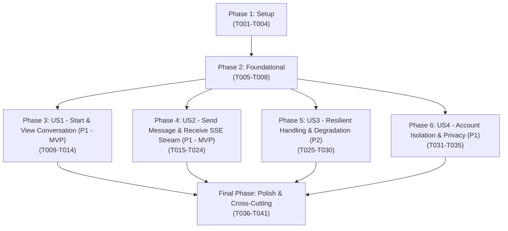

# Tasks: Conversational Interface (Feature 121)

**Branch**: `feat/121-conversational-interface` | **Group**: 120 – AI Conversational Agent (Owner: Lê Công Minh Nhựt)  
**Input**: Design documents from `specs/120-ai-conversational-agent/121-conversational-interface/` (`plan.md`, `spec.md`, `data-model.md`, `research.md`, `quickstart.md`, `contracts/conversational-interface-api.json`)  
**Prerequisites**: `plan.md` (required), `spec.md` (required for user stories), `data-model.md`, `research.md`, `contracts/conversational-interface-api.json`, `quickstart.md`

---

## Format: `[ID] [P?] [Story] Description with file path`

- **Checkbox**: `- [ ]` markdown checkbox
- **[P]**: Can run in parallel (different files, no dependencies on incomplete tasks)
- **[Story]**: User story identifier (`[US1]`, `[US2]`, `[US3]`, `[US4]`) for story-phase tasks; omitted for Setup, Foundational, and Polish phases
- **File Paths**: Explicit source file path included in every task

---

## Path Conventions

- **Backend**: `src/backend/` (Node.js / Express API server)
  - Config: `src/backend/config/`
  - Controllers: `src/backend/controllers/`
  - Middleware: `src/backend/middleware/`
  - Routes: `src/backend/routes/`
  - Services: `src/backend/services/`
  - Utils & Helpers: `src/backend/utils/`
  - Tests: `src/backend/tests/`
- **Frontend**: `src/frontend/` (React 18 / Vite 5 Client)
  - Components: `src/frontend/src/components/chat/`
  - Context & Store: `src/frontend/src/context/`
  - Utilities & Services: `src/frontend/src/utils/`
  - Tests: `src/frontend/tests/`

---

## Phase 1: Setup (Shared Infrastructure & Markdown Configuration)

**Purpose**: Initialize agent backend configuration, Server-Sent Events (SSE) response helpers, safe Markdown rendering utility, and client mock generators.

- [X] T001 Configure AI agent microservice environment settings and timeout thresholds (`AI_AGENT_SERVICE_URL`, `AGENT_TIMEOUT_MS=15000`) in `src/backend/config/agentConfig.js`.
- [X] T002 [P] Implement Server-Sent Events (SSE) stream helper and event formatter (`event: thinking`, `event: text`, `event: error`, `event: done`) in `src/backend/utils/sseResponse.js` enforcing schema in `contracts/conversational-interface-api.json`.
- [X] T003 [P] Implement safe Markdown rendering component in `src/frontend/src/components/chat/MarkdownRenderer.jsx` supporting bold (`**`), italics (`*`), bullet lists, code blocks, and sanitized hyperlinks (`http:`, `https:`, `/`) with `target="_blank"` and `rel="noopener noreferrer"` per FR-007.
- [X] T004 [P] Implement client-side async generator mock adapter in `src/frontend/src/utils/aiMockData.js` yielding realistic thinking states and Markdown delta chunks for zero-dependency standalone demo mode (`VITE_USE_MOCKS=true`).

---

## Phase 2: Foundational (Blocking Prerequisites)

**Purpose**: Core routing infrastructure, JWT authentication middleware, streaming controller skeleton, and frontend SSE stream reader that MUST be completed before ANY user story can begin.

**⚠️ CRITICAL**: No user story implementation can proceed until this phase is verified.

- [X] T005 Create agent conversation routing module in `src/backend/routes/agentRoutes.js` and mount `/api/v1/agent` in `src/backend/server.js`.
- [X] T006 [P] Verify and adapt JWT authentication middleware in `src/backend/middleware/authMiddleware.js` to protect `/api/v1/agent/chat`, rejecting unauthenticated requests with HTTP 401 (`UNAUTHORIZED`) per FR-001.
- [X] T007 [P] Implement agent conversation service coordinator in `src/backend/services/agentConversationService.js` managing LLM/provider streaming connection and token dispatching.
- [X] T008 [P] Implement frontend SSE stream client adapter in `src/frontend/src/utils/agentService.js` consuming `ReadableStream` from `POST /api/v1/agent/chat` with `AbortController` cancellation and fallback to `aiMockData.js` when `import.meta.env.VITE_USE_MOCKS === 'true'`.

**Checkpoint**: Foundation ready — routing module, auth guard, backend streaming service, and client SSE reader are established.

---

## Phase 3: User Story 1 - Start and View Conversation (Priority: P1) 🎯 MVP

**Goal**: Authenticated listeners can open the dedicated floating terminal dialog, view the initial welcome banner, navigate using keyboard shortcuts (Esc to close), and maintain accessibility focus trap.

**Independent Test**: Log in as an authenticated listener, click "AuraTune Agent" button in TopBar or BottomPlayer, verify floating terminal panel opens anchored at bottom right with emerald `● online` badge, pristine welcome banner (`kind: 'banner'`), suggestion chips, and prompt textarea automatically focused (SC-001).

### Tests for User Story 1

> **NOTE: Write these tests FIRST and ensure they FAIL before implementing component updates and controller routes.**

- [X] T009 [P] [US1] Create component test suite in `src/frontend/tests/components/AIHostChatOpen.test.jsx` verifying terminal panel mounting, header status rendering (`● online`), welcome banner appearance, and keyboard accessibility (Esc closing and focus restoration).
- [X] T010 [P] [US1] Create contract test suite in `src/backend/tests/contracts/agentHealthContract.test.js` validating `GET /api/v1/agent/health` returns HTTP 200 with `{ status: "online", latencyMs }` matching OpenAPI schema in `contracts/conversational-interface-api.json`.

### Implementation for User Story 1

- [X] T011 [US1] Implement health check handler `getAgentHealth` in `src/backend/controllers/agentController.js` and register `GET /health` in `src/backend/routes/agentRoutes.js`.
- [X] T012 [US1] Refactor container layout and header in `src/frontend/src/components/chat/AIHostChat.jsx` anchoring floating panel (`bottom-[96px] right-2 top-2`, max-width 460px), dark CLI theme, and dynamic status badge (`~/auratune · ● online` in emerald).
- [X] T013 [P] [US1] Implement welcome banner entry renderer (`BannerEntry`) and suggestion chips bar in `src/frontend/src/components/chat/AIHostChat.jsx` displaying intro bullets and quick starter prompts.
- [X] T014 [US1] Implement accessibility focus trap and global toggle triggers in `src/frontend/src/components/chat/AIHostChat.jsx` connecting to `chatOpen` state in `src/frontend/src/context/AppStore.jsx`.

**Checkpoint**: User Story 1 complete as initial MVP milestone. Panel opens cleanly with terminal theme and welcome state.

---

## Phase 4: User Story 2 - Send Message and Receive AI Response with Processing State (Priority: P1) 🎯 MVP

**Goal**: Authenticated listeners type text (1-500 chars), submit message, see immediate prompt echo with chevron `❯`, animated braille spinner `⠋`, elapsed seconds timer, collapsible reasoning trace, and real-time streamed Markdown response.

**Independent Test**: Type `"Xin chào, bạn có thể giúp gì cho mình?"` and press Enter; verify user message is appended immediately prefixed with `❯`, input is cleared and locked, animated braille spinner `⠋` rotates with active verbs, elapsed timer ticks, streamed Markdown tokens render with cursor `█`, auto-scroll keeps view anchored to bottom, and final completion badge `✓ xong trong [N]s` appears (SC-002, SC-003).

### Tests for User Story 2

> **NOTE: Write these tests FIRST and ensure they FAIL before implementing streaming handlers.**

- [X] T015 [P] [US2] Create unit test suite in `src/backend/tests/services/agentConversationService.test.js` validating prompt length validation (1-500 chars), whitespace trimming, rejection of empty prompts with HTTP 400 (`VALIDATION_ERROR`), and chunked token dispatching (FR-006).
- [X] T016 [P] [US2] Create contract test suite in `src/backend/tests/contracts/agentChatStreamingContract.test.js` validating that `POST /api/v1/agent/chat` opens a valid `text/event-stream` returning sequential `thinking`, `text`, and `done` events per `contracts/conversational-interface-api.json`.
- [X] T017 [P] [US2] Create frontend unit test suite in `src/frontend/tests/components/MarkdownRenderer.test.jsx` verifying safe rendering of bold, italics, bullet lists, code blocks, and sanitization of malicious script/javascript links (FR-007).

### Implementation for User Story 2

- [X] T018 [US2] Implement streaming endpoint handler `streamAgentChat` in `src/backend/controllers/agentController.js` validating input prompt (non-empty, 1-500 characters), extracting `currentTrack`, `isPlaying`, `volume` from request body, and setting SSE headers (`Content-Type: text/event-stream`, `Cache-Control: no-cache`, `Connection: keep-alive`).
- [X] T019 [US2] Implement token and thinking state streaming pipeline in `src/backend/services/agentConversationService.js` emitting SSE events (`event: thinking`, `event: text`, `event: done` with `totalDurationMs`).
- [X] T020 [US2] Register streaming route `router.post('/chat', authenticateToken, agentController.streamAgentChat)` in `src/backend/routes/agentRoutes.js`.
- [X] T021 [P] [US2] Implement prompt submission handler, input validation, and duplicate submission locking in `src/frontend/src/components/chat/AIHostChat.jsx` immediately appending `UserMessageEntry` with chevron `❯` and clearing textarea (FR-005, FR-006).
- [X] T022 [P] [US2] Implement animated processing indicator in `src/frontend/src/components/chat/AIHostChat.jsx` featuring rotating braille spinner `⠋⠙⠹...`, cycling thinking verbs, and real-time elapsed seconds timer (SC-002).
- [X] T023 [US2] Implement expandable reasoning trace accordion (`AgentRunEntry`) in `src/frontend/src/components/chat/AIHostChat.jsx` with toggle button (`✻ Đã suy nghĩ [N]s >`) displaying internal thinking lines.
- [X] T024 [US2] Integrate `MarkdownRenderer.jsx` and streaming text delta accumulation in `src/frontend/src/components/chat/AIHostChat.jsx` displaying pulsating cursor `█` during generation and auto-scrolling log view to bottom (FR-007, FR-012).

**Checkpoint**: User Story 2 complete. Core streaming dialogue is fully functional with rich Markdown responses and live reasoning states.

---

## Phase 5: User Story 3 - Resilient Handling of Message Delivery Failure and AI Unavailability (Priority: P2)

**Goal**: Ensure non-disruptive feedback during network failure or AI downtime; display inline error badge with "Thử lại" (Retry) action without losing entered prompt; display `● tạm ngưng` when `aiAvailable = false` with disabled input; guarantee zero interruption to background music playback.

**Independent Test**: Disconnect network or simulate HTTP 503 from `/agent/chat`; submit prompt; verify inline failure notice `✗ Lỗi kết nối đến AI Host` appears with clickable "Thử lại" button; set `aiAvailable = false`, verify amber badge `● tạm ngưng` renders with explanatory alert and disabled input; verify background audio continues streaming without interruption across all errors (SC-005, EF-01).

### Tests for User Story 3

- [X] T025 [P] [US3] Create resilience integration test in `src/frontend/tests/integration/agentAudioIsolation.test.jsx` verifying that simulated SSE stream network failures, HTTP 503 errors, and chat crashes do NOT pause, mutate, or interrupt active audio in `PlayerContext` (FR-011, SC-005).
- [X] T026 [P] [US3] Create frontend test in `src/frontend/tests/components/AIHostChatRetry.test.jsx` verifying inline error state rendering and "Thử lại" button re-dispatching the exact original prompt without retyping.

### Implementation for User Story 3

- [X] T027 [US3] Implement HTTP 503 (`AI_SERVICE_UNAVAILABLE`) error handler in `src/backend/controllers/agentController.js` and SSE `event: error` emitter when AI provider is unreachable or times out (> 15s).
- [X] T028 [US3] Implement inline failure status and "Thử lại" (Retry) handler in `src/frontend/src/components/chat/AIHostChat.jsx` preserving `retryPrompt` on failed turn and re-dispatching via `runPrompt()` on button click (FR-009).
- [X] T029 [P] [US3] Implement AI suspension state handling in `src/frontend/src/components/chat/AIHostChat.jsx` reading `aiAvailable` from `AppStore`, rendering status badge `~/auratune · ● tạm ngưng` (amber), inline explanatory notice, and disabling textarea input without stopping background music (FR-009, FR-011).
- [X] T030 [US3] Wrap `AIHostChat` component with a dedicated React `ErrorBoundary` in `src/frontend/src/components/chat/AIHostChat.jsx` isolating all chat render crashes completely from `PlayerContext` and the main application shell (FR-011).

**Checkpoint**: User Story 3 complete. System handles offline AI and connection drops with inline retries and complete audio playback isolation.

---

## Phase 6: User Story 4 - User Account Isolation and Conversation Privacy (Priority: P1)

**Goal**: Enforce strict account boundary isolation; protect chat endpoints with JWT Bearer; clear in-memory dialogue log and command history buffer on user logout; ensure zero cross-account data leakage per Decree 13/2023/NĐ-CP.

**Independent Test**: User A logs in, chats with AI host, verifies entries exist in terminal; User A logs out; verify `entries` state and `historyRef` buffer are completely purged; User B logs in, opens AI host, verifies pristine welcome banner appears with zero messages from User A (SC-004).

### Tests for User Story 4

- [X] T031 [P] [US4] Create security test suite in `src/backend/tests/security/agentAuthIsolation.test.js` validating that requests to `POST /api/v1/agent/chat` without a valid Bearer JWT return HTTP 401 `UNAUTHORIZED` (FR-001, FR-010, SC-004).
- [X] T032 [P] [US4] Create account isolation test in `src/frontend/tests/security/agentSessionPurge.test.jsx` verifying that logging out immediately resets `AIHostChat` entries to `BannerEntry` and clears the 30-item command history ring buffer.

### Implementation for User Story 4

- [X] T033 [US4] Enforce `authenticateToken` JWT guard on `src/backend/routes/agentRoutes.js`, extracting `req.user.id` and rejecting invalid or expired tokens with standard error envelope `{ success: false, message: "Phiên đăng nhập không hợp lệ hoặc đã hết hạn", error: { code: "UNAUTHORIZED" } }`.
- [X] T034 [US4] Implement unauthenticated visitor challenge handler in `src/frontend/src/components/chat/AIHostChat.jsx` prompting login and blocking chat dispatch for unauthenticated users (FR-001).
- [X] T035 [US4] Implement session wipe hook in `src/frontend/src/components/chat/AIHostChat.jsx` listening to `currentUser` changes in `src/frontend/src/context/AppStore.jsx`, automatically resetting `entries` to initial welcome banner and clearing `historyRef` on logout (FR-010).

**Checkpoint**: User Story 4 complete. Account isolation and privacy are enforced at API middleware and client lifecycle layers.

---

## Final Phase: Polish & Cross-Cutting Concerns

**Purpose**: Offline terminal commands (`/clear`, `/help`), 30-item command history ring buffer, in-flight cancellation via Esc, and quickstart scenario validation.

- [X] T036 [P] Implement `/clear` command interceptor in `src/frontend/src/components/chat/AIHostChat.jsx` resetting `entries` state to initial `BannerEntry` locally with zero network dispatch per FR-008.
- [X] T037 [P] Implement `/help` command handler in `src/frontend/src/components/chat/AIHostChat.jsx` rendering offline cheat sheet table (`/help`, `/clear`, `↑ ↓`, `esc`, `y / n`) without calling backend API.
- [X] T038 [P] Implement 30-item command history ring buffer in `src/frontend/src/components/chat/AIHostChat.jsx` supporting `ArrowUp` (older) and `ArrowDown` (newer) navigation, restoring empty input when navigating past index 0 (FR-008).
- [X] T039 [P] Implement in-flight turn abort via `Escape` key in `src/frontend/src/components/chat/AIHostChat.jsx` triggering `AbortController`, halting SSE reader, setting turn status to `■ Đã dừng`, and immediately re-enabling prompt input.
- [X] T040 [P] Update contract documentation and integration guide in `specs/120-ai-conversational-agent/121-conversational-interface/contracts/README.md` reflecting endpoints, request payload, SSE event schemas, error envelopes, and mock testing steps.
- [X] T041 Execute end-to-end verification covering all 8 validation scenarios in `specs/120-ai-conversational-agent/121-conversational-interface/quickstart.md` (Scenario 1: Authenticated open, Scenario 2: Send & stream, Scenario 3: Arrow history, Scenario 4: `/clear`, Scenario 5: `/help`, Scenario 6: `Esc` abort, Scenario 7: Outage handling, Scenario 8: Account isolation).

---

## Dependencies & Execution Order

### Phase Dependencies



### User Story Dependencies

- **User Story 1 (P1 - MVP)**: Can start immediately after Phase 2 (Foundational). Delivers container layout, welcome banner, and health check.
- **User Story 2 (P1 - MVP)**: Extends US1 with bidirectional prompt dispatch, SSE token streaming, thinking spinner, and Markdown rendering.
- **User Story 3 (P2)**: Builds upon US2 streaming pipeline to handle connection errors, inline retries, and AI service suspension (`● tạm ngưng`).
- **User Story 4 (P1)**: Enforces JWT authentication middleware on `/agent/chat` and binds session memory clearing to logout events.
- **Final Polish**: Depends on all stories being completed. Adds `/clear`, `/help`, arrow-key history buffer, `Esc` abort, and quickstart validation.

---

## Parallel Execution Examples

### User Story 1 Parallel Work

```bash
# Backend Developer A (Health Endpoint & Contract Test):
Task: T010 [P] [US1] Contract test in src/backend/tests/contracts/agentHealthContract.test.js
Task: T011 [US1] Health check handler in src/backend/controllers/agentController.js

# Frontend Developer B (Terminal Panel UI):
Task: T009 [P] [US1] Component test in src/frontend/tests/components/AIHostChatOpen.test.jsx
Task: T012 [US1] Terminal layout & header in src/frontend/src/components/chat/AIHostChat.jsx
Task: T013 [P] [US1] Welcome banner in src/frontend/src/components/chat/AIHostChat.jsx
```

### User Story 2 Parallel Work

```bash
# Backend Developer A (Streaming Endpoint & Token Dispatch):
Task: T015 [P] [US2] Unit test in src/backend/tests/services/agentConversationService.test.js
Task: T016 [P] [US2] Contract test in src/backend/tests/contracts/agentChatStreamingContract.test.js
Task: T018 [US2] Controller handler in src/backend/controllers/agentController.js
Task: T019 [US2] Streaming pipeline in src/backend/services/agentConversationService.js

# Frontend Developer B (UI Processing Feedback & Markdown):
Task: T017 [P] [US2] Markdown test in src/frontend/tests/components/MarkdownRenderer.test.jsx
Task: T021 [P] [US2] Input validation in src/frontend/src/components/chat/AIHostChat.jsx
Task: T022 [P] [US2] Braille spinner & timer in src/frontend/src/components/chat/AIHostChat.jsx
```

---

## Implementation Strategy

### MVP First (User Story 1 + User Story 2)

1. Complete **Phase 1: Setup** (agent config, SSE helper, Markdown renderer, mock adapter).
2. Complete **Phase 2: Foundational** (routing, auth guard, backend streaming service, client adapter).
3. Complete **Phase 3: User Story 1** (terminal panel, welcome banner, health check).
4. Complete **Phase 4: User Story 2** (SSE streaming, thinking spinner, Markdown answer).
5. **VALIDATE**: Run `quickstart.md` Scenario 1 & 2. Open panel, send prompt, verify braille spinner, elapsed timer, and streamed Markdown response. Deploy MVP.

### Incremental Delivery

1. **Sprint 1 (Foundation + Core Dialogue MVP)**: Setup + Foundational + User Story 1 + User Story 2.
2. **Sprint 2 (Security & Isolation)**: User Story 4 (JWT auth guard + memory wipe on logout per Decree 13/2023/NĐ-CP).
3. **Sprint 3 (Resilience & Edge Cases)**: User Story 3 (Inline error retry + AI suspension notice `● tạm ngưng` + audio isolation).
4. **Sprint 4 (Polish & Terminal Utilities)**: `/clear`, `/help`, 30-item arrow history buffer, `Esc` abort, and quickstart validation.

---

## Scope Boundaries & Prohibitions (Rule Check)

- **Permitted Scope**: Conversational interface container, SSE bidirectional streaming, processing feedback, safe Markdown rendering, in-memory command history, inline error retry, and audio isolation.
- **Prohibited Features**:
  - NO natural language music intent understanding (strictly reserved for Feature 122).
  - NO real-time music assistance or playback actions (strictly reserved for Feature 123).
  - NO PostgreSQL database tables for dialogue logs in v1 (transient in-memory session lifecycle only per FR-008).
  - NO audio playback engine modifications (strictly delegated to `PlayerContext` of Group 040).
- **Fault-Tolerance Invariants**:
  - Chat errors or AI outages MUST NOT interrupt, pause, or block background audio playback (FR-011, SC-005).
  - Inline error notice MUST provide a "Thử lại" action without requiring retyping (FR-009).
- **Security Invariants**:
  - User messages captured as plain text (XSS immunity).
  - AI responses rendered via sanitized Markdown component (FR-007).
  - Conversation log and command history wiped completely on logout (FR-010).
