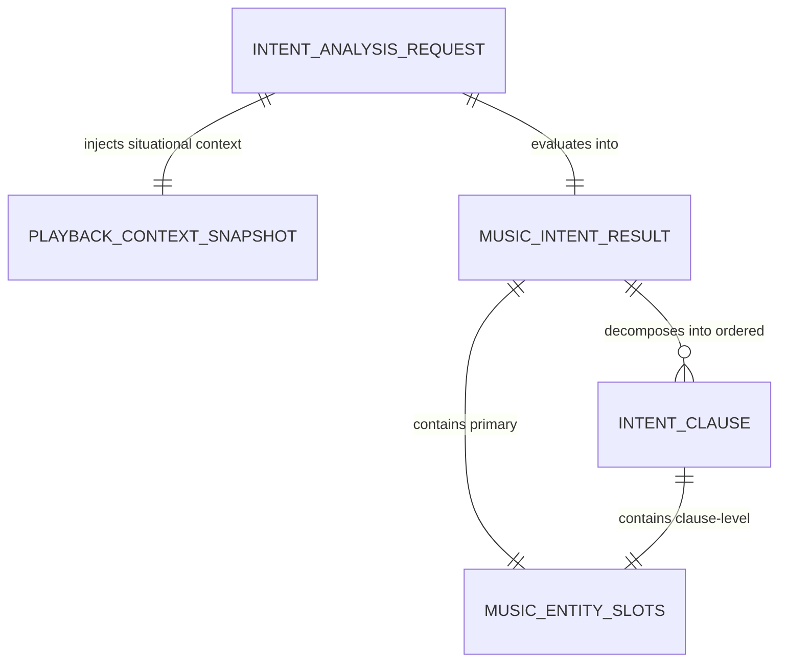

# Data Model: Music Intent Understanding (Feature 122)

## Overview

This document specifies the logical data model, entity structures, validation constraints, slot attributes, and processing state transitions for **Feature 122: Music Intent Understanding** in AuraTune.

Feature 122 is a computational and analytical feature operating within the AI Conversational Agent pipeline. It ingests conversational text and context snapshots, redacts PII, decomposes compound clauses, and generates structured intent results for the Centralized AI Agent Orchestrator. It does not introduce persistent database tables.

---

## 1. Domain Entities & Schemas

### 1.1. `IntentAnalysisRequest` (Input Payload)

Represents the raw message and situational context submitted to the intent understanding module.

| Field | Type | Required | Description | Constraints / Validation |
|---|---|---|---|---|
| `requestId` | `String` | Yes | Unique request tracking identifier. | Prefix `req-intent-` + timestamp or UUID. |
| `rawPrompt` | `String` | Yes | Natural language message text entered by the user. | Non-empty string, length 1–500 chars (FR-001). |
| `context` | `PlaybackContextSnapshot` | Yes | Active playback state snapshot. | Must be provided (can have null track if idle). |
| `userId` | `UUID` | Yes | Authenticated listener identifier. | Non-null, extracted from verified JWT session. |

---

### 1.2. `PlaybackContextSnapshot` (Contextual State)

Captures situational player attributes used to resolve deictic references (FR-004).

| Field | Type | Required | Description |
|---|---|---|---|
| `currentTrack` | `Object | null` | No | Active playing track metadata `{ id, title, artist }` or `null`. |
| `isPlaying` | `Boolean` | Yes | Whether the player is actively streaming audio. |
| `volume` | `Integer` | Yes | Master volume percentage (0–100). |
| `playlistId` | `String | null` | No | Identifier of the active playlist being played, if any. |

---

### 1.3. `MusicIntentResult` (Standardized Output DTO)

The canonical output delivered to the Centralized AI Agent Orchestrator (FR-007).

| Field | Type | Required | Description | Values / Constraints |
|---|---|---|---|---|
| `requestId` | `String` | Yes | Matching input request ID. | String. |
| `intentType` | `String` | Yes | Primary classified intent category (FR-002). | `"play_music"`, `"search_music"`, `"query_music_info"`, `"manage_library"`, `"general_chitchat"`, `"unknown"` |
| `confidenceScore` | `Float` | Yes | Normalized confidence score (FR-006). | `0.00` to `1.00`. |
| `completenessStatus` | `String` | Yes | Parameter completeness indicator (FR-005). | `"complete"`, `"missing_parameters"`, `"ambiguous"` |
| `extractedEntities` | `MusicEntitySlots` | Yes | Map of recognized musical slot tokens (FR-003). | Structured object. |
| `clauses` | `List<IntentClause>` | Yes | Array of decomposed sequential clauses (FR-005). | Length >= 1. |
| `suggestedAction` | `String` | Yes | Recommended downstream dispatch destination. | `"real_time_assistance"`, `"search_service"`, `"recommendation_service"`, `"dialogue_response"`, `"unrecognized_fallback"` |
| `inferredDefaults` | `Object | null` | No | Metadata on heuristics applied when slots were missing. | Null if parameters were explicitly provided. |
| `sanitizedPrompt` | `String` | Yes | Text after PII stripping (FR-008). | Free of email, phone, and passwords. |

---

### 1.4. `MusicEntitySlots` (Extracted Parameter Slots)

Represents domain entity parameters extracted from user language (FR-003).

| Slot Name | Type | Description | Example Extracted Value |
|---|---|---|---|
| `songTitle` | `String | null` | Recognized song title token. | `"Chúng ta của hiện tại"`, `"Nơi này có anh"` |
| `artistName` | `String | null` | Recognized artist or band name. | `"Sơn Tùng M-TP"`, `"Đen Vâu"`, `"Ngọt"` |
| `albumTitle` | `String | null` | Recognized album name. | `"Ánh Sáng"`, `"25"` |
| `genre` | `String | null` | Musical genre. | `"lofi"`, `"indie"`, `"pop"`, `"rap"` |
| `mood` | `String | null` | Mood or emotional state. | `"chill"`, `"vui vẻ"`, `"buồn"`, `"năng lượng"` |
| `activity` | `String | null` | Activity or situational context. | `"học bài"`, `"chạy bộ"`, `"ngủ"`, `"làm việc"` |
| `lyricsSnippet` | `String | null` | Fragment of lyrics for search. | `"nụ cười em như nắng mai"` |
| `controlAction` | `String | null` | Direct player control action. | `"play"`, `"pause"`, `"resume"`, `"next"`, `"previous"`, `"set_volume"`, `"like_track"`, `"clear_queue"`, `"navigate"` |
| `volumeLevel` | `Integer | null`| Target volume percentage (0–100). | `40`, `80` |
| `playlistName` | `String | null` | Target playlist name for library actions. | `"Nhạc yêu thích"`, `"Chill cuối tuần"` |
| `targetTrackId` | `String | null` | Context-resolved track identifier. | UUID or slug resolved from `currentTrack`. |

---

### 1.5. `IntentClause` (Sequential Clause Plan)

Represents an individual action unit resulting from compound instruction decomposition (FR-005).

| Field | Type | Description |
|---|---|---|
| `clauseIndex` | `Integer` | 0-based execution order index. |
| `rawClauseText` | `String` | Substring of the clause (e.g. `"giảm âm lượng 40%"`). |
| `intentType` | `String` | Intent category for this specific clause. |
| `extractedEntities` | `MusicEntitySlots` | Extracted slots specific to this clause. |
| `suggestedAction` | `String` | Routing destination for this clause. |

---

## 2. Entity Relationships



---

## 3. Processing State Machine

```mermaid
stateDiagram-v2
    [*] --> IngestRawPrompt: Receive (prompt, context, user)
    
    IngestRawPrompt --> SanitizePII: Execute Regex Sanitizer (FR-008)
    note right of SanitizePII: Redacts email, phone, passwords (Decree 13/2023/ND-CP)
    
    SanitizePII --> ClauseDecomposition: Split on delimiters (',', 'rồi', 'sau đó')
    
    ClauseDecomposition --> EvaluateClauses: Process each clause sequentially
    
    state EvaluateClauses {
        [*] --> TryTier1LLM: Send to Primary LLM Parser
        TryTier1LLM --> ClassifyAndExtract: Parse response (intent, slots, confidence)
        TryTier1LLM --> Tier2Fallback: Timeout (>1200ms) or Network Error (FR-010)
        Tier2Fallback --> ClassifyAndExtract: Execute Regex/Keyword Plan (planClause)
        
        ClassifyAndExtract --> ResolveContext: Bind "bài này", "to lên/nhỏ lại" via context (FR-004)
        ResolveContext --> ApplyDefaults: Check missing slots; apply trending/recs (FR-005)
    }
    
    EvaluateClauses --> BuildStructuredResult: Assemble MusicIntentResult & clauses (FR-007)
    BuildStructuredResult --> DispatchToOrchestrator: Forward to Centralized Orchestrator
    DispatchToOrchestrator --> [*]: Ready for Real-Time Execution (123) / Search / Dialog
```

---

## 4. Business Rules & Validation Constraints

1. **PII Redaction Invariant (FR-008)**:
   - Any string matching email (`\S+@\S+\.\S+`) or phone (`(?:\+84|0)\d{9,10}`) must be stripped or masked before the text leaves the system perimeter.
2. **Intent Category Exhaustiveness (FR-002)**:
   - Every clause MUST be classified into exactly one of: `play_music`, `search_music`, `query_music_info`, `manage_library`, `general_chitchat`, or `unknown`.
3. **Compound Decomposition Precedence (FR-005)**:
   - Chained clauses are ordered strictly in chronological left-to-right sequence as spoken by the user.
4. **Smart Default Invariant (FR-005)**:
   - If `intentType === "play_music"` and all track/artist/playlist slots are null, the system must NOT prompt "Bạn muốn nghe gì?" but rather assign `inferredDefaults.default_source = "personalized_or_trending"`.
5. **Separation of Concerns Invariant (FR-012)**:
   - Under no circumstances shall Feature 122 invoke player APIs or directly mutate UI state. It is strictly an intent classification and parameter extraction service.
