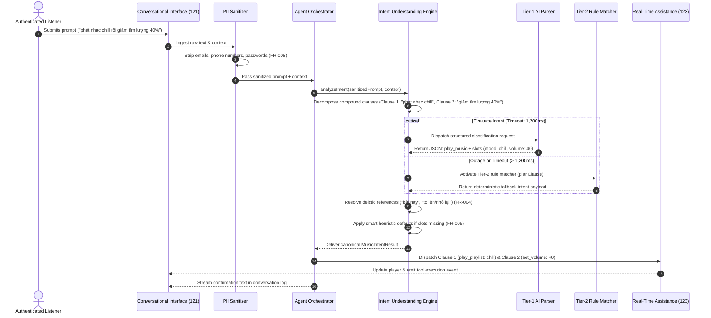

# Implementation Plan: Music Intent Understanding (Feature 122)

**Branch**: `feat/122-music-intent-understanding` | **Date**: 2026-11-03 | **Spec**: [spec.md](./spec.md)

**Input**: Feature specification from `/specs/120-ai-conversational-agent/122-music-intent-understanding/spec.md`

---

## 1. Summary

Feature 122 establishes the **Music Intent Understanding** engine for the AuraTune AI Conversational Agent (Group 120). It analyzes natural language conversational messages dispatched by authenticated listeners to identify underlying musical intents and extract structured domain entity parameters.

The technical approach implements a **Two-Tier Hybrid Architecture**:
1. **Tier 1 (Primary NLP)**: External LLM / Python AI Service endpoint returning a validated JSON schema with intent classification, confidence scores, and extracted entity slots.
2. **Tier 2 (Deterministic Rule-Based Fallback)**: High-speed local regex and keyword parser (formalizing `planClause` from `src/frontend/src/utils/agentService.js`) ensuring zero-failure resilience if the external AI service times out (> 1,200ms) or becomes unreachable.

Prior to external processing, a strict pre-processing pipeline sanitizes and scrubs all Personal Identifiable Information (emails, phone numbers, passwords) in compliance with Vietnamese Decree 13/2023/ND-CP. The engine decomposes compound chained requests (e.g., *"phát nhạc chill rồi giảm âm lượng 40%"*) into ordered sequential clauses, resolves situational references against active playback context (*"bài này"*, *"ca sĩ này"*, relative volume shifts), applies smart heuristic defaults for vague commands (*"bật nhạc đi"*), and delivers the canonical structured payload to the **Centralized AI Agent Orchestrator**. In strict adherence to FR-012, Feature 122 decouples language understanding from execution: it does NOT mutate player state or render chat UI components.

---

## 2. Technical Context

**Language/Version**:
- Frontend / Middleware: JavaScript (ES Modules, Node.js >= 18)
- Backend API / AI Service: JavaScript / Node.js (ES Modules) or Python 3.11 (FastAPI)
- Data Schemas: OpenAPI 3.0.3, JSON Schema / Zod validation

**Primary Dependencies**:
- Frontend: `src/frontend/src/utils/agentService.js` (parser & clause planner), `aiMockData.js`
- Backend: Express.js (or NestJS / FastAPI), PII regex sanitizer, `jsonwebtoken`
- Testing: Vitest, React Testing Library, Supertest

**Storage**:
- In-memory computational pipeline: Context snapshots and intent payloads are transiently processed during message handling.
- No persistent database tables required for intent evaluation logs.

**Testing**:
- Unit Tests: Vitest for regex token extraction, PII scrubber masking, compound clause delimiter splitting, and relative volume math
- Accuracy Benchmark: Automated benchmark test suite evaluating >= 90% classification accuracy across all 5 supported intent categories (SC-001)
- Contract Tests: Supertest verifying endpoint schema conformity against [`music-intent-understanding-api.json`](./contracts/music-intent-understanding-api.json)
- Resilience & Fault Isolation Tests: Simulated AI timeouts (> 1,200ms) verifying instant fallback to Tier 2 with continuous audio playback (SC-005)

**Target Platform**:
- Server-side runtime (Node.js / Python) and client-side edge evaluation

**Project Type**:
- Analytical AI / Natural Language Understanding Service Pipeline

**Performance Goals**:
- Intent analysis completed and structured result produced within **1,200 milliseconds** (SC-002)
- Intent classification accuracy >= **90%** across benchmark dataset (SC-001)
- Sensitive PII stripped in **100%** of test cases (SC-003)
- Background audio streaming continuity maintained in **100%** of error/timeout scenarios (SC-005)

**Constraints**:
- Strict compliance with Vietnamese Decree 13/2023/ND-CP: PII must never be transmitted across untrusted network boundaries (FR-008)
- Scope bounded strictly to 5 supported intent categories (FR-002)
- Must NOT execute player actions, mutate player state, or render chat UI directly (FR-012); execution belongs to Feature 123 (`123-real-time-music-assistance`)
- Semantic vector search execution belongs to Group 030 (`033-semantic-vector-search`)
- Conversational terminal UI rendering belongs to Feature 121 (`121-conversational-interface`)

**Scale/Scope**:
- 1 feature (Feature 122) within Group 120. Intent classification pipeline + 1 REST analytical endpoint (`POST /api/v1/agent/intent/analyze`).

---

## 3. Current Implementation Baseline vs Planned Work

| Component / Layer | What Currently Exists | What Will Be Implemented in Feature 122 | What Needs Future Confirmation |
|---|---|---|---|
| **Client Intent Planner** | Prototype `planClause(text, context)` in `src/frontend/src/utils/agentService.js` matching track queries, volume, playback actions, and mood tags. | Refactor and elevate `planClause` into Tier-2 deterministic fallback parser; add compound clause splitter; add PII scrubber. | Final packaging (shared npm package vs utility module). |
| **PII Sanitizer** | None. Raw prompts currently flow directly into client routines. | Implement pre-processing regex pipeline scrubbing emails, phone numbers, and credentials before network transmission (FR-008). | Specific regulatory reporting requirements if PII breaches occur. |
| **Backend Intent Endpoint** | Architectural concept in `system-architecture.md`. `src/backend` has `.gitkeep`. | `intentController.js` and `intentRoutes.js` implementing `POST /api/v1/agent/intent/analyze` with JWT guard and timeout wrapper (1,200ms). | Backend framework selection (Express vs NestJS vs FastAPI). |
| **External AI Parsing (Tier 1)** | Simulated async generator in `agentService.js` using mock recommendations. | Integration with backend Python AI Service or LLM adapter generating structured JSON function-calling payloads. | Model choice (Gemini Flash vs OpenAI) and production API quota limits. |
| **Centralized Orchestrator** | Direct inline execution inside `AIHostChat.jsx` / `agentService.js`. | Formalize Centralized AI Agent Orchestrator contract routing structured intent payloads to Feature 123 or Dialogue Responder. | Future asynchronous queue-based intent routing if needed. |

---

## 4. Constitution Check

Checking compliance against repository principles, Team Contract, Proposal, and Project Plan:

| Gate | Status | Notes |
|---|---|---|
| **No New Product Scope** | **PASS** | Strictly satisfies Feature 122 in `spec.md` and Proposal Section 6.12. Bounded to 5 intent categories; excludes player action execution (123). |
| **Group Ownership Boundary** | **PASS** | Group 120 (Nhựt) owns Music Intent Understanding. Does not duplicate Search (Đăng, Group 030) or Core Player (Huy, Group 040). |
| **Data Privacy & Isolation** | **PASS** | Mandatory local PII scrubber before outbound transmission (FR-008); strictly isolated by authenticated user session (FR-009). |
| **No Secrets Committed** | **PASS** | Zero credentials or API keys hardcoded or committed to git. |
| **Language & Conventions** | **PASS** | Documentation in English Markdown; diagrams in Mermaid; API conventions follow repository OpenAPI 3.0 standards. |
| **Test-First & Verifiable** | **PASS** | Unit, benchmark accuracy (>= 90%), and edge-case testing plans defined in [quickstart.md](./quickstart.md) and Section 8. |

---

## 5. Project Structure

### Documentation (`specs/120-ai-conversational-agent/122-music-intent-understanding/`)

```text
specs/120-ai-conversational-agent/122-music-intent-understanding/
├── spec.md                          # Feature specification (Source of truth)
├── plan.md                          # This implementation plan
├── research.md                      # Phase 0 architectural research & decisions
├── data-model.md                    # Phase 1 data model & state machine
├── quickstart.md                    # Phase 1 validation scenarios
├── checklists/
│   └── requirements.md              # Quality checklist
├── contracts/
│   ├── README.md                    # Interface contract documentation
│   └── music-intent-understanding-api.json # OpenAPI 3.0.3 specification
└── ui/
    ├── 01-ai-host-closed.png
    ├── 02-ai-host-open.png
    ├── 03-conversation-history.png
    └── 06-ai-host-unavailable.png
```

### Source Code Layout (`src/`)

```text
src/
├── backend/
│   └── src/
│       ├── controllers/
│       │   └── intentController.js        # Handles POST /api/v1/agent/intent/analyze
│       ├── routes/
│       │   └── intentRoutes.js            # Route mounting for intent analyzer
│       ├── services/
│       │   ├── intentUnderstandingService.js # Orchestrates Tier 1 LLM & Tier 2 Fallback
│       │   ├── piiSanitizerService.js     # Regex scrubber for emails, phones, passwords
│       │   └── clauseDecompositionService.js # Splits compound conjunctions
│       └── middlewares/
│           └── authMiddleware.js          # JWT verification & req.user assignment
│
└── frontend/
    └── src/
        └── utils/
            ├── agentService.js            # Client-side agent orchestrator & Tier-2 rule matcher
            ├── piiSanitizer.js            # Client-side edge sanitizer
            └── aiMockData.js              # Mock fallback intent data
```

**Structure Decision**: Preserves clean separation between analytical intent classification (`intentUnderstandingService.js`) and client-side conversational interaction. Reuses established patterns from Feature 121.

---

## 6. Architecture & Data Flow

### Architectural Overview

```mermaid
flowchart TD
    subgraph Client["Frontend Client (Browser)"]
        UI["Conversational Interface (AIHostChat.jsx)"]
        ClientSanitizer["Edge PII Sanitizer (piiSanitizer.js)"]
        ClientOrchestrator["Agent Orchestrator (agentService.js)"]
        LocalRuleMatcher["Tier-2 Fallback Matcher (planClause)"]
        
        UI -->|Raw Message + Context| ClientSanitizer
        ClientSanitizer -->|Sanitized Prompt| ClientOrchestrator
    end

    subgraph Server["Backend API (/api/v1)"]
        Router["intentRoutes.js"]
        AuthGuard["authMiddleware.js (JWT)"]
        IntentService["intentUnderstandingService.js"]
        ClauseDecomposer["clauseDecompositionService.js"]
        TimeoutGuard{"Response < 1200ms?"}
        
        ClientOrchestrator -->|HTTP POST /agent/intent/analyze| Router
        Router --> AuthGuard
        AuthGuard --> IntentService
        IntentService --> ClauseDecomposer
        ClauseDecomposer --> TimeoutGuard
    end

    subgraph AIService["Python AI Service / LLM Provider"]
        LLMParser["Tier-1 LLM Intent Parser (Function Calling)"]
        TimeoutGuard -->|Yes (Normal)| LLMParser
    end

    subgraph Downstream["Downstream Execution Targets"]
        Assistance["Feature 123 (Real-Time Music Assistance)"]
        Search["Group 030 / 100 (Search / Recommendations)"]
        Dialogue["Feature 121 (Conversational Stream)"]
    end

    TimeoutGuard -->|No (Timeout / Error)| LocalRuleMatcher
    LLMParser -->|Structured Intent JSON| ClientOrchestrator
    LocalRuleMatcher -->|Fallback Intent JSON| ClientOrchestrator
    
    ClientOrchestrator -->|play_music, manage_library| Assistance
    ClientOrchestrator -->|search_music| Search
    ClientOrchestrator -->|query_music_info, general_chitchat| Dialogue
```

### Detailed Sequence Flow



---

## 7. Technical Approach & Detailed Rules

### 7.1. Supported Intent Categories & Taxonomy (FR-002)

Every message clause is mapped into one of five official categories:

| Intent Category | Scope & Semantic Triggers | Example User Phrases | Suggested Action |
|---|---|---|---|
| `play_music` | Direct song/artist/album playback; playback control (play, pause, resume, skip, previous, set_volume, clear_queue). | *"bật bài Cắt Đôi Nỗi Sầu"*, *"phát nhạc Đen Vâu"*, *"dừng nhạc"*, *"chuyển bài"*, *"cho nhỏ volume"* | `real_time_assistance` |
| `search_music` | Music discovery by mood, situational activity, genre, or partial lyrics snippet. | *"tìm nhạc chill để code"*, *"nhạc gì vui vui tập gym"*, *"bài nào có lời 'nụ cười em như nắng mai'"* | `search_service` / `recommendation_service` |
| `query_music_info` | Metadata and trivia inquiries regarding active track, artist bio, album details. | *"bài này tên gì?"*, *"ai hát bài này?"*, *"ca sĩ này bao nhiêu tuổi?"* | `dialogue_response` |
| `manage_library` | Library actions executed through conversation (like song, follow artist, create playlist, add to playlist). | *"thích bài này"*, *"lưu bài hát vào playlist chill"*, *"follow ca sĩ này"* | `real_time_assistance` |
| `general_chitchat` | Greetings, small-talk, off-topic conversational queries unrelated to music operations. | *"chào bạn"*, *"hôm nay thời tiết đẹp không?"*, *"bạn là ai?"* | `dialogue_response` |

If a message cannot be classified with confidence >= 0.50, it is labeled `unknown` with `completenessStatus: "ambiguous"` and `suggestedAction: "unrecognized_fallback"`.

### 7.2. Two-Tier Hybrid Architecture (FR-010, SC-002, SC-005)

1. **Tier 1 (External AI Parser)**:
   - Uses a prompt-engineered LLM function calling schema:
     `classify_music_intent(intent_type, confidence, slots, clauses, suggested_action)`.
   - Provides rich extraction for unstructured natural language and bilingual Vietnamese/English inputs.
2. **Tier 2 (Deterministic Rule Matcher)**:
   - Built with deterministic regular expressions operating on NFC-normalized text (elevating `planClause` in `agentService.js`).
   - Hardcoded regex patterns for:
     - Track inquiry: `/(bai (nay|dang phat) (la )?(bai )?gi|ai hat|ca si nao)/`
     - Volume adjustment: `/(?:am luong|volume)\D{0,10}(\d{1,3})/`, `/(giam am luong|nho lai)/`, `/(tang am luong|to len)/`
     - Playback controls: `/^(tam dung|pause|dung)/`, `/^(tiep tuc|resume)/`, `/^(bai tiep|next|skip)/`, `/^(bai truoc|previous)/`
     - Library controls: `/^(thich|tha tim|like|luu)/`, `/(xoa|don) (het )?hang cho/`
     - Mood recommendations: `/^(phat|mo|nghe|bat)\b/` matching mood keywords (`chill`, `lofi`, `vui`, `nang luong`).
3. **Failover Invariant**:
   - Tier 1 network call is wrapped in a strict 1,200ms `AbortSignal`.
   - If aborted or failing, Tier 2 runs synchronously in < 5ms. Zero downtime, zero application crash.

### 7.3. PII Pre-Sanitization Pipeline (FR-008, SC-003)

Before any message text is transmitted to Tier 1 external AI services:
1. **Email pattern**: `/\b[A-Za-z0-9._%+-]+@[A-Za-z0-9.-]+\.[A-Za-z]{2,}\b/g` -> `[EMAIL_REDACTED]`
2. **Phone pattern**: `/(?:\+84|0)(?:3[2-9]|5[6|8|9]|7[0|6-9]|8[1-9]|9[0-9])\d{7}\b/g` -> `[PHONE_REDACTED]`
3. **Password pattern**: `/(?:m[ậa]t kh[ẩa]u|password|token)\s*[:=]?\s*\S+/gi` -> `[CREDENTIAL_REDACTED]`

All musical entities remain unmasked. Scrubbed strings are preserved in `sanitizedPrompt`.

### 7.4. Compound Instruction & Sequential Clause Decomposition (FR-005)

1. Prompts are evaluated against compound conjunction delimiters:
   `/\s*(?:[,;]|\s+rồi\s+|\s+sau đó\s+|\s+tiếp theo\s+)\s*/i`
2. Each segmented clause string is analyzed sequentially.
3. For example: *"phát nhạc lofi rồi giảm âm lượng 30%"*
   - Clause 0: `"phát nhạc lofi"` -> `intent: "play_music", mood: "lofi"`
   - Clause 1: `"giảm âm lượng 30%"` -> `intent: "play_music", controlAction: "set_volume", volumeLevel: 30`
4. The Centralized Orchestrator receives `clauses: [Clause 0, Clause 1]` and coordinates ordered execution.

### 7.5. Contextual Reference Resolution (FR-004)

- The request includes `context: { currentTrack, isPlaying, volume }`.
- When deictic tokens are detected:
  - *"bài này"*, *"bài đang phát"* -> mapped to `context.currentTrack.id` and `context.currentTrack.title`.
  - *"ca sĩ này"* -> mapped to `context.currentTrack.artist`.
  - *"nhỏ lại"* -> computes `volumeLevel = Math.max(0, context.volume - 20)`.
  - *"to lên"* -> computes `volumeLevel = Math.min(100, context.volume + 20)`.

### 7.6. Smart Heuristic Defaults for Incomplete Commands (FR-005)

- If `intentType === "play_music"` and all entity slots (`songTitle`, `artistName`, `playlistName`, `mood`, `genre`) are null (e.g., *"bật nhạc lên"*, *"muốn nghe nhạc"*):
  - Do NOT stop and ask clarifying questions.
  - Set `completenessStatus = "missing_parameters"`.
  - Set `inferredDefaults = { targetType: "playlist", defaultSource: "trending_recommendations" }`.
  - Route directly to `suggestedAction: "real_time_assistance"` to initiate playback immediately.

---

## 8. Testing Strategy

### 8.1. Unit & Component Tests

- **PII Scrubbing Tests**:
  - Test strings containing personal emails, phone numbers, and passwords; verify 100% redaction while preserving musical tokens.
- **Clause Decomposition Tests**:
  - Verify splitting on `,`, `;`, `rồi`, `sau đó`, `tiếp theo`.
  - Verify single-clause inputs produce `clauses.length === 1`.
- **Contextual Resolution Tests**:
  - Context with active track: verify "bài đang phát là gì" extracts active track title.
  - Context with volume 70: verify "nhỏ lại" outputs volume level 50.
- **Smart Default Heuristics Tests**:
  - Input `"bật nhạc đi"` produces `completenessStatus: "missing_parameters"` and trending recommendations target.

### 8.2. Benchmark Accuracy Evaluation (SC-001)

- Execute an automated test suite containing at least 100 standard test sentences distributed across the 5 intent categories:
  - 25 `play_music` variations (specific songs, artists, volume controls, queue actions)
  - 25 `search_music` variations (moods, activities, genres, lyrics fragments)
  - 20 `query_music_info` variations (active track queries, artist trivia)
  - 15 `manage_library` variations (like track, follow artist, add to playlist)
  - 15 `general_chitchat` variations (greetings, weather, jokes)
- Pass criteria: Overall classification accuracy >= **90.0%**.

### 8.3. Contract & Resilience Tests

- **OpenAPI Contract Compliance**:
  - `POST /api/v1/agent/intent/analyze` verified against [`music-intent-understanding-api.json`](./contracts/music-intent-understanding-api.json).
- **Latency & Timeout Guard (SC-002, SC-005)**:
  - Simulate 2,000ms delay in Tier-1 external AI service.
  - Verify timeout triggers at 1,200ms and Tier-2 rule matcher returns fallback result within < 10ms.
  - Confirm audio playback in `PlayerContext` remains completely uninterrupted.

---

## 9. Risks & Technical Considerations

| Risk / Consideration | Severity | Mitigation Strategy |
|---|---|---|
| **External LLM Latency Spikes (> 1,200ms)** | High | Enforce strict 1,200ms `AbortController` timeout; seamlessly fall back to Tier-2 deterministic regex rule matcher. |
| **Inadvertent PII Leakage to External AI** | Critical | Synchronous local regex sanitizer executed before network dispatch; unit test coverage for Decree 13/2023/ND-CP compliance. |
| **Bilingual Language Mixing (Vietnamese + English)** | Medium | NFC Unicode normalization (`prompt.normalize('NFC')`); prompt engineering for multilingual entities ("play bài Em của ngày hôm qua của Son Tung"). |
| **Accidental Player Action on Chit-chat** | High | Strict boundary: general chit-chat routes exclusively to `dialogue_response`; player commands are completely decoupled. |
| **Scope Creep into Action Execution** | High | Strict adherence to FR-012: Feature 122 outputs structured intent schemas only. Player mutation belongs exclusively to Feature 123. |

---

## 10. Readiness for `/speckit.tasks`

This implementation plan satisfies all completion gates:
1. Requirements from `spec.md` are completely accounted for (FR-001 through FR-012, SC-001 through SC-005).
2. Interface contracts are fully defined in `contracts/` ([`music-intent-understanding-api.json`](./contracts/music-intent-understanding-api.json)).
3. Entity models, slot schemas, and processing state machines are specified in [`data-model.md`](./data-model.md).
4. Concrete runnable validation scenarios are documented in [`quickstart.md`](./quickstart.md).
5. Technical decisions, rationale, and alternatives are consolidated in [`research.md`](./research.md).
6. Technical approach aligns with the existing implementation in `src/frontend/src/utils/agentService.js` (`planClause`, clause decomposition, context snapshot).

Next phase: Execute `/speckit.tasks` to generate ordered, actionable implementation tasks for Feature 122.
