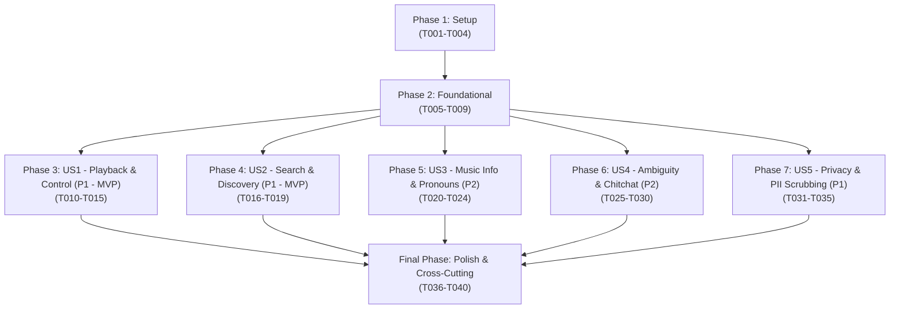

# Tasks: Music Intent Understanding (Feature 122)

**Branch**: `feat/122-music-intent-understanding` | **Group**: 120 – AI Conversational Agent (Owner: Lê Công Minh Nhựt)  
**Input**: Design documents from `specs/120-ai-conversational-agent/122-music-intent-understanding/` (`plan.md`, `spec.md`, `data-model.md`, `research.md`, `quickstart.md`, `contracts/music-intent-understanding-api.json`)  
**Prerequisites**: `plan.md` (required), `spec.md` (required for user stories), `data-model.md`, `research.md`, `contracts/music-intent-understanding-api.json`, `quickstart.md`

---

## Format: `[ID] [P?] [Story] Description with file path`

- **Checkbox**: `- [ ]` markdown checkbox
- **[P]**: Can run in parallel (different files, no dependencies on incomplete tasks)
- **[Story]**: User story identifier (`[US1]`, `[US2]`, `[US3]`, `[US4]`, `[US5]`) for story-phase tasks; omitted for Setup, Foundational, and Polish phases
- **File Paths**: Explicit source file path included in every task

---

## Path Conventions

- **Backend**: `src/backend/` (Node.js / Express API server)
  - Config & Constants: `src/backend/config/`, `src/backend/constants/`
  - Controllers: `src/backend/controllers/`
  - Middleware: `src/backend/middleware/`
  - Routes: `src/backend/routes/`
  - Services: `src/backend/services/`
  - Utils & Helpers: `src/backend/utils/`
  - Tests: `src/backend/tests/`
- **Frontend**: `src/frontend/` (React 18 / Vite 5 Client)
  - Utilities: `src/frontend/src/utils/`
  - Tests: `src/frontend/tests/`

---

## Phase 1: Setup (Shared Infrastructure & PII / Regex Configuration)

**Purpose**: Initialize intent analyzer configuration, regular expression patterns for entities and PII sanitization, response envelope helpers, and mock fixtures.

- [X] T001 Configure intent analyzer environment thresholds (`AI_INTENT_SERVICE_URL`, `INTENT_TIMEOUT_MS=1200`, `INTENT_CONFIDENCE_THRESHOLD=0.7`) in `src/backend/config/intentConfig.js`.
- [X] T002 [P] Define core intent category enumeration (`play_music`, `search_music`, `query_music_info`, `manage_library`, `general_chitchat`, `unknown`) and regex pattern dictionaries in `src/backend/constants/intentConstants.js`.
- [X] T003 [P] Implement response envelope formatter in `src/backend/utils/intentResponse.js` enforcing schema `{ success, message, data: MusicIntentResult, error }` per `contracts/music-intent-understanding-api.json`.
- [X] T004 [P] Create mock intent response fixtures in `src/frontend/src/utils/aiMockData.js` representing sample intent classification payloads across all 5 categories for standalone demo mode (`VITE_USE_MOCKS=true`).

---

## Phase 2: Foundational (Blocking Prerequisites)

**Purpose**: PII sanitization pipeline, compound clause decomposition service, authentication guard, and router mounting that MUST be completed before ANY user story can begin.

**⚠️ CRITICAL**: No user story implementation can proceed until this phase is verified.

- [X] T005 Create intent analysis routing module in `src/backend/routes/intentRoutes.js` and mount `/api/v1/agent/intent` in `src/backend/server.js`.
- [X] T006 [P] Verify and adapt JWT authentication middleware in `src/backend/middleware/authMiddleware.js` to protect `/api/v1/agent/intent/analyze`, rejecting unauthenticated requests with HTTP 401 (`UNAUTHORIZED`) per FR-009.
- [X] T007 [P] Implement backend PII sanitizer service in `src/backend/services/piiSanitizerService.js` stripping emails (`[EMAIL_REDACTED]`), phone numbers (`[PHONE_REDACTED]`), and credentials from raw prompt text before external processing (FR-008).
- [X] T008 [P] Implement client-side edge PII sanitizer utility in `src/frontend/src/utils/piiSanitizer.js` to sanitize prompts locally before dispatching over the network.
- [X] T009 [P] Implement compound clause decomposition service in `src/backend/services/clauseDecompositionService.js` splitting multi-action prompts on conjunction delimiters (`rồi`, `sau đó`, `tiếp theo`, `,`, `;`) into ordered `IntentClause` fragments (FR-005).

**Checkpoint**: Foundation ready — routing module, auth guard, PII scrubbers, and clause splitter are established.

---

## Phase 3: User Story 1 - Understand Music Playback and Control Requests (Priority: P1) 🎯 MVP

**Goal**: Correctly identify playback intent (`play_music`), extract song title (`songTitle`), artist name (`artistName`), and playback control actions (`controlAction`: `play`, `pause`, `next`, `previous`, `set_volume`, `like_track`, `clear_queue`) and volume levels (`volumeLevel`).

**Independent Test**: Send `"bật bài Chúng ta của hiện tại của Sơn Tùng M-TP"`, verify `intentType: "play_music"`, `extractedEntities.songTitle: "Chúng ta của hiện tại"`, `extractedEntities.artistName: "Sơn Tùng M-TP"`, `suggestedAction: "real_time_assistance"`, and `completenessStatus: "complete"` with confidence >= 0.90 (SC-001).

### Tests for User Story 1

> **NOTE: Write these tests FIRST and ensure they FAIL before implementing services and controllers.**

- [X] T010 [P] [US1] Create unit test suite in `src/backend/tests/services/intentPlaybackExtraction.test.js` evaluating classification accuracy of `play_music` and extraction of song titles, artist names, and direct control actions (play, pause, next, volume) (FR-002, FR-003).
- [X] T011 [P] [US1] Create contract test suite in `src/backend/tests/contracts/intentAnalyzePlaybackContract.test.js` validating `POST /api/v1/agent/intent/analyze` returns valid `MusicIntentResultEnvelope` for playback prompts per OpenAPI schema in `contracts/music-intent-understanding-api.json`.

### Implementation for User Story 1

- [X] T012 [US1] Implement playback intent classifier and slot extractor in `src/backend/services/intentUnderstandingService.js` matching track playback, artist playback, and playback controls (`controlAction`, `volumeLevel`).
- [X] T013 [US1] Implement controller handler `analyzeMusicIntent` in `src/backend/controllers/intentController.js` validating prompt length (1-500 characters, rejecting empty with HTTP 400 `VALIDATION_ERROR`) and returning standard envelope.
- [X] T014 [US1] Register route handler `router.post('/analyze', authenticateToken, intentController.analyzeMusicIntent)` in `src/backend/routes/intentRoutes.js`.
- [X] T015 [P] [US1] Upgrade client-side rule matcher `planClause` in `src/frontend/src/utils/agentService.js` to extract playback intent, target track, artist, and volume controls as Tier-2 fallback parser.

**Checkpoint**: User Story 1 complete as initial MVP milestone. Direct playback and playback control commands are recognized accurately.

---

## Phase 4: User Story 2 - Understand Music Search and Discovery Requests (Priority: P1) 🎯 MVP

**Goal**: Understand natural language descriptions of songs, moods, activities, genres, or lyrics snippets (`search_music`), routing to recommendation/search service without mutating player state.

**Independent Test**: Send `"tìm cho mình mấy bài chill để học bài đêm khuya"`, verify `intentType: "search_music"`, `extractedEntities.mood: "chill"`, `extractedEntities.activity: "học bài đêm khuya"`, `suggestedAction: "recommendation_service"` (or `"search_service"`), and zero direct playback mutation (SC-001, FR-012).

### Tests for User Story 2

> **NOTE: Write these tests FIRST and ensure they FAIL before implementing extraction logic.**

- [X] T016 [P] [US2] Create unit test suite in `src/backend/tests/services/intentSearchExtraction.test.js` evaluating extraction of `mood`, `activity`, `genre`, album title, and `lyricsSnippet` tokens from discovery queries (FR-002, FR-003).
- [X] T017 [P] [US2] Create client unit test in `src/frontend/tests/utils/agentServiceSearchPlan.test.js` verifying Tier-2 fallback extraction of mood tags and lyrics fragments in `src/frontend/src/utils/agentService.js`.

### Implementation for User Story 2

- [X] T018 [US2] Implement search & discovery intent extractor in `src/backend/services/intentUnderstandingService.js` extracting `mood`, `activity`, `genre`, `albumTitle`, and `lyricsSnippet` slots and mapping to `suggestedAction: "search_service"` or `"recommendation_service"`.
- [X] T019 [US2] Extend Tier-2 client rule matcher in `src/frontend/src/utils/agentService.js` to recognize mood discovery keywords (`chill`, `lofi`, `tập trung`, `sôi động`, `buồn`) and lyrics snippets (FR-003).

**Checkpoint**: User Story 2 complete. Music discovery queries by mood, context, genre, and lyrics are recognized and structured accurately.

---

## Phase 5: User Story 3 - Understand Music Information and Trivia Queries (Priority: P2)

**Goal**: Understand questions about musical metadata, currently playing track, or artist bios (`query_music_info`), binding deictic references ("bài này", "ca sĩ này") against active `PlaybackContextSnapshot`.

**Independent Test**: Provide context `{ currentTrack: { id: "song-1", title: "Ánh Nắng Của Anh", artist: "Đức Phúc" }, isPlaying: true, volume: 60 }`, send `"bài đang phát là gì thế?"`, verify `intentType: "query_music_info"`, `extractedEntities.targetTrackId: "song-1"`, `suggestedAction: "dialogue_response"`, and no player state mutation (FR-004, FR-012).

### Tests for User Story 3

- [X] T020 [P] [US3] Create unit test suite in `src/backend/tests/services/intentContextResolution.test.js` validating deictic pronoun resolution ("bài này", "ca sĩ này", "tiếp theo") against `currentTrack` in `PlaybackContextSnapshot` (FR-004).
- [X] T021 [P] [US3] Create contract test in `src/backend/tests/contracts/intentTrackQueryContract.test.js` verifying `query_music_info` response with `targetTrackId` and `dialogue_response` action per OpenAPI schema.

### Implementation for User Story 3

- [X] T022 [US3] Implement contextual reference resolver in `src/backend/services/intentUnderstandingService.js` inspecting `context.currentTrack` and binding pronouns ("bài này", "bài đang phát", "ca sĩ này") to canonical IDs and artist names (FR-004).
- [X] T023 [US3] Implement relative volume resolver in `src/backend/services/intentUnderstandingService.js` calculating `max(0, context.volume - 20)` for "nhỏ lại" and `min(100, context.volume + 20)` for "to lên" (FR-004).
- [X] T024 [P] [US3] Integrate contextual track and volume resolution into `planClause` in `src/frontend/src/utils/agentService.js` using active `context` parameter.

**Checkpoint**: User Story 3 complete. Conversational questions about current playback and artist information are resolved accurately via context snapshots.

---

## Phase 6: User Story 4 - Handle Ambiguous, Incomplete, or Out-of-Scope Messages (Priority: P2)

**Goal**: Handle vague requests with smart heuristic defaults ("bật nhạc đi" -> trending/recs default), decompose compound chained clauses ("rồi", "sau đó"), and safely classify non-music messages as `general_chitchat` without triggering playback.

**Independent Test**: Send `"bật nhạc lên"`, verify `intentType: "play_music"`, `completenessStatus: "missing_parameters"`, `inferredDefaults.default_source: "personalized_or_trending"`; send `"hôm nay ăn gì nhỉ?"`, verify `intentType: "general_chitchat"`, `suggestedAction: "dialogue_response"`, and zero playback mutations (SC-004, FR-005).

### Tests for User Story 4

- [X] T025 [P] [US4] Create unit test suite in `src/backend/tests/services/intentAmbiguityAndChitchat.test.js` evaluating smart defaults on vague commands, compound clause array generation, and safe classification of non-music messages to `general_chitchat` (FR-002, FR-005, SC-004).
- [X] T026 [P] [US4] Create integration test in `src/backend/tests/integration/intentCompoundClauses.test.js` sending compound prompt `"phát nhạc chill rồi giảm âm lượng 40%"`, verifying `clauses.length === 2` with sequential execution indices 0 and 1.

### Implementation for User Story 4

- [X] T027 [US4] Implement smart heuristic default assigner in `src/backend/services/intentUnderstandingService.js` setting `completenessStatus: "missing_parameters"` and `inferredDefaults.default_source: "personalized_or_trending"` when playback intent lacks track/artist slots (FR-005).
- [X] T028 [US4] Integrate `clauseDecompositionService` in `src/backend/services/intentUnderstandingService.js` to map each decomposed clause to an individual `IntentClause` record preserving sequential left-to-right order (FR-005).
- [X] T029 [US4] Implement non-music chit-chat classifier in `src/backend/services/intentUnderstandingService.js` categorizing conversational banter and out-of-scope queries into `general_chitchat` with `suggestedAction: "dialogue_response"` (FR-002, SC-004).
- [X] T030 [P] [US4] Implement compound clause chaining and smart defaults in `src/frontend/src/utils/agentService.js` (`splitClauses` and default fallback handling).

**Checkpoint**: User Story 4 complete. Compound commands are decomposed sequentially, vague prompts get instant defaults, and chit-chat is isolated safely.

---

## Phase 7: User Story 5 - Protect User Privacy in Message Analysis (Priority: P1)

**Goal**: Ensure personal identifiable information (emails, phone numbers, passwords) is completely scrubbed before reaching external AI natural language processing services; ensure zero cross-user leakage per Decree 13/2023/NĐ-CP.

**Independent Test**: Send `"Tôi là Nam, email nam99@gmail.com, số điện thoại 0912345678, hãy bật nhạc Trịnh"`, verify text dispatched to external AI is `"Tôi là Nam, email [EMAIL_REDACTED], số điện thoại [PHONE_REDACTED], hãy bật nhạc Trịnh"`, `extractedEntities.artistName: "Trịnh"`, and 100% of PII is redacted (SC-003, FR-008).

### Tests for User Story 5

- [X] T031 [P] [US5] Create security unit test suite in `src/backend/tests/security/piiSanitizerService.test.js` verifying 100% detection and masking of Vietnamese phone numbers, international phone formats, RFC 5322 emails, and password patterns (FR-008, SC-003).
- [X] T032 [P] [US5] Create client-side edge security test in `src/frontend/tests/utils/piiSanitizer.test.js` validating that `src/frontend/src/utils/piiSanitizer.js` redacts emails and phones before network transmission.

### Implementation for User Story 5

- [X] T033 [US5] Integrate `piiSanitizerService` as the mandatory first step of `intentUnderstandingService.js` before calling external AI parsing service (FR-008, SC-003).
- [X] T034 [US5] Wire `piiSanitizer.js` into client prompt preparation in `src/frontend/src/utils/agentService.js` ensuring edge redaction prior to HTTP dispatch.
- [X] T035 [US5] Enforce authenticated session scoping in `src/backend/controllers/intentController.js` binding `requestId` and processing strictly to `req.user.id`, ensuring analytical logs never persist unmasked PII (FR-009).

**Checkpoint**: User Story 5 complete. PII is scrubbed with 100% reliability at both client edge and backend service layers.

---

## Final Phase: Polish & Cross-Cutting Concerns

**Purpose**: Tier-1 timeout enforcement (1,200ms) with seamless Tier-2 fallback, benchmark evaluation (>= 90% accuracy), contract documentation, and quickstart scenario validation.

- [X] T036 [P] Implement strict 1,200ms `AbortController` timeout wrapper in `src/backend/services/intentUnderstandingService.js` that catches timeout / 5xx from Tier 1 and seamlessly falls back to Tier 2 deterministic rule parser without error (FR-010, SC-002, SC-005).
- [X] T037 [P] Create automated benchmark evaluation script in `src/backend/tests/benchmarks/intentAccuracyBenchmark.test.js` running 50+ diverse test cases across all 5 intent categories to assert classification accuracy >= 90% (SC-001).
- [X] T038 [P] Implement latency benchmark test in `src/backend/tests/benchmarks/intentLatencyBenchmark.test.js` verifying intent evaluation finishes within 1,200ms under simulated network conditions (SC-002).
- [X] T039 [P] Update contract documentation and integration guide in `specs/120-ai-conversational-agent/122-music-intent-understanding/contracts/README.md` reflecting endpoints, request payload, `MusicIntentResult` envelope, and error schemas.
- [X] T040 Execute end-to-end verification covering all 8 validation scenarios in `specs/120-ai-conversational-agent/122-music-intent-understanding/quickstart.md` (Scenario 1: Playback, Scenario 2: Track query & relative volume, Scenario 3: Discovery by mood, Scenario 4: Compound clauses, Scenario 5: Vague defaults, Scenario 6: Chit-chat, Scenario 7: PII scrubbing, Scenario 8: Fallback on AI outage).

---

## Dependencies & Execution Order

### Phase Dependencies



### User Story Dependencies

- **User Story 1 (P1 - MVP)**: Can start immediately after Phase 2 (Foundational). Delivers playback intent recognition and control actions.
- **User Story 2 (P1 - MVP)**: Extends US1 with search and discovery intent recognition (mood, activity, lyrics).
- **User Story 3 (P2)**: Builds upon US1/US2 to resolve deictic pronouns ("bài này") and relative volume shifts using `PlaybackContextSnapshot`.
- **User Story 4 (P2)**: Integrates clause decomposition for compound commands, smart defaults, and safe chit-chat routing.
- **User Story 5 (P1)**: Enforces PII sanitization at both client edge and backend pre-processing layers before outbound dispatch.
- **Final Polish**: Depends on all stories being completed. Validates 1,200ms timeout fallback, benchmark accuracy (>= 90%), and quickstart scenarios.

---

## Parallel Execution Examples

### User Story 1 Parallel Work

```bash
# Backend Developer A (Playback Classification & Controller):
Task: T010 [P] [US1] Unit test in src/backend/tests/services/intentPlaybackExtraction.test.js
Task: T011 [P] [US1] Contract test in src/backend/tests/contracts/intentAnalyzePlaybackContract.test.js
Task: T012 [US1] Playback classifier in src/backend/services/intentUnderstandingService.js

# Frontend Developer B (Client Tier-2 Fallback Matcher):
Task: T015 [P] [US1] Upgrade planClause in src/frontend/src/utils/agentService.js
```

### User Story 2 & 3 Parallel Work

```bash
# Developer A (User Story 2 - Search & Discovery):
Task: T016 [P] [US2] Unit test in src/backend/tests/services/intentSearchExtraction.test.js
Task: T018 [US2] Search extractor in src/backend/services/intentUnderstandingService.js

# Developer B (User Story 3 - Contextual Track & Volume Resolution):
Task: T020 [P] [US3] Unit test in src/backend/tests/services/intentContextResolution.test.js
Task: T022 [US3] Context resolver in src/backend/services/intentUnderstandingService.js
```

---

## Implementation Strategy

### MVP First (User Story 1 + User Story 2)

1. Complete **Phase 1: Setup** (intent config, constants, response helper, mock fixtures).
2. Complete **Phase 2: Foundational** (routing, auth guard, PII scrubber, clause splitter).
3. Complete **Phase 3: User Story 1** (playback intent & control actions).
4. Complete **Phase 4: User Story 2** (search & discovery by mood, context, lyrics).
5. **VALIDATE**: Run `quickstart.md` Scenario 1 & 3. Verify playback and search intents are classified with >= 90% confidence. Deploy MVP.

### Incremental Delivery

1. **Sprint 1 (Foundation + Core Intents MVP)**: Setup + Foundational + User Story 1 + User Story 2.
2. **Sprint 2 (Privacy & Context Resolution)**: User Story 5 (PII scrubbing per Decree 13/2023/NĐ-CP) + User Story 3 (Contextual pronouns "bài này").
3. **Sprint 3 (Edge Cases & Resilience)**: User Story 4 (Compound clauses "rồi", smart defaults, general chit-chat).
4. **Sprint 4 (Polish & Optimization)**: 1,200ms timeout wrapper, accuracy benchmark (>= 90%), and quickstart validation.

---

## Scope Boundaries & Prohibitions (Rule Check)

- **Permitted Scope**: Natural language intent classification, entity slot extraction, PII scrubbing, deictic reference resolution, compound clause decomposition, and structured `MusicIntentResult` delivery to the Centralized Orchestrator.
- **Prohibited Features**:
  - NO execution of playback actions or direct player state mutation (strictly reserved for Feature 123).
  - NO chat UI rendering or message bubble management (strictly reserved for Feature 121).
  - NO vector database search execution (strictly reserved for Group 030).
  - NO persistent database tables for intent evaluation logs.
- **Performance Invariants**:
  - Intent analysis MUST complete within **1,200ms** (SC-002).
  - On Tier-1 timeout (> 1,200ms) or 5xx error, system MUST instantly switch to Tier-2 deterministic fallback without error or interruption to active audio playback (FR-010, SC-005).
- **Privacy Invariants**:
  - 100% of emails, phone numbers, and credentials MUST be scrubbed before external dispatch (FR-008, SC-003).
