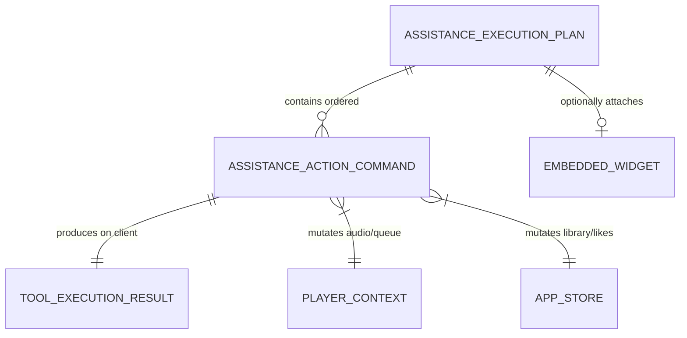

# Data Model: Real-Time Music Assistance (Feature 123)

## Overview

This document specifies the logical data model, entity structures, validation constraints, and state machines for **Feature 123: Real-Time Music Assistance** in AuraTune.

Feature 123 executes actionable musical commands dispatched by the AI Conversational Agent Orchestrator. Using a Client-Side Tool Dispatching model, it operates on browser player context, local audio controllers, and personal library endpoints.

---

## 1. Domain Entities & Schemas

### 1.1. `AssistanceActionCommand` (Tool Call Directive)

Represents an individual executable domain operation emitted by the AI Orchestrator to the client (FR-003, FR-014).

| Field | Type | Required | Description | Constraints / Validation |
|---|---|---|---|---|
| `id` | `String` | Yes | Unique tool call identifier. | Prefix `call_` followed by sequence integer. |
| `name` | `String` | Yes | Name of the tool to execute. | Whitelisted tool enum (see Section 1.2). |
| `args` | `Object` | Yes | Parameters passed to the tool function. | Validated against specific tool schema. |
| `label` | `String` | Yes | Display label for terminal UI log. | Descriptive string (e.g., `set_volume(40)`). |
| `confirm` | `String | null` | No | Confirmation prompt text if destructive. | Present ONLY for `clear_queue` (FR-013). |

---

### 1.2. Tool Registry & Parameter Schemas (`agentTools`)

| Tool Name | Parameters | Target Layer | Description | Confirmation Required? |
|---|---|---|---|:---:|
| `play_playlist` | `{ playlistId: String }` | `PlayerContext` | Resolves tracks and begins playback of a playlist. | No |
| `play_tracks` | `{ trackIds: String[] }` | `PlayerContext` | Loads specified track IDs into player and begins playing. | No |
| `playback` | `{ action: 'pause' \| 'resume' \| 'next' \| 'previous' }` | `PlayerContext` | Toggles or skips audio stream. | No |
| `set_volume` | `{ value: Integer (0–100) }` | `PlayerContext` | Unmutes and sets master volume level. | No |
| `queue_add` | `{ trackIds: String[] }` | `PlayerContext` | Appends tracks to upcoming playback queue. | No |
| `clear_queue` | `{}` | `PlayerContext` | Clears all upcoming tracks from queue. | **Yes (`[y/N]`)** |
| `like_track` | `{ trackId: String }` | `AppStore` / REST API | Adds track to user's liked songs. | No |
| `navigate` | `{ path: String }` | `navigation.jsx` | Routes client to a platform view. | No |

---

### 1.3. `ToolExecutionResult` (Execution Feedback)

The immediate outcome produced by executing a tool function on the client.

| Field | Type | Required | Description | Values / Examples |
|---|---|---|---|---|
| `ok` | `Boolean` | Yes | Execution success flag. | `true` if operation succeeded; `false` on failure. |
| `output` | `String` | Yes | Summary text displayed under the tool line in UI. | E.g., `⎿ Âm lượng 40%`, `⎿ Đã xóa hàng chờ`. |
| `state` | `String` | Yes | Terminal lifecycle status dot indicator. | `'running'`, `'confirm'`, `'ok'`, `'error'`, `'skipped'`. |

---

### 1.4. `AssistanceExecutionPlan` (Orchestrator Payload)

The complete structured execution bundle returned to the Conversational Interface.

| Field | Type | Required | Description |
|---|---|---|---|
| `planId` | `String` | Yes | Unique plan tracking identifier. |
| `tools` | `List<AssistanceActionCommand>` | Yes | Array of ordered tool calls to execute sequentially (FR-014). |
| `embeddedWidget` | `EmbeddedWidget | null` | No | Rich interactive card attached to the turn (FR-004). |
| `confirmationText`| `String` | Yes | Natural language conversational response from AI host. |

---

### 1.5. `EmbeddedWidget` (Interactive Preview Card)

Attached when an action results in an interactive playlist or album presentation (FR-004).

| Field | Type | Required | Description |
|---|---|---|---|
| `type` | `String` | Yes | Widget type: `'playlist'`. |
| `playlistId` | `String` | Yes | Identifier of the playlist resolved in catalog. |

---

## 2. Entity Relationships

---

## 3. Tool Execution State Machine

```mermaid
stateDiagram-v2
    [*] --> Dispatched: Tool call event received by client
    
    Dispatched --> CheckConfirm: Has 'confirm' property?
    
    CheckConfirm --> AwaitingConfirmation: Yes (clear_queue)
    CheckConfirm --> Running: No (Regular tool)
    
    state AwaitingConfirmation {
        [*] --> PromptRendered: Render [y/N] prompt buttons
        PromptRendered --> Confirmed: User clicks 'y' or presses 'y'/Enter
        PromptRendered --> Rejected: User clicks 'n' or presses 'n'/Esc
    }
    
    Confirmed --> Running: Proceed with execution
    Rejected --> Skipped: Mark tool as 'skipped' (output: "Đã hủy theo yêu cầu")
    
    state Running {
        [*] --> ExecuteLocalAction: Call agentTools[name](args, context)
        ExecuteLocalAction --> EvaluateResult: Check result.ok
        EvaluateResult --> Ok: result.ok === true
        EvaluateResult --> Error: result.ok === false or exception
    }
    
    Ok --> Finalized: Render green dot ● + output summary
    Error --> Finalized: Render red dot ● + error message
    Skipped --> Finalized: Render gray dot ●
    
    Finalized --> NextTool: Dispatch next tool in sequence
    Finalized --> [*]: All tools completed; stream AI response
```

---

## 4. Safety & Invariant Rules

1. **Audio Playback Continuity Invariant (FR-008, SC-003)**:
   - Tool execution failure (`ok === false`) MUST NEVER invoke `player.stop()`, pause audio, or mute sound.
   - If a requested track or playlist cannot be found, the tool returns an error status and the current song keeps playing.
2. **Destructive Operation Confirmation Invariant (FR-013)**:
   - `clear_queue` is the ONLY tool that requires user confirmation.
   - It cannot execute until `confirmRef.current` resolves `true`.
3. **Sequential Execution Invariant (FR-014)**:
   - Tool $N+1$ cannot execute until Tool $N$ transitions out of `running` / `confirm` state into `ok`, `error`, or `skipped`.
4. **Library Permission Invariant (FR-005, SC-002)**:
   - Library tools (`like_track`, `save_to_playlist`) verify `store.currentUser`. If null, execution halts with an unauthenticated error without mutating data.
5. **Listening History Registration (FR-010, SC-005)**:
   - Starting track playback via `play_tracks` or `play_playlist` triggers the standard playback event in `listening_history`.
