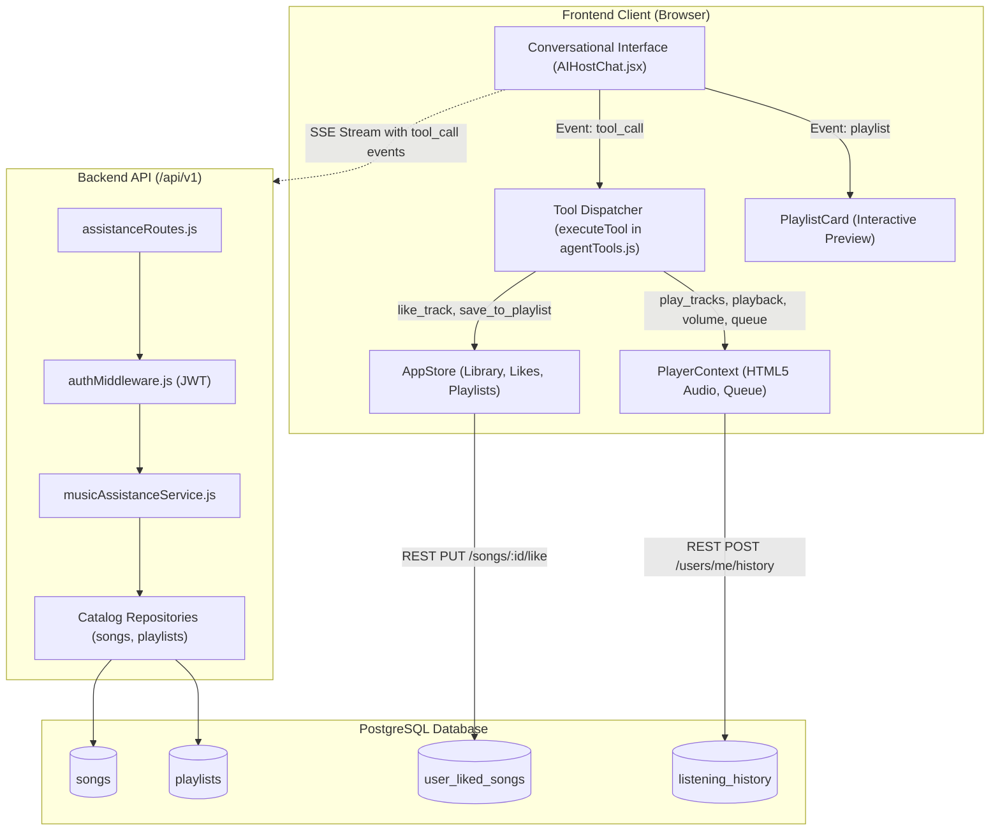
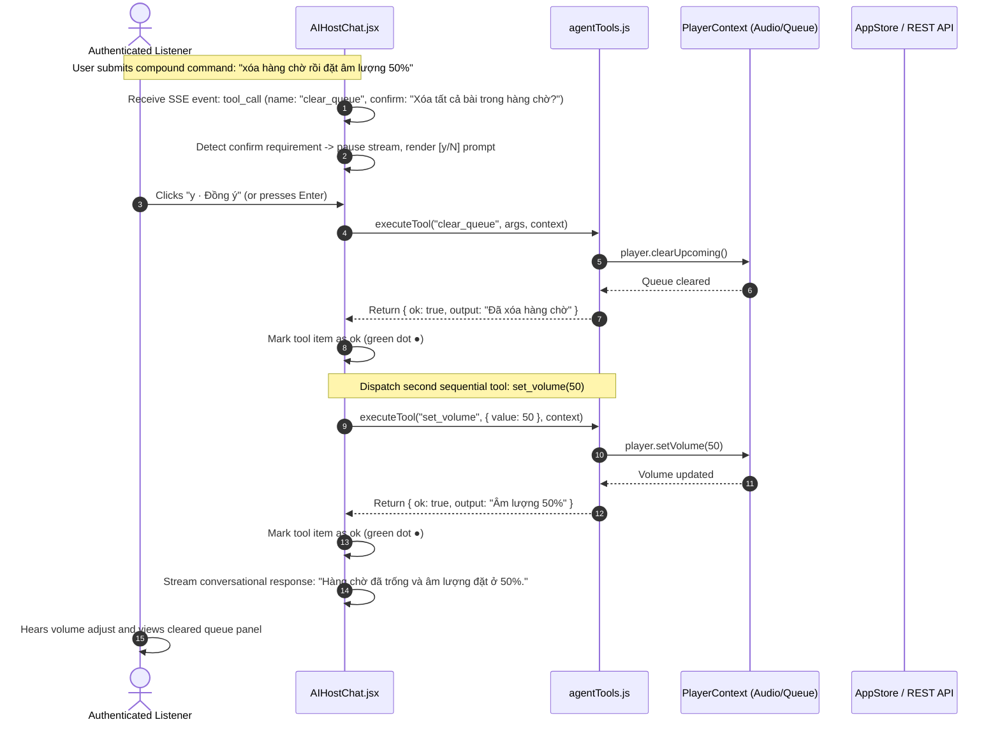

# Implementation Plan: Real-Time Music Assistance (Feature 123)

**Branch**: `feat/123-real-time-music-assistance` | **Date**: 2026-11-03 | **Spec**: [spec.md](./spec.md)

**Input**: Feature specification from `/specs/120-ai-conversational-agent/123-real-time-music-assistance/spec.md`

---

## 1. Summary

Feature 123 implements the **Real-Time Music Assistance** execution engine for the AuraTune AI Conversational Agent (Group 120). Operating downstream from Intent Understanding (Feature 122), it translates recognized musical intents into concrete client actions across three core domains:
1. **Core Playback Controls**: `play_tracks`, `play_playlist`, `playback` (`pause`, `resume`, `next`, `previous`), and `set_volume`.
2. **Queue Management & Discovery Streaming**: `queue_add`, `play_next`, and streaming mood recommendations into the active playback queue.
3. **Personal Library Interactions**: `like_track`, `save_to_playlist`, and `follow_artist` within authenticated listener permissions.

The technical approach standardizes a **Client-Side Tool Dispatching Architecture** centered around `src/frontend/src/components/chat/agentTools.js`. The backend AI Orchestrator returns structured tool directives over the SSE stream, which `AIHostChat.jsx` dispatches sequentially to local player contexts (`PlayerContext.jsx`, `AppStore.jsx`) and platform REST endpoints. Irreversible destructive operations (`clear_queue`) enforce a strict **Destructive-Only Confirmation Policy** requiring interactive listener approval (`[y/N]`) before execution. Successful playlist actions embed a compact, interactive `PlaylistCard` widget directly inside the dialogue thread. In strict adherence to FR-008 and SC-003, all action handlers enforce the **Zero Audio Disruption Invariant**: catalog misses or service errors fail safely without ever interrupting active audio playback.

---

## 2. Technical Context

**Language/Version**:
- Frontend: JavaScript (ES Modules, JSX, React 18), Node.js >= 18
- Backend: JavaScript / Node.js (ES Modules) or Python 3.11 (FastAPI)
- Database: PostgreSQL (reference schema in `docs/design/database/README.md`)

**Primary Dependencies**:
- Frontend: React 18, Tailwind CSS 3, `lucide-react`, `src/frontend/src/components/chat/agentTools.js`, `PlayerContext.jsx`, `AppStore.jsx`, `PlaylistCard.jsx`
- Backend: Express.js (or NestJS / FastAPI), `jsonwebtoken`
- Testing: Vitest, React Testing Library, Supertest

**Storage**:
- Client component state: Audio element in `PlayerContext`, active queue in memory
- PostgreSQL Database: `user_liked_songs`, `playlist_songs`, `listening_history` (registered upon assisted playback start)

**Testing**:
- Unit Tests: Vitest for `agentTools.js` individual tool functions and defensive parameter validation
- Component Tests: React Testing Library for interactive `[y/N]` confirmation prompts and embedded `PlaylistCard` widget interactions in `AIHostChat.jsx`
- Contract Tests: Supertest verifying `POST /api/v1/agent/assistance/execute` and library REST endpoints
- Audio Continuity Tests: Automated non-regression tests proving that failed tool executions preserve 100% active audio streaming (SC-003)

**Target Platform**:
- Web application on modern desktop and mobile browsers (Chrome, Edge, Firefox, Safari)

**Project Type**:
- Full-stack Web Application (Client Tool Dispatcher + Backend Action Orchestrator)

**Performance Goals**:
- Playback commands dispatched to player controllers in < **1,000 milliseconds** from intent resolution (SC-001)
- 100% of failed assistance attempts preserve active background music playback without interruption (SC-003)
- 100% of assisted playback sessions register listening events in `listening_history` (SC-005)

**Constraints**:
- Strict compliance with Vietnamese Decree 13/2023/ND-CP: user authorization verified before library or queue mutations (FR-005, SC-002)
- Zero disruption to background audio streaming and platform navigation (FR-008)
- Irreversible queue clearing strictly requires interactive confirmation (`[y/N]`) (FR-013)
- Must NOT perform natural language intent parsing or render chat shell UI directly, respecting boundaries with Feature 121 and 122 (FR-012)

**Scale/Scope**:
- 1 feature (Feature 123) within Group 120. Tool dispatching engine + 1 REST action coordination endpoint (`POST /api/v1/agent/assistance/execute`).

---

## 3. Current Implementation Baseline vs Planned Work

| Component / Layer | What Currently Exists | What Will Be Implemented in Feature 123 | What Needs Future Confirmation |
|---|---|---|---|
| **Client Tool Handlers** | Prototype `agentTools.js` implementing `play_playlist`, `play_tracks`, `playback`, `set_volume`, `queue_add`, `clear_queue`, `like_track`, `navigate`. | Harden `agentTools.js`: add strict parameter validation, catalog pre-flight verification, defensive error handling, and unit test coverage. | Collaborative playlist permission edge cases. |
| **Interactive Confirmation** | Prototype inline confirmation in `AIHostChat.jsx` awaiting `y`/`n` buttons or keystrokes for `clear_queue`. | Formalize confirmation lifecycle in `data-model.md` and contract schema; ensure accessible focus trap during prompt. | Future multi-action bulk undo options. |
| **Embedded Rich Widgets** | Prototype `PlaylistCard` rendered when `run.playlistId` is present. | Standardize `EmbeddedWidget` payload contract; support compact album cards and track cards. | Custom themes or expansion to full player view. |
| **Backend Integration** | Prototype mock generator yielding simulated tool calls in `agentService.js`. | Connect real backend AI Orchestrator delivering structured `tool_call` events over SSE stream (`POST /api/v1/agent/chat`). | Production webhook callbacks for async tool execution if needed. |
| **Listening History** | Basic player events in `PlayerContext`. | Guarantee `POST /api/v1/users/me/history` is dispatched upon AI-assisted playback start (FR-010, SC-005). | Offline listening history synchronization. |

---

## 4. Constitution Check

Checking compliance against repository principles, Team Contract, Proposal, and Project Plan:

| Gate | Status | Notes |
|---|---|---|
| **No New Product Scope** | **PASS** | Bounded strictly to 3 action categories in `spec.md` (playback controls, queue management, library interactions). Excludes external model training. |
| **Group Ownership Boundary** | **PASS** | Group 120 (Nhựt) owns Real-Time Music Assistance. Coordinates with Player/Queue (Huy, Groups 040/050) and Library (Khoa, Group 060) without violating boundaries. |
| **Data Privacy & Isolation** | **PASS** | Library mutations strictly guarded by Bearer JWT; unauthenticated requests rejected with 401; zero cross-account player control (FR-011, SC-002). |
| **No Secrets Committed** | **PASS** | Zero credentials or tokens hardcoded in source. |
| **Language & Conventions** | **PASS** | Documentation in English Markdown; diagrams in Mermaid; API conventions match OpenAPI 3.0 standards. |
| **Test-First & Verifiable** | **PASS** | Unit, component, contract, and audio continuity test plans defined in [quickstart.md](./quickstart.md) and Section 8. |

---

## 5. Project Structure

### Documentation (`specs/120-ai-conversational-agent/123-real-time-music-assistance/`)

```text
specs/120-ai-conversational-agent/123-real-time-music-assistance/
├── spec.md                          # Feature specification (Source of truth)
├── plan.md                          # This implementation plan
├── research.md                      # Phase 0 architectural research & decisions
├── data-model.md                    # Phase 1 data model & state machines
├── quickstart.md                    # Phase 1 validation scenarios
├── checklists/
│   └── requirements.md              # Quality checklist
├── contracts/
│   ├── README.md                    # Contracts overview & examples
│   └── real-time-music-assistance-api.json # OpenAPI 3.0.3 specification
└── ui/
    ├── 02-music-assistance-conversation.png
    └── 05-host-unavailable-fallback.png
```

### Source Code Layout (`src/`)

```text
src/
├── backend/
│   └── src/
│       ├── controllers/
│       │   └── assistanceController.js    # Handles POST /api/v1/agent/assistance/execute
│       ├── routes/
│       │   └── assistanceRoutes.js        # Route definitions for assistance coordination
│       ├── services/
│       │   └── musicAssistanceService.js  # Validates catalog entities & constructs tool directives
│       └── middlewares/
│           └── authMiddleware.js          # JWT verification & req.user assignment
│
└── frontend/
    └── src/
        ├── components/
        │   ├── chat/
        │   │   ├── AIHostChat.jsx         # Renders tool call items & confirmation dialog
        │   │   └── agentTools.js          # Client-side tool registry & local player dispatchers
        │   └── playlist/
        │       └── PlaylistCard.jsx       # Embedded compact preview card widget
        └── context/
            ├── PlayerContext.jsx          # HTML5 audio element & queue mutations
            └── AppStore.jsx               # Library state (liked songs, playlists)
```

**Structure Decision**: Leverages the existing `agentTools.js` and `AIHostChat.jsx` component hierarchy, formalizing the Client-Side Tool Dispatching model without creating redundant state managers.

---

## 6. Architecture & Data Flow

### Architectural Overview



### Detailed Sequence Flow (Including Destructive Confirmation)



---

## 7. Technical Approach & Detailed Rules

### 7.1. Tool Registry Implementation (`agentTools.js`)

All tools conform to the signature: `(args, { store, player }) => { ok: boolean, output: string }`:

1. `play_playlist({ playlistId })`:
   - Looks up playlist in store: `const playlist = store.findPlaylistById(playlistId)`.
   - If missing or empty: returns `{ ok: false, output: 'Không tìm thấy playlist hoặc playlist trống' }`. Audio continues playing.
   - If valid: calls `player.playCollection(items, { playlistId, openPlayer: false })`.
   - Returns `{ ok: true, output: 'Đang phát N bài từ "[Title]"' }`.
2. `play_tracks({ trackIds })`:
   - Resolves and filters playable tracks: `trackIds.map(store.findTrack).filter(track => track && store.isPlayable(track.id))`.
   - If empty: returns `{ ok: false, output: 'Không có bài nào phát được' }`. Audio continues playing.
   - If valid: calls `player.playCollection(items, { openPlayer: false })`.
   - Returns `{ ok: true, output: 'Đang phát "[Title]"' }`.
3. `playback({ action })`:
   - `pause`: toggles playback if `player.isPlaying`. Returns `Đã tạm dừng`.
   - `resume`: toggles playback if `!player.isPlaying`. Returns `Đang phát`.
   - `next`: calls `player.nextTrack()`. Returns `Đã chuyển bài`.
   - `previous`: calls `player.previousTrack()`. Returns `Đã quay lại bài trước`.
4. `set_volume({ value })`:
   - Unmutes audio: `player.setMuted(false)`.
   - Calls `player.setVolume(value)`.
   - Returns `{ ok: true, output: 'Âm lượng [value]%' }`.
5. `queue_add({ trackIds })`:
   - Appends tracks: `player.addManyToQueue(tracks)`.
   - Returns count added: `Đã thêm N bài vào hàng chờ`.
6. `clear_queue()`:
   - Calls `player.clearUpcoming()`.
   - Returns `{ ok: true, output: 'Đã xóa hàng chờ' }`.
7. `like_track({ trackId })`:
   - Checks auth: if `!store.currentUser`, returns `{ ok: false, output: 'Cần đăng nhập để thích bài hát' }`.
   - Calls `store.toggleLike(trackId)`.
   - Returns `{ ok: true, output: 'Đã lưu vào Bài hát đã thích' }`.
8. `navigate({ path })`:
   - Calls `navigate(path)`.
   - Returns `{ ok: true, output: 'Đã mở [path]' }`.

### 7.2. Destructive-Only Confirmation Policy (FR-013)

- Handled directly in `AIHostChat.jsx` via `askConfirm(signal)` Promise bridge:
  ```javascript
  const askConfirm = (signal) => new Promise((resolve) => {
    confirmRef.current = { resolve };
    signal.addEventListener('abort', () => {
      if (confirmRef.current?.resolve === resolve) confirmRef.current = null;
      resolve(false);
    }, { once: true });
  });
  ```
- Triggered exclusively when `event.confirm` is present (specifically for `clear_queue`).
- Keyboard controls:
  - Pressing `y` resolves `true` -> proceeds to execute tool.
  - Pressing `n` or `Esc` resolves `false` -> updates tool item to `state: 'skipped'`, `output: 'Đã hủy theo yêu cầu'`.

### 7.3. Sequential Tool Execution & Real-Time Indicators (FR-014)

- In compound commands, `runAgent` yields tool calls sequentially.
- For each tool, `AIHostChat.jsx` updates entry state:
  1. Append tool call with initial `state: 'running'` (sky-blue pulsating dot).
  2. If confirmation required: `state: 'confirm'` (amber dot) with interactive buttons.
  3. Dispatch to `executeTool(event, contextRef.current)`.
  4. On completion: `state: result.ok ? 'ok' : 'error'`, updating output text.
  5. Proceeds to the next tool in sequence.

### 7.4. Rich Interactive Preview Card Widget (FR-004)

- When an action returns `type: 'playlist'`, `AIHostChat.jsx` captures `run.playlistId`.
- Upon stream finalization, the component renders:
  ```jsx
  {playlist && run.status !== 'running' && (
    <div className="font-sans">
      <PlaylistCard compact playlist={playlist} onPlayPlaylist={onPlayPlaylist} isPlaying={isPlaying && currentPlaylistId === playlist.id} />
    </div>
  )}
  ```
- Allows direct playback control of the recommended playlist from the chat window.

### 7.5. Zero Audio Disruption Resilience Invariant (FR-008, SC-003)

- Defensive catalog checks: If a track or playlist cannot be found, `executeTool` catches the error locally, marks `ok: false`, and never touches the player.
- The active audio stream continues completely uninterrupted.

### 7.6. Listening History Registration (FR-010, SC-005)

- Any playback initiated via `play_tracks` or `play_playlist` triggers the standard `PlayerContext` playback lifecycle.
- When audio begins streaming, `PlayerContext` automatically dispatches `POST /api/v1/users/me/history`, recording the listen event.

---

## 8. Testing Strategy

### 8.1. Unit & Component Tests

- **Tool Execution Unit Tests (`agentTools.test.js`)**:
  - Test `play_tracks` with valid track IDs -> calls `player.playCollection`, returns `ok: true`.
  - Test `play_tracks` with missing IDs -> returns `ok: false`, does NOT call `player.playCollection`.
  - Test `set_volume` with numeric value -> calls `player.setVolume`, returns formatted output string.
  - Test `playback` with 'pause', 'resume', 'next', 'previous' -> verifies corresponding player method called.
  - Test `like_track` with unauthenticated user -> returns `ok: false`, requires login notice.
- **Interactive Confirmation Component Tests (`AIHostChat.test.jsx`)**:
  - Dispatch `clear_queue` with confirm -> verify prompt buttons render.
  - Click `y` -> verify `player.clearUpcoming()` called and tool state turns `ok`.
  - Click `n` -> verify `player.clearUpcoming()` NOT called and tool state turns `skipped`.
- **Compound Action Execution Tests**:
  - Dispatch sequential tools (`queue_add` followed by `set_volume`) -> verify both execute in order and render individual status lines.

### 8.2. Integration & Contract Tests

- **Contract Compliance**:
  - Verify `POST /api/v1/agent/assistance/execute` against [`real-time-music-assistance-api.json`](./contracts/real-time-music-assistance-api.json).
- **Listening History Registration**:
  - Trigger assisted track playback -> verify `listening_history` record created with matching `user_id` and `song_id`.

### 8.3. Audio Continuity Stress Tests (SC-003)

- Start persistent audio playback in `BottomPlayer`.
- Concurrently dispatch:
  1. Non-existent track playback request (`play_tracks` with invalid UUID)
  2. Empty playlist playback request
  3. Simulated 503 downstream network timeout
- Verify that in 100% of cases, the active audio stream continues without pause, stutter, or interruption.

---

## 9. Risks & Technical Considerations

| Risk / Consideration | Severity | Mitigation Strategy |
|---|---|---|
| **Audio Glitches or Stutter during Tool Execution** | Critical | Execute player state mutations synchronously on React context; wrap tool calls in local `try/catch` to isolate from audio element. |
| **Accidental Deletion of User Playback Queue** | High | Enforce mandatory `[y/N]` interactive confirmation for `clear_queue` (FR-013). |
| **Race Conditions between Conversational and Manual Player Controls** | Medium | Audio playback state is single-source-of-truth in `PlayerContext`. Assistant commands dispatch to the exact same methods as manual UI clicks. |
| **Unauthorized Library Mutations** | High | Enforce session token validation in `like_track` and backend REST endpoints (FR-005, SC-002). |
| **Out-of-Order Execution in Chained Commands** | Medium | Enforce strict sequential execution pipeline in `AIHostChat.jsx` (FR-014). |

---

## 10. Readiness for `/speckit.tasks`

This implementation plan satisfies all completion gates:
1. Requirements from `spec.md` are completely accounted for (FR-001 through FR-014, SC-001 through SC-005).
2. Interface contracts are fully defined in `contracts/` ([`real-time-music-assistance-api.json`](./contracts/real-time-music-assistance-api.json)).
3. Entity models, tool schemas, and confirmation state machines are defined in [`data-model.md`](./data-model.md).
4. Concrete runnable validation scenarios are documented in [`quickstart.md`](./quickstart.md).
5. Technical decisions, rationale, and alternatives are consolidated in [`research.md`](./research.md).
6. Technical approach directly builds upon the shipped implementation in `src/frontend/src/components/chat/agentTools.js` and `AIHostChat.jsx`.

Next phase: Execute `/speckit.tasks` to generate ordered, actionable implementation tasks for Feature 123.
