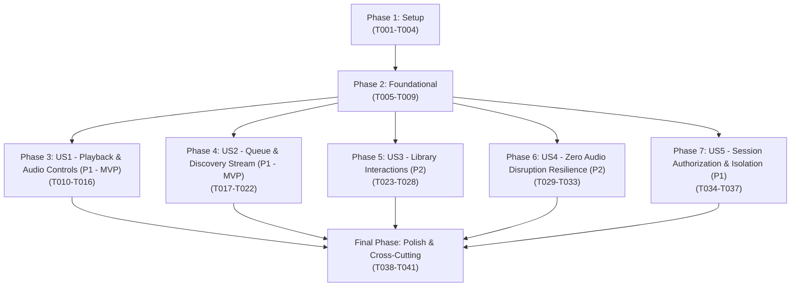

# Tasks: Real-Time Music Assistance (Feature 123)

**Branch**: `feat/123-real-time-music-assistance` | **Group**: 120 – AI Conversational Agent (Owner: Lê Công Minh Nhựt)  
**Input**: Design documents from `specs/120-ai-conversational-agent/123-real-time-music-assistance/` (`plan.md`, `spec.md`, `data-model.md`, `research.md`, `quickstart.md`, `contracts/real-time-music-assistance-api.json`)  
**Prerequisites**: `plan.md` (required), `spec.md` (required for user stories), `data-model.md`, `research.md`, `contracts/real-time-music-assistance-api.json`, `quickstart.md`

---

## Format: `[ID] [P?] [Story] Description with file path`

- **Checkbox**: `- [ ]` markdown checkbox
- **[P]**: Can run in parallel (different files, no dependencies on incomplete tasks)
- **[Story]**: User story identifier (`[US1]`, `[US2]`, `[US3]`, `[US4]`, `[US5]`) for story-phase tasks; omitted for Setup, Foundational, and Polish phases
- **File Paths**: Explicit source file path included in every task

---

## Path Conventions

- **Backend**: `src/backend/` (Node.js / Express API server)
  - Config & Constants: `src/backend/config/`, `src/backend/constants/`
  - Controllers: `src/backend/controllers/`
  - Middleware: `src/backend/middleware/`
  - Routes: `src/backend/routes/`
  - Services: `src/backend/services/`
  - Utils & Helpers: `src/backend/utils/`
  - Tests: `src/backend/tests/`
- **Frontend**: `src/frontend/` (React 18 / Vite Client)
  - Components: `src/frontend/src/components/chat/`, `src/frontend/src/components/playlist/`
  - Context & Store: `src/frontend/src/context/`
  - Utilities: `src/frontend/src/utils/`
  - Tests: `src/frontend/tests/`

---

## Phase 1: Setup (Tool Schemas, Configuration & Mock Data)

**Purpose**: Initialize assistance environment thresholds, action type constants, response envelope formatters, and mock tool call fixtures.

- [X] T001 Configure assistance environment thresholds (`ASSISTANCE_DISPATCH_TIMEOUT_MS=1000`, `DOWNSTREAM_TIMEOUT_MS=3000`) in `src/backend/config/assistanceConfig.js`.
- [X] T002 [P] Define core tool action enumerations (`play_playlist`, `play_tracks`, `playback`, `set_volume`, `queue_add`, `clear_queue`, `like_track`, `navigate`) and action status codes in `src/backend/constants/assistanceConstants.js`.
- [X] T003 [P] Implement response envelope formatter in `src/backend/utils/assistanceResponse.js` enforcing schema `{ success, message, data: AssistancePlanData, error }` per `contracts/real-time-music-assistance-api.json`.
- [X] T004 [P] Create assistance mock fixtures in `src/frontend/src/utils/assistanceMockData.js` simulating tool directives (`play_tracks`, `set_volume`, `clear_queue` with confirmation prompt, and `embeddedWidget`) for offline demo and UI testing.

---

## Phase 2: Foundational (Blocking Prerequisites)

**Purpose**: Catalog entity verification service, player context bridge, authentication guard, and router mounting that MUST be completed before ANY user story can begin.

**⚠️ CRITICAL**: No user story implementation can proceed until this phase is verified.

- [X] T005 Create assistance routing module in `src/backend/routes/assistanceRoutes.js` and mount `/api/v1/agent/assistance` in `src/backend/server.js`.
- [X] T006 [P] Verify and adapt JWT authentication middleware in `src/backend/middleware/authMiddleware.js` to protect `/api/v1/agent/assistance/execute`, rejecting unauthenticated requests with HTTP 401 (`UNAUTHORIZED`) per FR-005 and FR-011.
- [X] T007 [P] Implement catalog pre-flight verification service in `src/backend/services/catalogValidationService.js` checking existence and playability of `songId`, `playlistId`, `albumId`, and `artistId` against PostgreSQL catalog before generating execution directives (FR-006).
- [X] T008 [P] Implement player context bridge interface in `src/frontend/src/context/PlayerContext.jsx` exposing safe methods (`playCollection`, `togglePlayback`, `nextTrack`, `previousTrack`, `setVolume`, `addManyToQueue`, `clearUpcoming`, `playNext`) without mutating audio element on null inputs.
- [X] T009 [P] Implement client tool execution dispatcher in `src/frontend/src/components/chat/agentTools.js` accepting `(toolCall, context)` and returning `{ ok: boolean, output: string }` with global `try/catch` protection against audio crashes.

**Checkpoint**: Foundation ready — routing module, auth guard, catalog pre-flight validator, and safe player context bridges are established.

---

## Phase 3: User Story 1 - Real-time Playback and Audio Control Assistance (Priority: P1) 🎯 MVP

**Goal**: Execute core playback actions (`play_tracks`, `play_playlist`, `playback` [`pause`, `resume`, `next`, `previous`], and `set_volume`) directly through `PlayerContext` without leaving the chat, dispatching within 1,000ms.

**Independent Test**: Provide a validated playback intent (`play_music` targeting a specific song or artist), verify that the engine resolves the catalog track, dispatches `play_tracks` to `PlayerContext`, starts audio streaming within 1,000ms (SC-001), and returns confirming host response.

### Tests for User Story 1

> **NOTE: Write these tests FIRST and ensure they FAIL before implementing services and controllers.**

- [X] T010 [P] [US1] Create unit test suite in `src/backend/tests/services/musicAssistancePlayback.test.js` validating translation of `play_music` intent into `play_tracks`, `play_playlist`, and `playback` control actions.
- [X] T011 [P] [US1] Create contract test suite in `src/backend/tests/contracts/assistancePlaybackContract.test.js` validating `POST /api/v1/agent/assistance/execute` schema compliance for playback commands per OpenAPI contract in `contracts/real-time-music-assistance-api.json`.
- [X] T012 [P] [US1] Create client unit test suite in `src/frontend/tests/components/chat/agentToolsPlayback.test.js` verifying `play_tracks`, `play_playlist`, `playback` (`pause`, `resume`, `next`, `previous`), and `set_volume` tool functions in `agentTools.js`.

### Implementation for User Story 1

- [X] T013 [US1] Implement playback action generator in `src/backend/services/musicAssistanceService.js` mapping resolved song IDs and control actions into `ToolCallDirective` objects (`id` with prefix `call_`, name matching whitelisted enum, required `label`).
- [X] T014 [US1] Implement controller handler `executeAssistancePlan` in `src/backend/controllers/assistanceController.js` validating `AssistanceRequestPayload` (`intentType`, `extractedEntities`) and returning assistance plan envelope within 1,000ms (SC-001).
- [X] T015 [US1] Register route handler `router.post('/execute', authenticateToken, assistanceController.executeAssistancePlan)` in `src/backend/routes/assistanceRoutes.js`.
- [X] T016 [P] [US1] Harden core playback handlers (`play_tracks`, `play_playlist`, `playback`, `set_volume`) in `src/frontend/src/components/chat/agentTools.js` ensuring volume clamps to `0–100` and unmuting occurs before volume assignment.

**Checkpoint**: User Story 1 complete as initial MVP milestone. Real-time audio playback and volume controls respond in < 1,000ms.

---

## Phase 4: User Story 2 - Queue Management and Discovery Stream Assistance (Priority: P1) 🎯 MVP

**Goal**: Manage playback queue (`queue_add`, `play_next`) and stream dynamic recommendations or search results into active player queue without interrupting current track audio.

**Independent Test**: Issue queue commands (`"thêm bài X vào hàng đợi"`, `"phát bài Y tiếp theo"`), verify the playback queue updates with the specified track in the correct position (`play_next` inserts at index 0 ahead of queue) while currently playing audio continues uninterrupted.

### Tests for User Story 2

> **NOTE: Write these tests FIRST and ensure they FAIL before implementing queue directives.**

- [X] T017 [P] [US2] Create unit test suite in `src/backend/tests/services/musicAssistanceQueue.test.js` validating queue additions and priority next-play action generation from discovery streams.
- [X] T018 [P] [US2] Create client unit test suite in `src/frontend/tests/components/chat/agentToolsQueue.test.js` verifying `queue_add` and `play_next` append tracks into `PlayerContext` while preserving currently playing audio.

### Implementation for User Story 2

- [X] T019 [US2] Implement queue action generator in `src/backend/services/musicAssistanceService.js` handling `search_music` and discovery intents to output `queue_add` directives with resolved catalog tracks.
- [X] T020 [US2] Implement `playNext` priority insertion in `src/frontend/src/context/PlayerContext.jsx` placing specified tracks immediately after the active song at queue index 0.
- [X] T021 [US2] Harden `queue_add` in `src/frontend/src/components/chat/agentTools.js` filtering already-queued songs and returning accurate count feedback (`Đã thêm N bài vào hàng chờ` or `Các bài đã có sẵn trong hàng chờ`).
- [X] T022 [P] [US2] Implement sequential multi-tool chaining runner in `src/frontend/src/components/chat/AIHostChat.jsx` executing queue and volume actions in ordered sequence with real-time status transitions (`running` -> `ok`/`error`) (FR-014).

**Checkpoint**: User Story 2 complete. Queue management and recommendation stream insertion operate smoothly without audio pauses.

---

## Phase 5: User Story 3 - Real-time Library Interaction via Conversation (Priority: P2)

**Goal**: Perform personal library operations (`like_track`, `save_to_playlist`, `follow_artist`) within authenticated user's permission scope without navigating away from the chat dialogue.

**Independent Test**: Issue library commands (`"thích bài này"`, `"lưu vào playlist Yêu thích"`, `"theo dõi ca sĩ này"`), verify that the corresponding backend API (`PUT /songs/:id/like`, `POST /playlists/:id/songs`, `PUT /artists/:id/follow`) is triggered and UI reflects liked state.

### Tests for User Story 3

> **NOTE: Write these tests FIRST and ensure they FAIL before implementing library operations.**

- [X] T023 [P] [US3] Create unit test suite in `src/backend/tests/services/musicAssistanceLibrary.test.js` verifying permission validation and action generation for `like_track`, playlist addition, and artist follows.
- [X] T024 [P] [US3] Create client unit test suite in `src/frontend/tests/components/chat/agentToolsLibrary.test.js` verifying `like_track` toggles store state for authenticated users and blocks unauthenticated guests.

### Implementation for User Story 3

- [X] T025 [US3] Implement library interaction service methods in `src/backend/services/musicAssistanceService.js` verifying playlist ownership (`is_collaborative` or `owner_id === req.user.id`) before issuing library modification directives (FR-005).
- [X] T026 [US3] Harden `like_track` tool handler in `src/frontend/src/components/chat/agentTools.js` verifying `store.currentUser`, synchronizing with `AppStore.jsx`, and triggering `PUT /api/v1/songs/:id/like`.
- [X] T027 [US3] Implement `save_to_playlist` tool handler in `src/frontend/src/components/chat/agentTools.js` invoking `POST /api/v1/playlists/:id/songs` and updating local store with user feedback.
- [X] T028 [P] [US3] Implement `follow_artist` tool handler in `src/frontend/src/components/chat/agentTools.js` invoking `PUT /api/v1/artists/:id/follow` and updating following status in `AppStore.jsx`.

**Checkpoint**: User Story 3 complete. Library curation actions execute securely within authenticated account scope.

---

## Phase 6: User Story 4 - Graceful Error Handling & Zero Audio Disruption Invariant (Priority: P2)

**Goal**: Provide clear, polite feedback and safe fallback behaviors when a requested song is missing, input details are incomplete, or downstream services fail, enforcing the **Zero Audio Disruption Invariant** (FR-008, SC-003).

**Independent Test**: Simulate catalog misses (non-existent song ID), invalid parameters, and downstream 503 service outages, verifying that the system returns friendly explanatory feedback and leaves active background audio 100% undisturbed (SC-003).

### Tests for User Story 4

> **NOTE: Write these tests FIRST and ensure they FAIL before implementing error wrappers.**

- [X] T029 [P] [US4] Create audio continuity stress test suite in `src/frontend/tests/audio/audioContinuityStress.test.js` asserting `player.isPlaying === true` and audio stream stays uninterrupted across catalog misses, 503 downstream outages, and invalid tool arguments (SC-003).
- [X] T030 [P] [US4] Create backend resilience test suite in `src/backend/tests/services/assistanceErrorRecovery.test.js` validating catalog miss responses and smart default fallback for ambiguous inputs (SC-004).

### Implementation for User Story 4

- [X] T031 [US4] Implement smart default fallback engine in `src/backend/services/musicAssistanceService.js` resolving ambiguous requests (e.g., "bật nhạc đi") to top trending songs or mood discovery tracks with >= 95% success rate (FR-007, SC-004).
- [X] T032 [US4] Implement defensive error wrapper in `src/frontend/src/components/chat/agentTools.js` ensuring any catalog miss or network error returns `{ ok: false, output: '...' }` without calling `player.stop()` or muting audio (FR-008).
- [X] T033 [US4] Implement inline retry banner and alternative suggestions widget renderer in `src/frontend/src/components/chat/AIHostChat.jsx` for 503 service outage and catalog misses without blocking chat input (FR-004).

**Checkpoint**: User Story 4 complete. Zero audio disruption resilience invariant verified under all error conditions.

---

## Phase 7: User Story 5 - User Session Authorization and Playback Isolation (Priority: P1)

**Goal**: Enforce strict session token authorization and playback isolation per Vietnamese Decree 13/2023/NĐ-CP, guaranteeing that User A's conversational actions cannot control User B's player, queue, or personal library (FR-005, FR-011, SC-002).

**Independent Test**: Execute assistance actions across distinct user sessions, verifying 100% of actions validate against user authorization rules and 0 cross-account mutations occur (SC-002).

### Tests for User Story 5

> **NOTE: Write these tests FIRST and ensure they FAIL before implementing isolation checks.**

- [X] T034 [P] [US5] Create security test suite in `src/backend/tests/security/assistanceSessionIsolation.test.js` evaluating multi-tenant token isolation, blocking cross-account queue modifications, and ensuring 0 unauthorized library mutations (SC-002).
- [X] T035 [P] [US5] Create client session isolation test in `src/frontend/tests/components/chat/chatSessionIsolation.test.js` verifying unauthenticated guests are prompted to log in before executing personal library actions.

### Implementation for User Story 5

- [X] T036 [US5] Enforce strict session token checks and playlist ownership verification in `src/backend/controllers/assistanceController.js` rejecting cross-user mutation requests with HTTP 403 (`FORBIDDEN`) (FR-011, SC-002).
- [X] T037 [US5] Bind client tool dispatcher context in `src/frontend/src/components/chat/AIHostChat.jsx` to the active session user identity from `AppStore.jsx`, preventing state leakage across logouts/logins.

**Checkpoint**: User Story 5 complete. Session authorization and playback isolation verified across all user boundaries.

---

## Final Phase: Polish & Cross-Cutting Concerns

**Purpose**: Interactive destructive confirmation for `clear_queue`, rich `PlaylistCard` preview widget, automatic listening history hook, and full quickstart validation.

- [X] T038 Implement Destructive-Only Confirmation lifecycle in `src/frontend/src/components/chat/AIHostChat.jsx` with keyboard shortcuts (`y`, `n`, `Enter`, `Esc`), accessible focus trap, and Promise bridge `askConfirm` strictly reserved for `clear_queue` (FR-013).
- [X] T039 [P] Standardize embedded `PlaylistCard` rendering in `src/frontend/src/components/chat/AIHostChat.jsx` using `src/frontend/src/components/playlist/PlaylistCard.jsx` displaying artwork, track count, and active play/pause toggle when `embeddedWidget.type === 'playlist'` (FR-004).
- [X] T040 [P] Implement automatic listening history hook in `src/frontend/src/context/PlayerContext.jsx` dispatching `POST /api/v1/users/me/history` with `{ songId, listenedAt: ISO8601 }` upon assisted playback start (FR-010, SC-005).
- [X] T041 Execute and validate all 8 end-to-end verification scenarios in `specs/120-ai-conversational-agent/123-real-time-music-assistance/quickstart.md` ensuring 100% compliance with acceptance criteria.

---

## Dependencies & Execution Graph



### User Story Dependencies

- **User Story 1 (P1 - MVP)**: Can start immediately after Phase 2 (Foundational). Implements playback actions (`play_tracks`, `play_playlist`, `playback`, `set_volume`).
- **User Story 2 (P1 - MVP)**: Extends US1 with queue additions (`queue_add`) and priority insertion (`play_next`) without pausing active audio.
- **User Story 3 (P2)**: Builds upon authenticated session context to manage library operations (`like_track`, `save_to_playlist`, `follow_artist`).
- **User Story 4 (P2)**: Guarantees the Zero Audio Disruption Invariant (FR-008, SC-003) and smart defaults for ambiguous requests (SC-004).
- **User Story 5 (P1)**: Enforces strict session isolation per Decree 13/2023/NĐ-CP, preventing cross-tenant player control or library modification.
- **Final Polish**: Depends on all stories being completed. Validates interactive `[y/N]` confirmation for `clear_queue`, rich `PlaylistCard` rendering, listening history recording, and quickstart scenarios.

---

## Parallel Execution Examples

### User Story 1 Parallel Work

```bash
# Backend Developer A (Playback Action Generator & Controller):
Task: T010 [P] [US1] Unit test in src/backend/tests/services/musicAssistancePlayback.test.js
Task: T011 [P] [US1] Contract test in src/backend/tests/contracts/assistancePlaybackContract.test.js
Task: T013 [US1] Playback action generator in src/backend/services/musicAssistanceService.js

# Frontend Developer B (Client Tool Dispatcher & Hardening):
Task: T012 [P] [US1] Client unit test in src/frontend/tests/components/chat/agentToolsPlayback.test.js
Task: T016 [P] [US1] Harden playback handlers in src/frontend/src/components/chat/agentTools.js
```

### User Story 2 & 3 Parallel Work

```bash
# Developer A (User Story 2 - Queue Management & Chaining):
Task: T017 [P] [US2] Unit test in src/backend/tests/services/musicAssistanceQueue.test.js
Task: T019 [US2] Queue action generator in src/backend/services/musicAssistanceService.js
Task: T022 [P] [US2] Tool chaining runner in src/frontend/src/components/chat/AIHostChat.jsx

# Developer B (User Story 3 - Personal Library Interactions):
Task: T023 [P] [US3] Unit test in src/backend/tests/services/musicAssistanceLibrary.test.js
Task: T026 [US3] Harden like_track in src/frontend/src/components/chat/agentTools.js
```

---

## Implementation Strategy

### MVP First (User Story 1 + User Story 2)

1. Complete **Phase 1: Setup** (assistance config, action constants, response helper, mock fixtures).
2. Complete **Phase 2: Foundational** (routing, auth guard, catalog pre-flight validator, player context bridge).
3. Complete **Phase 3: User Story 1** (core playback commands & volume controls in < 1,000ms).
4. Complete **Phase 4: User Story 2** (queue additions & discovery stream without audio pauses).
5. **VALIDATE**: Run `quickstart.md` Scenario 1, 2, and 3. Verify real-time playback and queue controls operate seamlessly. Deploy MVP.

### Incremental Delivery

1. **Sprint 1 (Foundation + Core Playback MVP)**: Setup + Foundational + User Story 1 (Playback controls < 1,000ms).
2. **Sprint 2 (Queue & Session Isolation)**: User Story 2 (Queue management & multi-tool chaining) + User Story 5 (Session isolation per Decree 13/2023/NĐ-CP).
3. **Sprint 3 (Library & Resilience)**: User Story 3 (Library interactions `like_track`) + User Story 4 (Zero Audio Disruption resilience & smart defaults).
4. **Sprint 4 (Polish & Cross-Cutting)**: Interactive `[y/N]` confirmation for `clear_queue`, rich `PlaylistCard` preview, listening history hook (`POST /api/v1/users/me/history`), and quickstart validation.

---

## Scope Boundaries & Prohibitions (Rule Check)

- **Permitted Scope**: Client-side tool dispatching (`play_playlist`, `play_tracks`, `playback`, `set_volume`, `queue_add`, `clear_queue`, `like_track`, `navigate`), interactive destructive confirmation for `clear_queue`, embedded `PlaylistCard` rendering, listening history recording (`POST /api/v1/users/me/history`), and backend assistance action coordination endpoint `POST /api/v1/agent/assistance/execute`.
- **Prohibited Features**:
  - NO natural language understanding or intent extraction (strictly reserved for Feature 122).
  - NO raw chat shell rendering or message bubble styling from scratch (strictly reserved for Feature 121).
  - NO vector database search execution (strictly reserved for Group 030).
  - NO direct table creation in PostgreSQL for conversational message logs.
- **Safety & Performance Invariants**:
  - **Zero Audio Disruption Invariant**: Catalog misses, parameter errors, or AI service 503 outages MUST NEVER stop, mute, or disrupt currently playing audio (FR-008, SC-003).
  - **Destructive-Only Confirmation Policy**: Interactive `[y/N]` confirmation is strictly reserved for `clear_queue`; all other actions execute automatically (FR-013).
  - **Playback Latency**: Validated playback commands must be dispatched within **1,000ms** of intent parsing (SC-001).
  - **Listening History Recording**: 100% of assisted playback sessions must register listening events in `listening_history` (FR-010, SC-005).
