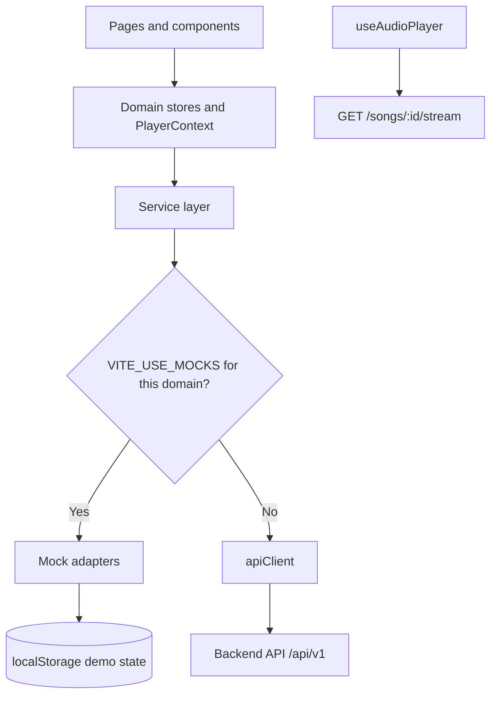
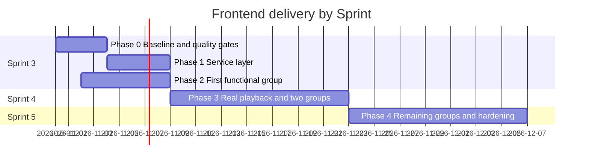

# Implementation Plan: Frontend Foundation

**Branch**: `131-frontend-foundation-spec` | **Date**: 2026-10-30 | **Spec**: [spec.md](./spec.md)

**Input**: Feature specification from `/specs/130-frontend/131-frontend-foundation/spec.md`

## Summary

AuraTune has a complete UI prototype that runs on mock data. This plan turns it into a production client without rewriting the screens: add quality gates, introduce a service layer behind the existing store, connect one functional group at a time, then replace simulated playback with real audio. Feature owners keep their groups, and this plan provides the shared foundation they build on.

## Technical Context

**Language/Version**: JavaScript (ES modules), JSX

**Primary Dependencies**: React 18, Vite 5, Tailwind CSS 3, `lucide-react` (working decision OQ-1)

**Storage**: Backend API; browser memory for the access token; HttpOnly cookie for the refresh token; `localStorage` for demo mode only

**Testing**: Vitest and React Testing Library for unit and component tests; Playwright for critical flows (proposed)

**Target Platform**: Latest stable Chrome, Edge, Firefox, and Safari on desktop and mobile

**Project Type**: Web application client

**Performance Goals**: Home dashboard usable within 2 seconds; AI search results within 3 seconds

**Constraints**: Must follow the API Contract; must not call `/ai/*` directly; no secrets in the client

**Scale/Scope**: 15 routes across 12 functional groups, five team members, three remaining Sprints

## Current Implementation Baseline

The frontend is a working client-side prototype. It covers all 12 functional groups at the UI level, but no group is connected to a backend.

| Area | Current implementation |
| ---- | ---------------------- |
| Stack | React 18, Vite 5, Tailwind CSS 3, `lucide-react`, pnpm |
| Routing | Custom History API router in `utils/navigation.jsx` and `routes/AppRouter.jsx` |
| State | `AppStore` context for domain and dialog state; `PlayerContext` for playback |
| Data | `utils/mockData.js`, `utils/aiMockData.js`, and `localStorage` key `auratune-demo-state-v1` |
| Playback | Simulated by a one-second timer in `hooks/useMockPlayer.js`; no audio element is used |
| Tests and linting | None configured |
| Production build | Passes; JavaScript bundle is 373 KB (106 KB gzip) as one chunk |

## Constitution Check

`.specify/memory/constitution.md` is still the unfilled Spec Kit template, so it provides no gates. Until the team ratifies it, this plan is checked against the Team Contract and `specs/README.md`.

| Gate | Result |
| ---- | ------ |
| No new product scope | Pass: the plan covers integration and quality work only |
| Group ownership respected | Pass: feature work stays with the Team Contract owners |
| Documentation in English and Markdown, diagrams in Mermaid | Pass |
| No secrets committed | Pass: this PR contains documentation only |
| Shared API and data changes coordinated | Pass with follow-up: owners confirm the working decisions OQ-2, OQ-4, OQ-7, and OQ-8 |

## Project Structure

### Documentation

```text
specs/130-frontend/131-frontend-foundation/
├── spec.md
├── plan.md
└── checklists/
    └── requirements.md
```

### Source Code

Existing folders stay in place. New or changed folders are marked.

```text
src/frontend/src/
├── components/
├── context/
│   ├── AppStore.jsx          # split by domain in Phase 1
│   └── PlayerContext.jsx
├── hooks/
│   └── useAudioPlayer.js     # new, replaces useMockPlayer.js in Phase 3
├── pages/
├── routes/
│   └── AppRouter.jsx         # lazy-loaded routes in Phase 4
├── services/                 # new
│   ├── apiClient.js          # base URL, auth header, envelope, refresh
│   ├── apiError.js           # normalized ApiError
│   ├── authService.js        # one service per API Contract section
│   ├── catalogService.js
│   └── mock/                 # adapters built on the current mock data
└── utils/
```

**Structure Decision**: Keep the existing `src/frontend` layout and add a `services/` layer. No new top-level project is needed.

## Architecture

Pages keep using the store and player contexts. The contexts call services, and each service selects a mock or HTTP adapter from environment configuration, so one group can move to the API while the others stay on mock data.



### Key Decisions

| Decision | Choice | Reason | Alternative rejected |
| -------- | ------ | ------ | -------------------- |
| Migration | Incremental, by domain | The UI already works and can stay demoable throughout | Rewriting pages in one pass blocks the demo and every feature owner |
| HTTP | Native `fetch` in one client | Covers the contract without a new dependency | Axios adds a dependency for little benefit here |
| Server state | Service layer plus store; review after the first group | Keeps the first change small | Adding a query library before real needs are known |
| Routing | Keep the current router; review after OQ-1 | It already supports all routes and adding a dependency is not needed yet | Migrating to React Router now adds risk with no user-visible benefit |
| Access token | In memory only | Limits token exposure | `localStorage` is readable by injected scripts |

## Delivery Phases

Dates follow `docs/proposal/project_plan.md`. Owners follow the Team Contract, and Jira IDs will be added when tasks are created. Under the Team Contract, PRs are due by 12:00 on Saturday to count for that week.



### Phase 0: Baseline and Quality Gates (Sprint 3)

**Goal**: The team agrees on the baseline, and every later PR is verifiable.

| ID | Task | Owner | Covers |
| -- | ---- | ----- | ------ |
| T-001 | Confirm working decisions OQ-1 and OQ-3 at the Sunday meeting | Nhựt (A), Team | OQ-1, OQ-3 |
| T-002 | Update `src/frontend/STRUCTURE.md`, which still describes the earlier three-page version | Frontend Lead | Documentation |
| T-003 | Add ESLint and `lint` and `test` scripts with Vitest | Frontend Lead | NFR-008 |
| T-004 | Add unit tests for `utils/playback.js` and `utils/searchEngine.js` | Frontend Lead | NFR-008 |
| T-005 | Add a CI workflow running lint, tests, and build on pull requests | Frontend Lead | NFR-008 |

**Exit criteria**: CI passes on `main`, and OQ-1 and OQ-3 are confirmed.

### Phase 1: Service Layer (Sprint 3)

**Goal**: All data flows through one replaceable layer, with no visible behavior change.

| ID | Task | Owner | Covers |
| -- | ---- | ----- | ------ |
| T-006 | Build `apiClient` with envelope handling and `ApiError` | Frontend Lead | FR-010, FR-011 |
| T-007 | Add `.env.example` with `VITE_API_BASE_URL` and mock flags | Frontend Lead | FR-010 |
| T-008 | Add shared error mapping and an error boundary | Frontend Lead | FR-012, FR-023 |
| T-009 | Add reusable loading, empty, and error components | Frontend Lead | FR-021, FR-022 |
| T-010 | Move mock access behind services and split `AppStore` by domain | Frontend Lead | FR-009, SC-004 |

**Exit criteria**: No page imports mock modules directly, and all routes behave as before.

### Phase 2: First Functional Group (Sprint 3, D-18)

**Goal**: One group works end to end. The group is chosen at Sprint 3 Planning; this plan recommends group 010 because most user-owned features need a real session.

| ID | Task | Owner | Covers |
| -- | ---- | ----- | ------ |
| T-011 | Align spec 011 with OQ-2 and connect sign-up and sign-in | Khoa (B) | FR-015, FR-016 |
| T-012 | Implement token refresh, retry, and session expiry | Khoa (B), Frontend Lead | FR-017, FR-018, FR-019 |
| T-013 | Add Google and Facebook sign-in entry points | Khoa (B) | FR-020 |
| T-014 | Add service-layer tests for the Error Handling table in the specification | Khoa (B), Frontend Lead | SC-003 |

**Exit criteria**: The chosen group passes its specification's acceptance scenarios against the API.

### Phase 3: Real Playback and Two Groups (Sprint 4, D-27)

**Goal**: The player uses real audio, and two more groups are integrated.

| ID | Task | Owner | Covers |
| -- | ---- | ----- | ------ |
| T-015 | Plan playback integration from the specifications of groups 040 and 050 | Huy (E) | Spec Kit workflow |
| T-016 | Implement `useAudioPlayer` with the same interface as `useMockPlayer` | Huy (E) | FR-026, FR-028 |
| T-017 | Handle buffering, stream errors, and autoplay restrictions | Huy (E) | Edge Cases |
| T-018 | Send listening sessions to the history API | Huy (E), Khoa (B) | FR-030 |
| T-019 | Connect the two groups selected at Sprint 4 Planning | Group owners | D-27 |
| T-020 | Document frontend components for C4 Level 3 | Frontend Lead | D-25 |

**Exit criteria**: SC-002 passes, and history entries are recorded through the API.

### Phase 4: Remaining Groups and Hardening (Sprint 5, D-32)

**Goal**: All 12 groups are integrated and the demo is ready.

| ID | Task | Owner | Covers |
| -- | ---- | ----- | ------ |
| T-021 | Connect remaining groups, and close the gaps listed in the Feature Coverage Baseline | Group owners | D-32 |
| T-022 | Remove demo accounts and mock data from production builds | Frontend Lead | NFR-007, SC-005 |
| T-023 | Add lazy-loaded routes and measure load time | Frontend Lead | NFR-001, SC-006 |
| T-024 | Run browser, responsive, and keyboard checks | Frontend Lead | NFR-003 to NFR-005 |
| T-025 | Add Playwright tests for sign-in, search, play, and playlist flows | Frontend Lead | SC-002 |

**Exit criteria**: All success criteria in the specification pass on the demo build.

## Testing Strategy

| Level | Tool | Focus |
| ----- | ---- | ----- |
| Unit | Vitest | Playback rules, search helpers, error normalization, token refresh |
| Component | React Testing Library | Forms, access states, shared loading, empty, and error states |
| End to end | Playwright | Sign-in, search, play, and playlist flows |
| Manual | Checklist per build | Real audio and mobile browser behavior |

## Definition of Done

- Acceptance scenarios for the task pass, and new logic has tests.
- Lint, tests, and build pass.
- Loading, empty, and error states are implemented.
- At least one other member has reviewed and approved the PR.
- Documentation is updated when behavior or contracts change.
- AI assistance is recorded in `docs/ai-log/` as required by the team.

## Risks

| Risk | Impact | Mitigation |
| ---- | ------ | ---------- |
| Backend endpoints arrive later than the frontend needs them | Blocks integration | Mock adapters keep the UI demoable; the contract is the shared interface |
| API Contract and specifications disagree (OQ-2, OQ-4) | Rework | Owners update the affected documents before integrating that group |
| `AppStore` split causes regressions | Broken screens | Complete quality gates first; move one domain per PR |
| Mobile browsers restrict autoplay or background audio | Playback failures | Require a user action to start audio and test on real devices |
| Long-running PRs conflict across groups | Delays | Keep PRs small and merge shared foundation work first |
| Specifications for groups 060 and 070 are not standardized | Scope drift | Owners standardize them before integration |

## Immediate Next Steps

1. Review this plan and confirm the working decisions OQ-1 and OQ-3 at the Sunday meeting.
2. Create Jira tasks T-001 to T-005 and assign one reviewer to each.
3. Start Phase 0 after this PR is approved.

## Complexity Tracking

No Constitution Check violations need justification.
