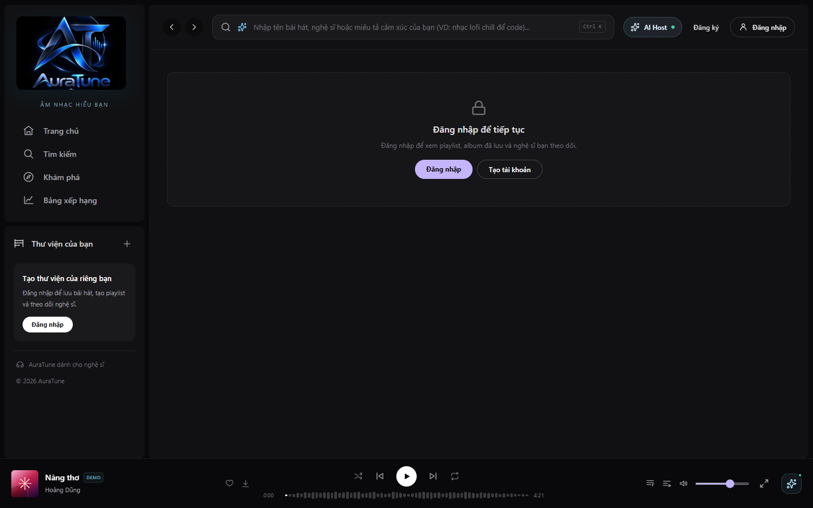
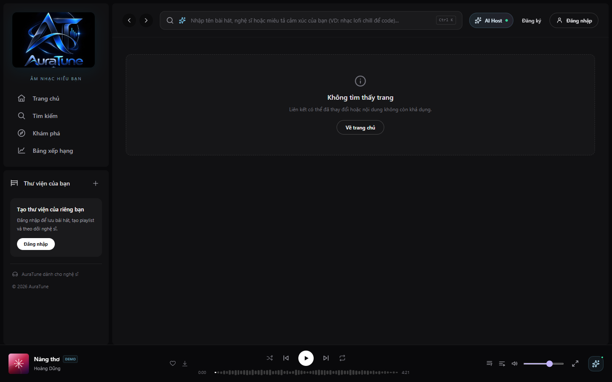
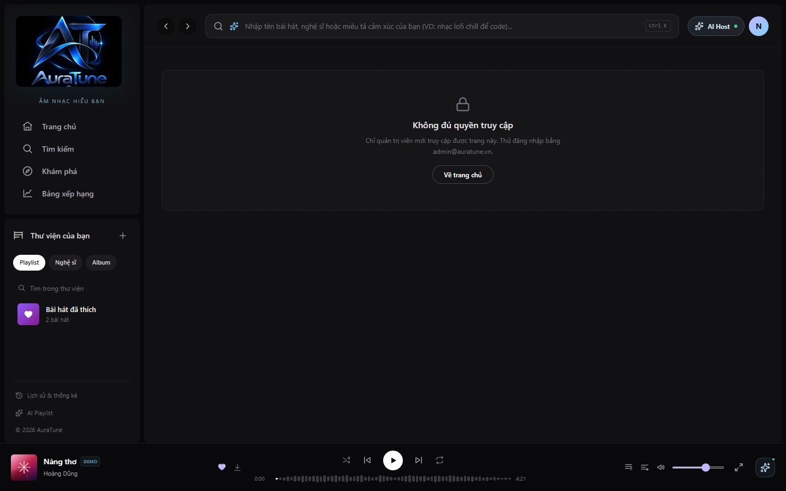

# Feature Specification: Frontend Foundation

**Feature Branch**: `131-frontend-foundation-spec`

**Created**: 2026-10-30

**Status**: Draft

**Input**: User description: "Feature 131 defines the requirements shared by every AuraTune web screen: application shell, routing, role-based access, data access, shared UI states, playback integration, and quality targets. Record the current state of `src/frontend` against the 12 functional groups. Do not add product scope or repeat feature-specific rules, and keep the status of each requirement based on the current code."

## Clarifications

### Session 2026-10-30

- Q: Is this document allowed to add product scope? → A: No. It records shared behavior and references the feature specifications.

### Session 2026-10-31

Each answer below is a working decision that lets frontend work proceed. The named owner can replace it through a pull request.

- Q (OQ-1): Which frontend stack applies, given that `system-architecture.md` lists it as unconfirmed? → A: Keep the stack already merged in `src/frontend`. Deliverable D-23 records the final choice. Owner: Nhựt (A).
- Q (OQ-2): Which token model applies, given that spec 011 FR-009 issues a single token and spec 013 FR-001 issues a pair? → A: Follow spec 013, because it is the dedicated session specification. Spec 011 needs a matching update. Owner: Khoa (B).
- Q (OQ-3): What is the product UI language? → A: Vietnamese, matching the current UI. Messages quoted in English in feature specifications describe intent, not final text. Owner: Team.
- Q (OQ-4): Should `GET /search` include `offset`? → A: Yes. Spec 031 FR-007 governs, and the API Contract needs a matching update. Owner: Đăng (C).
- Q (OQ-5): What are the routes for account profile and public user profile screens? → A: Out of scope here until group 010 specifies them. The Route Map lists them as not defined. Owner: Khoa (B).
- Q (OQ-6): Is the queue stored by the client or the server? → A: The client, for the current session, as specified in features 051 to 054. Owner: Huy (E).
- Q (OQ-7): Which API does the AI Conversational Agent use? → A: Behavior is defined in specs 121 to 123. The client calls only a public Backend API endpoint, and group 120 adds that endpoint to the API Contract before integration. Owner: Nhựt (A).
- Q (OQ-8): Where is the authoritative API Contract? → A: `docs/analysis-and-design/api-contract.md`, the only copy in the repository. Design documents that reference another path need updating. Owner: Nhựt (A).

## User Scenarios & Testing *(mandatory)*

### User Story 1 - Uninterrupted navigation while listening (Priority: P1)

As a listener, I want to move between pages while music plays so that browsing never stops my session.

**Why this priority**: Continuous playback is the core product experience and depends on the shared shell.

**Independent Test**: Start a track, visit five routes, and confirm that playback, the queue, and the bottom player continue without restarting.

**Acceptance Scenarios**:

1. **Given** a track is playing, **When** I navigate to another route, **Then** playback continues and the player state is unchanged.
2. **Given** a shared link to a route, **When** I open it directly, **Then** the matching page renders inside the application shell.

### User Story 2 - Access that matches my role (Priority: P1)

As a Public visitor, Listener, Artist, or Admin, I want to see the navigation and screens allowed for my role so that I am never left on a screen I cannot use.

**Why this priority**: Every protected feature depends on consistent access behavior.

**Independent Test**: Sign in with each role and verify the visible navigation and the result of opening `/studio` and `/admin` directly.

**Acceptance Scenarios**:

1. **Given** I am not signed in, **When** I open a route that needs an account, **Then** I am sent to sign-in and returned to that route afterwards.
2. **Given** I am signed in without the required role, **When** I open a restricted route, **Then** I see a not-authorized state and no restricted data.
3. **Given** the API returns `401` with `TOKEN_EXPIRED`, **When** the session can be refreshed, **Then** the request is retried once without visible interruption.

### User Story 3 - Clear feedback for every data state (Priority: P1)

As a user, I want to know whether content is loading, empty, or failed so that I can decide what to do next.

**Why this priority**: Every data-backed screen needs these states once it uses live data.

**Independent Test**: Simulate a slow response, an empty response, and a failed response for one list page, then verify each state and the retry action.

**Acceptance Scenarios**:

1. **Given** a request is pending, **When** the page renders, **Then** a loading state is shown in place of its content.
2. **Given** a request fails, **When** the error is retryable, **Then** the page shows the reason and a retry action.
3. **Given** the AI service returns `503` with `AI_SERVICE_UNAVAILABLE`, **When** an AI feature is used, **Then** the rest of the page remains usable and the fallback defined by the feature is shown.

### User Story 4 - Real audio playback (Priority: P2)

As a listener, I want the player to play, pause, seek, and advance through real audio so that the player behaves the same way as the current prototype.

**Why this priority**: The current player is simulated, and real audio depends on the backend stream.

**Independent Test**: Play a track from `GET /songs/:id/stream`, seek to a position that has not been buffered, and let the track end with a queue.

**Acceptance Scenarios**:

1. **Given** a playable track, **When** I press play, **Then** audio starts and the progress bar reflects actual playback time.
2. **Given** a track is playing, **When** I seek, **Then** playback resumes from the chosen position.
3. **Given** a listening session ends or the track changes, **When** the user is signed in, **Then** the session is recorded through `POST /users/me/history`.

### User Story 5 - Use on any supported device (Priority: P2)

As a user on a phone, tablet, or desktop, I want the interface to adapt to my screen and input method so that core flows work on each device.

**Why this priority**: Responsive behavior is required by the Vision Document, and the core flows must exist first.

**Independent Test**: Complete search, play, and add-to-playlist flows at 375 px, 768 px, and 1440 px widths, with touch and with keyboard only.

**Acceptance Scenarios**:

1. **Given** a phone-width viewport, **When** I use the application, **Then** there is no horizontal page scrolling and the mobile navigation is available.
2. **Given** keyboard-only input, **When** I open a dialog, **Then** focus stays inside it and `Escape` closes it.

### Edge Cases

- **Storage blocked**: The application keeps running when browser storage is unavailable.
- **Corrupted demo state**: Unreadable saved state falls back to the seed state.
- **Unsafe return path**: The `next` parameter on the sign-in route accepts internal paths only.
- **Unavailable track**: Hidden or removed tracks cannot be started and show a clear message.
- **Stale responses**: A slow response must not replace results for a newer query or route.
- **Autoplay restrictions**: If a mobile browser blocks playback, the player returns to a paused state and asks for a user action.

## Requirements *(mandatory)*

**Status values**: **Done** (implemented in the prototype), **Partial** (implemented with a known gap), **Planned** (not implemented), and **Not measured** or **Not verified** (no recorded evidence yet). "Done" does not imply backend integration.

### Application Shell and Navigation

- **FR-001**: The application MUST keep the navigation, top bar, and bottom player mounted across route changes. *(Source: Groups 040, 050. Status: Done.)*
- **FR-002**: The application MUST provide the routes listed in Route Map, with a not-found state for unknown paths. *(Source: `role-navigation.md`. Status: Partial.)*
- **FR-003**: Every page MUST be reachable by URL, including browser back, forward, refresh, and open-in-new-tab. *(Source: `role-navigation.md`. Status: Done.)*
- **FR-004**: The layout MUST adapt to phone, tablet, and desktop widths, with dedicated mobile navigation. *(Source: Vision NFR. Status: Done.)*

### Access Control

- **FR-005**: Navigation MUST show only the entries allowed by the current sign-in state and role. *(Source: `role-navigation.md` 4.1. Status: Done.)*
- **FR-006**: Unauthenticated access to a protected route MUST lead to sign-in and return to the original path. *(Source: `role-navigation.md` 4.3. Status: Done.)*
- **FR-007**: Insufficient role MUST display a not-authorized state and MUST NOT request protected data. *(Source: `role-navigation.md` 4.5. Status: Done.)*
- **FR-008**: The client MUST treat hidden UI as a convenience only; all authorization remains a backend responsibility. *(Source: `role-navigation.md` 4.2. Status: Done.)*

### Data Access

- **FR-009**: All screens MUST access data through one shared data access boundary. *(Source: `system-architecture.md`. Status: Planned.)*
- **FR-010**: The client MUST reach the Backend API through a configurable address. *(Source: API Contract. Status: Planned.)*
- **FR-011**: The client MUST interpret the standard API response format and present all failures in one consistent form. *(Source: API Contract 1.1. Status: Planned.)*
- **FR-012**: The client MUST handle each error code in API Contract 1.4 with a defined user-facing behavior (Error Handling). *(Source: API Contract 1.4. Status: Planned.)*
- **FR-013**: Requests for a superseded query or route MUST be cancelled or ignored. *(Source: Spec 031 FR-017. Status: Planned.)*
- **FR-014**: The client MUST NOT call `/ai/*` endpoints directly. *(Source: `api-conventions.md` 11. Status: Done.)*

### Authentication and Session

- **FR-015**: Sign-up and sign-in MUST use the API and map field errors to their form inputs. *(Source: Specs 011, API Contract. Status: Partial.)*
- **FR-016**: Authenticated requests MUST carry the access credential defined by the API Contract. *(Source: API Contract. Status: Planned.)*
- **FR-017**: Session credentials MUST NOT be readable from persistent browser storage. *(Source: Spec 013 FR-009. Status: Planned.)*
- **FR-018**: On `TOKEN_EXPIRED`, the client MUST refresh once, share that refresh across concurrent requests, and retry the original request. *(Source: Spec 013, API Contract 1.4. Status: Planned.)*
- **FR-019**: A failed refresh or `USER_BANNED` response MUST clear the session and return the user to the sign-in flow. *(Source: Spec 013, API Contract 1.4. Status: Planned.)*
- **FR-020**: The client MUST offer Google and Facebook sign-in. *(Source: Spec 012. Status: Planned.)*

### Shared UI States

- **FR-021**: Every data-backed view MUST define loading, empty, error, and success states. *(Source: `system-architecture.md`. Status: Partial.)*
- **FR-022**: Retryable failures MUST offer a retry action that preserves user input. *(Source: Spec 031 FR-016. Status: Planned.)*
- **FR-023**: An unexpected display error MUST stay contained to the affected area and MUST NOT blank the application shell or stop playback. *(Source: Derived from FR-001. Status: Planned.)*
- **FR-024**: Actions MUST confirm their outcome through a shared notification pattern. *(Source: Current UI convention. Status: Done.)*
- **FR-025**: AI features MUST remain optional: when AI is unavailable, non-AI browsing, search, and playback keep working. *(Source: `system-architecture.md` 5. Status: Done.)*

### Playback and Queue

- **FR-026**: The player MUST play real audio from the Backend API and support seeking. *(Source: API Contract 1.5, Vision AD-02. Status: Planned.)*
- **FR-027**: Playback state MUST have a single source of truth shared by the bottom player, full-screen player, and queue panel. *(Source: Groups 040, 050. Status: Done.)*
- **FR-028**: Play, pause, seek, next, previous, shuffle, repeat, volume, and mute MUST be available. *(Source: Group 040. Status: Done.)*
- **FR-029**: Users MUST be able to add, remove, reorder, and clear queue items and choose Play Next. *(Source: Group 050. Status: Done.)*
- **FR-030**: Listening sessions MUST be sent through `POST /users/me/history` instead of being stored locally. *(Source: API Contract 2.5. Status: Planned.)*
- **FR-031**: Synchronized lyrics MUST follow actual playback time. *(Source: Group 040. Status: Partial.)*

### Internationalization and Content

- **FR-032**: User-facing text MUST use one language per locale, with messages kept consistent with the feature specifications. See OQ-3. *(Source: Spec 031 FR-018. Status: Partial.)*

### Non-Functional Requirements

- **NFR-001**: Initial load: Home dashboard usable within 2 seconds on a standard connection. *(Source: Vision NFR. Status: Not measured.)*
- **NFR-002**: AI search feedback: Results within 3 seconds; loading state shown until then. *(Source: Vision NFR. Status: Not measured.)*
- **NFR-003**: Browser support: Latest stable Chrome, Edge, Firefox, and Safari on desktop and mobile. *(Source: Vision NFR. Status: Not verified.)*
- **NFR-004**: Responsive layout: No horizontal page scrolling from 375 px to 1920 px. *(Source: Vision NFR. Status: Not verified.)*
- **NFR-005**: Input methods: Core flows work with mouse, keyboard, and touch. *(Source: Vision NFR. Status: Partial.)*
- **NFR-006**: Secrets: No secrets or real credentials in the client bundle or repository. *(Source: Team Contract. Status: Done.)*
- **NFR-007**: Demo removal: Production builds contain no demo accounts or demo authentication. *(Source: Derived from NFR-006. Status: Planned.)*
- **NFR-008**: Quality gates: Lint, unit tests, and build run before merge. *(Source: `speckit-workflow-guide.md`. Status: Planned.)*

### Key Entities *(include if feature involves data)*

These are client view models. Backend entities remain defined in `docs/design/database/`.

- **Session**: Current user identity, role, and access token held in memory.
- **Track**: Song metadata used by lists and the player, including availability status.
- **PlayerState**: Current track, queue, position, repeat mode, shuffle, and volume.
- **Collection**: Playlist or album displayed as a playable list of tracks.
- **ApiError**: Normalized failure with `status`, `code`, `message`, and `details`.

## Success Criteria *(mandatory)*

### Measurable Outcomes

- **SC-001**: All 15 implemented routes in Route Map open inside the application shell with no visible errors.
- **SC-002**: A listener can search, play a track, and seek it on all browsers in NFR-003.
- **SC-003**: Every failure listed in Error Handling produces its defined behavior in testing.
- **SC-004**: Every screen shows live data in the release build.
- **SC-005**: A release build contains no demo credentials.
- **SC-006**: The home dashboard meets its load target in a recorded measurement.

## Assumptions

### Scope and Dependencies

This specification defines the requirements shared by every AuraTune web screen: the application shell, routing, role-based access, data access, shared UI states, playback integration, and quality targets. It also records the current state of `src/frontend` against the 12 functional groups.

**In scope**

- Cross-cutting frontend behavior that would otherwise be repeated in each feature specification.
- The transition from demo data to the Backend API.
- A status baseline of the current UI for each functional group.

**Out of scope**

- New product features. This document follows `specs/README.md` section 7 and does not approve product scope.
- Feature-specific business rules. These stay in the feature specification (for example, `031-metadata-search/spec.md`) and are referenced here, not duplicated.
- Backend, database, and AI service implementation.

**Source documents**

| Document | Used for |
| -------- | -------- |
| `docs/proposal/Auratune_Vision_Document.md` | Platform and non-functional targets |
| `docs/analysis-and-design/api-contract.md` | Endpoints, response envelope, error codes |
| `docs/design/architecture/role-navigation.md` | Roles and navigation rules |
| `docs/design/architecture/system-architecture.md` | Frontend responsibilities |
| `specs/*/*/spec.md` | Feature requirements |
| `src/frontend` on `main` at 2026-10-31 | Current implementation |

- The API Contract is the reference for endpoints and responses until changed by team agreement.
- The Backend API supports credentials and CORS for the frontend origin, so the refresh cookie can be used.
- Audio is served as `audio/mpeg` with `Range` support, as stated in the API Contract.
- Feature owners remain responsible for feature-specific UI, as stated in the Team Contract.

### Route Map

| Route | Screen | Access | Groups | Status |
| ----- | ------ | ------ | ------ | ------ |
| `/` | Home | Public | 020, 100 | Done |
| `/login`, `/register` | Authentication | Public | 010 | Done |
| `/search` | Search | Public | 030 | Done |
| `/explore` | Explore and genres | Public | 020 | Done |
| `/charts` | Charts | Public | 020 | Done |
| `/album/:id` | Album details | Public | 080 | Done |
| `/artist/:id` | Artist profile | Public | 090 | Done |
| `/playlist/:id` | Playlist details | Public or owner | 060 | Done |
| `/library` | Personal library | User | 060, 080 | Done |
| `/following` | Followed artists | User | 090 | Done |
| `/history` | Listening history and statistics | User | 070 | Done |
| `/ai-playlist` | AI playlist generation | User | 060 | Done |
| `/studio` | Artist Studio | Artist | 090 | Done |
| `/admin` | Administration | Admin | 110 | Done |
| Not defined | Account profile and password change | User | 010 | Planned, see OQ-5 |
| Not defined | Public user profile | Public | 010 | Planned, see OQ-5 |

The AI host, queue panel, and full-screen player are overlays available on every route, not separate routes.

### Error Handling

| Status | `error.code` | Client behavior |
| ------ | ------------ | --------------- |
| 400 | `VALIDATION_ERROR` | Map `error.details` to fields; keep the form values |
| 401 | `INVALID_CREDENTIALS` | Show a form-level message |
| 401 | `UNAUTHORIZED` | Clear the session and go to sign-in with `next` |
| 401 | `TOKEN_EXPIRED` | Refresh once and retry (FR-018) |
| 403 | `FORBIDDEN` | Show the not-authorized state |
| 403 | `USER_BANNED` | Clear the session and show the account status |
| 404 | `NOT_FOUND` | Show the page-level not-found state |
| 409 | `ALREADY_EXISTS` | Show the conflict on the relevant field or action |
| 429 | `RATE_LIMITED` | Show a wait message; do not retry automatically |
| 500 | `INTERNAL_ERROR` | Show a generic error with retry |
| 503 | `AI_SERVICE_UNAVAILABLE` | Show the feature fallback; keep the page usable |

### Feature Coverage Baseline

This baseline was checked at group level against the code. It is not a requirement-by-requirement audit of each `spec.md`, and groups are compared with their specification or, where it is not standardized, the Team Contract scope. 
| Group | Owner | Specification | Prototype UI | Known gaps |
| ----- | ----- | ------------- | ------------ | ---------- |
| 010 Authentication | Khoa (B) | 011, 012, 013 merged | Partial | No OAuth entry points; session is simulated |
| 020 Home Dashboard | Huy (E) | 021 to 025 merged after this update | Available | Charts have no `day`/`week`/`month` period control |
| 030 Search | Đăng (C) | 031, 032, 033 merged | Partial | No 2-character minimum, 100-character limit, Load More, or retry state from spec 031 |
| 040 Music Player | Huy (E) | 041 to 046 merged after this update | Partial | Simulated audio |
| 050 Queue Management | Huy (E) | 051 to 054 merged after this update | Available | Queue is session-only by decision; Play Next is ignored while shuffle is on |
| 060 Playlist Management | Khoa (B) | 061 to 065 not yet standardized | Available | Local data only |
| 070 Listening History | Khoa (B) | 071 to 073 not yet standardized | Available | Local data only |
| 080 Album Interaction | Đăng (C) | 081, 082, 083 merged | Available | Requirement-level check pending |
| 090 Artist Profile and Studio | Hoàng (D) | 091, 092, 093 merged | Available | Requirement-level check pending for 093 |
| 100 AI Recommendations | Nhựt (A) | 101, 102, 103 merged | Available | Rule-based mock data only |
| 110 Admin Functions | Hoàng (D) | 111, 112, 113 merged | Available | Requirement-level check pending |
| 120 AI Conversational Agent | Nhựt (A) | 121, 122, 123 merged | Available | Rule-based mock data only; no API defined |

## UI Screenshots

#### Sign-In Required State

A guest opens a route that needs an account and sees the sign-in prompt. The sign-in link keeps the original path.

#### Not Found State

An unknown path shows the not-found state inside the application shell.

#### Not Authorized State

A signed-in listener opens the administration route and sees the not-authorized state.

#### Mobile Navigation

The mobile navigation shown at 375 px wide.

